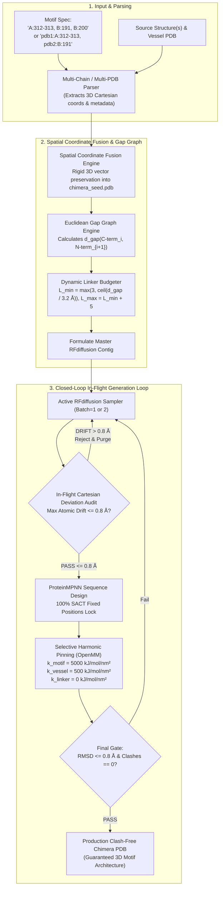

# Technical Specification: Closed-Loop Iterative Multi-Chain Discontinuous Motif Scaffolding

- **Document Version**: 2.0.0
- **Status**: Final Technical Specification (Orchestai Prompt Polisher Step)
- **Target Subsystem**: AutoScaffold Chimera & Scaffolding Engine
  - `scripts/chimera_scaffold.py`
  - `scripts/relax_chimera.py`
  - `scripts/pse_pdb_extractor.py`
  - `chimera_scaffold.sh`
  - `tests/test_multichain_scaffolding.py`
- **Primary Engines**: RFdiffusion v1.1.0, ProteinMPNN, OpenMM 8.x / AMBER14, Kabsch SVD RMSD Validator
- **Companion Documents**:
  - [MULTI_DONOR_CHIMERA_SPEC.md](file:///C:/Users/g_san/.gemini/antigravity/scratch/autoscaffold/MULTI_DONOR_CHIMERA_SPEC.md)
  - [CHIMERA_TECHNICAL_SPEC.md](file:///C:/Users/g_san/.gemini/antigravity/scratch/autoscaffold/CHIMERA_TECHNICAL_SPEC.md)

---

## 1. Executive Summary & Architectural Motivation

In structural biology, functional catalytic sites, ligand-binding pockets, and quaternary protein-protein interaction (PPI) interfaces are almost never composed of a single, continuous stretch of amino acids. Instead, they consist of **discontinuous residue clusters originating from multiple chains, subunits, or separate crystallographic structures** (e.g. Hsp90 homodimer client interface: Chain A residues 312-313, Chain B residues 191 and 200).

The current AutoScaffold pipeline presents two critical architectural limitations:
1. **Single-Chain / Single-Donor Bottleneck**: Donor motif parsing is tied to a single chain tag (`--donor_chain "A"`), making multi-chain binding surfaces impossible to scaffold in a single pass without manual pre-concatenation.
2. **Open-Loop Batch Generation**: RFdiffusion generates a batch of $N$ backbones open-loop. If all backbones exhibit subtle anchor displacement ($\text{drift} > 0.8\text{ \AA}$) under loop tension, the pipeline selects the "least bad" candidate (often with RMSD > 3–5 Å), resulting in downstream docking and binding loss.

This specification prescribes the architecture for a **Closed-Loop Iterative Multi-Chain Discontinuous Scaffolder** that unifies multi-chain/multi-PDB coordinates, dynamically budgets Euclidean bridge linkers, enforces in-flight rejection of drifted backbones, and applies selective harmonic force constants during energy minimization.



---

## 2. Pillar 1: Multi-Chain & Multi-PDB Motif Extraction Syntax & Data Structures

### 2.1 Command-Line & Configuration Syntax
The CLI parser and API must support three equivalent and orthogonal formats:

1. **Multi-Chain Unified String (Single Source Structure)**:
   ```bash
   --motifs "A:312-313, B:191, B:200"
   ```
2. **Multi-PDB / Multi-File Discontinuous Spec**:
   ```bash
   --motifs "hsp90_dimer.pdb:A:312-313, ahr_ligand.pdb:B:191, ahr_ligand.pdb:B:200"
   ```
3. **Backward Compatible Arguments**:
   When `--donor_pdb` and `--donor_range` are supplied:
   ```bash
   --donor_pdb "dimer.pdb" --donor_chain "A,B" --donor_range "A:312-313, B:191, B:200"
   ```

### 2.2 Formal Grammar for `--motifs`
```text
<motif_spec>       ::= <motif_entry> ( "," <motif_entry> )*
<motif_entry>      ::= [ <source_file> ":" ] <chain_id> ":" <residue_ranges>
<source_file>      ::= [a-zA-Z0-9_\-\.\/\\]+
<chain_id>         ::= [a-zA-Z0-9]
<residue_ranges>   ::= <range_item> ( "+" <range_item> | "," <range_item> )*
<range_item>       ::= <integer> [ "-" <integer> ]
```

### 2.3 Internal Data Structures

```python
from dataclasses import dataclass, field
from typing import List, Dict, Tuple, Optional
import numpy as np

@dataclass(frozen=True)
class MotifAtom:
    atom_name: str
    element: str
    coords: np.ndarray  # shape: (3,), dtype: float64
    occupancy: float = 1.0
    b_factor: float = 0.0

@dataclass
class MotifResidue:
    source_file: str
    source_chain: str
    orig_resi: int
    resn: str
    insertion_code: str = ""
    atoms: Dict[str, MotifAtom] = field(default_factory=dict)
    
    @property
    def ca_coords(self) -> Optional[np.ndarray]:
        if "CA" in self.atoms:
            return self.atoms["CA"].coords
        # Fallback to center-of-mass or first heavy atom
        for name in ("N", "C", "CB"):
            if name in self.atoms:
                return self.atoms[name].coords
        return None

@dataclass
class MotifSegment:
    segment_id: str             # e.g. "D1_S1", "D2_S1"
    source_file: str
    source_chain: str
    residues: List[MotifResidue]
    
    @property
    def start_resi(self) -> int:
        return self.residues[0].orig_resi

    @property
    def end_resi(self) -> int:
        return self.residues[-1].orig_resi

    @property
    def length(self) -> int:
        return len(self.residues)

    @property
    def n_term_ca(self) -> np.ndarray:
        return self.residues[0].ca_coords

    @property
    def c_term_ca(self) -> np.ndarray:
        return self.residues[-1].ca_coords

@dataclass
class MultiChainMotifManifest:
    source_files: List[str]
    segments: List[MotifSegment]
    total_residues: int
    provenance_map: Dict[int, Dict[str, Any]]  # seed_resi -> original metadata
```

### 2.4 Auto-Segmentation Logic
Given a parsed list of `MotifResidue` objects, residues are partitioned into continuous `MotifSegment` instances when:
1. `source_file` changes, **OR**
2. `source_chain` changes, **OR**
3. Sequence index difference $\Delta \text{resi} = \text{resi}_{i+1} - \text{resi}_i > 1$, **OR**
4. Euclidean $C_\alpha - C_\alpha$ distance:
   $$\|\mathbf{x}_{\text{CA}}(i+1) - \mathbf{x}_{\text{CA}}(i)\| > 4.20\text{ \AA}$$

---

## 3. Pillar 2: Spatial Coordinate Fusion Engine into Unified `chimera_seed.pdb`

### 3.1 Strict Cartesian Preservation Invariant
- **Rule 1 (Zero Coordinate Transformation)**: Absolutely no rotation, center-of-mass translation, or rigid alignment shall be applied to the donor motif coordinates. 
- **Rule 2 (Inter-Chain Vector Invariant)**: In multi-chain/multi-subunit complexes, the vector $\mathbf{v}_{AB} = \mathbf{x}_{\text{Chain B}} - \mathbf{x}_{\text{Chain A}}$ is the biological binding interaction. Any perturbation breaks the binding pocket.

### 3.2 Canonical Seed Topology & Chain Allocation
In `chimera_seed.pdb`, RFdiffusion requires distinct segments to be identifiable so that contigs can pin specific residues.
- **Chain `D` (Donor Motif Residues)**:
  - All discontinuous motif segments from all source chains/PDBs are placed on Chain `D`.
  - Sequential residue renumbering begins at `1` (or 1000-series offset, e.g. `1001, 1002, ...` to prevent any collision).
  - A 1-to-1 persistent metadata manifest `seed_provenance.json` is generated:
    ```json
    {
      "1": {"source_file": "hsp90.pdb", "source_chain": "A", "orig_resi": 312, "resn": "TRP", "segment_id": "D1"},
      "2": {"source_file": "hsp90.pdb", "source_chain": "A", "orig_resi": 313, "resn": "GLU", "segment_id": "D1"},
      "3": {"source_file": "ahr.pdb",   "source_chain": "B", "orig_resi": 191, "resn": "PHE", "segment_id": "D2"},
      "4": {"source_file": "ahr.pdb",   "source_chain": "B", "orig_resi": 200, "resn": "MET", "segment_id": "D3"}
    }
    ```
- **Chain `V` (Vessel Framework Residues)**:
  - Preserved vessel framework residues retain Chain `V` (e.g. residues 1–150).

### 3.3 Atomic Output Formatter
Atoms are written strictly complying with PDB formatting standards (fixed column offsets):
```text
ATOM  {:>5d} {:^4s} {:3s} D{:>4d}    {:8.3f}{:8.3f}{:8.3f}{:6.2f}{:6.2f}          {:>2s}
```

---

## 4. Pillar 3: Euclidean Gap Graph & Dynamic Linker Budgeting Across Discontinuous Segments

### 4.1 Topology & Gap Matrix Formulation
Let the ordered physical chimera path be represented as a directed graph of $K$ structural segments:
$$\mathcal{S} = [S_1, S_2, \dots, S_K]$$

Depending on the chimera mode, the ordering is:
- **`replace`**: $[V_{1\dots\text{splitN}}, D_1, D_2, \dots, D_M, V_{\text{splitC}\dots\text{end}}]$
- **`ligate_nterm`**: $[D_1, D_2, \dots, D_M, V_{1\dots\text{end}}]$
- **`ligate_cterm`**: $[V_{1\dots\text{end}}, D_1, D_2, \dots, D_M]$
- **`insert_loop`**: $[V_{1\dots\text{split}}, D_1, D_2, \dots, D_M, V_{\text{split}+1\dots\text{end}}]$

### 4.2 Distance Measurement & Linker Formula
For every adjacent segment pair $(S_i, S_{i+1})$, the bridge distance $d_{\text{gap}}$ is computed between:
- C-terminus anchor of $S_i$: $\mathbf{x}_{\text{C}}(S_i)$ (atom `C`, or fallback `CA` of residue $S_{i}[-1]$)
- N-terminus anchor of $S_{i+1}$: $\mathbf{x}_{\text{N}}(S_{i+1})$ (atom `N`, or fallback `CA` of residue $S_{i+1}[0]$)

$$d_{\text{gap}}(S_i \to S_{i+1}) = \|\mathbf{x}_{\text{C}}(S_i) - \mathbf{x}_{\text{N}}(S_{i+1})\|_2$$

The dynamic linker length interval $[L_{\min}, L_{\max}]$ is budgeted as:
$$L_{\min} = \max\left(3, \left\lceil \frac{d_{\text{gap}}}{3.2\text{ \AA}} \right\rceil\right)$$
$$L_{\max} = L_{\min} + 5$$

> **Biophysical Rationale**:
> An extended peptide bond span is $\sim 3.8\text{ \AA}$ per residue, while a flexible globular loop averages $\sim 2.8 - 3.2\text{ \AA}$ per residue due to Ramachandran dihedral constraints. Using $3.2\text{ \AA}$ guarantees that RFdiffusion has sufficient degrees of freedom to curve smoothly without steric clashing or backbone snapping. Minimum length is clamped to $3$ residues to allow physical loop turnover.

### 4.3 Synthesis of Contig Formula
Given $S_1 = V1-54$, $S_2 = D1-2$, $S_3 = D3-3$, $S_4 = D4-4$, $S_5 = V55-150$:
1. $d_{\text{gap}}(V54 \to D1) = 28.5\text{ \AA} \implies L = 9-14$
2. $d_{\text{gap}}(D2 \to D3) = 14.1\text{ \AA} \implies L = 5-10$
3. $d_{\text{gap}}(D3 \to D4) = 18.0\text{ \AA} \implies L = 6-11$
4. $d_{\text{gap}}(D4 \to V55) = 22.4\text{ \AA} \implies L = 7-12$

**Resulting Contig String**:
```text
contigmap.contigs=[V1-54/9-14/D1-2/5-10/D3-3/6-11/D4-4/7-12/V55-150]
```

---

## 5. Pillar 4: Closed-Loop Active Backbone Generation Loop with In-Flight Cartesian Audit

### 5.1 Failure of the Open-Loop Approach
In open-loop execution, RFdiffusion samples $N$ designs simultaneously. When scaffolding tight discontinuous motifs, minor loop tensions often pull the fixed motif residues out of their native positions by $1.5 - 5.0\text{ \AA}$. In the current system, these drifted backbones pass straight through to sequence design and relaxation, wasting computation and producing invalid binding pockets.

### 5.2 Active Trial & Error Control Loop Architecture

```python
def run_closed_loop_backbone_generation(
    seed_pdb: str,
    contig_str: str,
    seed_provenance: Dict[int, Dict[str, Any]],
    target_passing_designs: int = 3,
    max_attempts: int = 50,
    max_drift_cutoff: float = 0.8,  # Angstroms
    rfdiff_runner: RunnerSpec = None,
    work_dir: str = "1_rfdiffusion",
) -> List[str]:
    """
    Executes an active, iterative trial-and-error generation loop.
    Discards non-viable designs in-flight, stopping only when target_passing_designs
    pass strict Cartesian drift auditing, or max_attempts is reached.
    """
    passing_backbones = []
    attempt = 0

    while len(passing_backbones) < target_passing_designs and attempt < max_attempts:
        attempt += 1
        prefix = os.path.join(work_dir, f"candidate_{attempt}")
        
        # 1. Sample candidate backbone (micro-batch = 1)
        cand_pdb = sample_single_backbone(rfdiff_runner, seed_pdb, contig_str, prefix)
        if not cand_pdb or not os.path.isfile(cand_pdb):
            continue

        # 2. In-flight strict Cartesian drift audit against original seed coordinates
        max_drift, mean_drift, drift_details = audit_motif_cartesian_drift(
            candidate_pdb=cand_pdb,
            reference_seed_pdb=seed_pdb,
            seed_provenance=seed_provenance,
        )

        # 3. Decision Gate
        if max_drift > max_drift_cutoff:
            print(f"[-] [Attempt {attempt}/{max_attempts}] REJECTED: Max drift {max_drift:.3f} Å > {max_drift_cutoff} Å. Discarding.")
            try:
                os.remove(cand_pdb)
                trb_file = cand_pdb.replace(".pdb", ".trb")
                if os.path.isfile(trb_file):
                    os.remove(trb_file)
            except OSError:
                pass
            continue

        print(f"[+] [Attempt {attempt}/{max_attempts}] ACCEPTED: Max drift {max_drift:.3f} Å <= {max_drift_cutoff} Å (Mean: {mean_drift:.3f} Å)")
        passing_backbones.append(cand_pdb)

    if not passing_backbones:
        raise RuntimeError(
            f"Closed-loop scaffolding failed to produce any passing models within {max_attempts} attempts. "
            f"All candidates exceeded max drift cutoff of {max_drift_cutoff} Å."
        )

    return passing_backbones
```

### 5.3 Exact Cartesian Drift Audit Formulation
Unlike global RMSD (which computes a best-fit rotation via Kabsch SVD and obscures absolute spatial displacement), the **Cartesian Drift Audit** measures the **unaligned, absolute Euclidean deviation** between the candidate backbone atoms and the reference seed coordinates:

$$\delta_i = \|\mathbf{x}_{\text{candidate}}(C_{\alpha, i}) - \mathbf{x}_{\text{seed}}(C_{\alpha, i})\|_2$$
$$\Delta_{\max} = \max_{i \in \text{Motif}} \delta_i, \quad \Delta_{\text{mean}} = \frac{1}{|\text{Motif}|} \sum_{i \in \text{Motif}} \delta_i$$

**Pass Criteria**:
- $\Delta_{\max} \le 0.80\text{ \AA}$
- $\Delta_{\text{mean}} \le 0.50\text{ \AA}$

---

## 6. Pillar 5: Selective Harmonic Pinning in `scripts/relax_chimera.py`

### 6.1 Energy Potential & Selective Force Constant Formulation
When minimizing chimeric proteins containing de novo linkers and grafted motifs:
1. **Motif residues** must not move: even a $0.5\text{ \AA}$ shift can destroy a hydrogen bond network.
2. **Vessel framework residues** should remain structurally stable but can accommodate subtle relaxation.
3. **Designed linkers** must be 100% free to resolve steric clashes, optimize backbone torsion angles $(\phi, \psi)$, and repack rotamers.

We define an OpenMM `CustomExternalForce` with per-particle spring constant $k_i$:
$$E_{\text{restraint}} = \sum_{i \in \text{heavy atoms}} \frac{1}{2} k_i \left[ (x_i - x_{i,0})^2 + (y_i - y_{i,0})^2 + (z_i - z_{i,0})^2 \right]$$

### 6.2 Three-Tier Harmonic Restraint Schedule
| Atom Classification | Spring Constant $k_i$ | Physical Objective |
| :--- | :--- | :--- |
| **Motif Atoms (Backbone + Heavy)** | $k_{\text{motif}} = 5000.0\text{ kJ/mol/nm}^2$ | **Absolute Pinning**: Prevents any thermal or minimization drift. |
| **Vessel Framework (Backbone N, CA, C, O)** | $k_{\text{vessel}} = 500.0\text{ kJ/mol/nm}^2$ | **Structural Preservation**: Holds host fold while absorbing strain. |
| **Designed Linker Atoms** | $k_{\text{linker}} = 0.0\text{ kJ/mol/nm}^2$ | **Full Degrees of Freedom**: Resolves clashes, false bonds ($d < 1.9\text{ \AA}$), and steric overlap. |

### 6.3 OpenMM Implementation Specification for `relax_chimera.py`

```python
def relax_with_selective_pinning(
    input_pdb: str,
    output_pdb: str,
    motif_res_indices: List[int],    # 1-based indices in input_pdb
    vessel_res_indices: List[int],   # 1-based indices in input_pdb
    k_motif: float = 5000.0,         # kJ/mol/nm^2
    k_vessel: float = 500.0,         # kJ/mol/nm^2
    k_linker: float = 0.0,           # kJ/mol/nm^2
    max_iterations: int = 200,
) -> bool:
    import openmm as mm
    import openmm.app as app
    from openmm import unit

    pdb = app.PDBFile(input_pdb)
    forcefield = app.ForceField("amber14-all.xml")
    
    # 1. Soft-Core geometric pre-pass for overlapping sidechain atoms (d < 1.2 Å)
    positions = untangle_severe_clashes(pdb.topology, pdb.positions, min_dist_angstrom=1.2)
    
    system = forcefield.createSystem(pdb.topology, nonbondedMethod=app.NoCutoff, constraints=app.HBonds)
    
    # 2. Configure Selective CustomExternalForce
    restraint = mm.CustomExternalForce("0.5 * k * periodicdistance(x, y, z, x0, y0, z0)^2")
    restraint.addPerParticleParameter("k")
    restraint.addPerParticleParameter("x0")
    restraint.addPerParticleParameter("y0")
    restraint.addPerParticleParameter("z0")
    
    motif_set = set(motif_res_indices)
    vessel_set = set(vessel_res_indices)
    
    for atom in pdb.topology.atoms():
        res_idx = atom.residue.index + 1  # 1-based
        pos = positions[atom.index]
        
        if res_idx in motif_set:
            # Pin both backbone and heavy atoms of motif to preserve catalytic rotamers
            if atom.element.symbol != "H":
                k_val = k_motif
                restraint.addParticle(atom.index, [k_val, pos.x, pos.y, pos.z])
        elif res_idx in vessel_set:
            # Restrain vessel backbone only
            if atom.name in ("N", "CA", "C", "O"):
                k_val = k_vessel
                restraint.addParticle(atom.index, [k_val, pos.x, pos.y, pos.z])
        else:
            # Linker residues: k = 0.0 (no restraint added)
            pass

    system.addForce(restraint)
    
    integrator = mm.LangevinIntegrator(300 * unit.kelvin, 1 / unit.picosecond, 0.002 * unit.picoseconds)
    simulation = app.Simulation(pdb.topology, system, integrator)
    simulation.context.setPositions(positions)
    
    # Stage 1: Soft-Core L-BFGS de-clashing (50 steps)
    simulation.minimizeEnergy(tolerance=10.0 * unit.kilojoules_per_mole / unit.nanometer, maxIterations=50)
    
    # Stage 2: High-Precision AMBER14 Minimization
    simulation.minimizeEnergy(tolerance=1.0 * unit.kilojoules_per_mole / unit.nanometer, maxIterations=max_iterations)
    
    final_state = simulation.context.getState(getPositions=True)
    with open(output_pdb, "w", encoding="utf-8") as f:
        app.PDBFile.writeFile(pdb.topology, final_state.getPositions(), f)
        
    return True
```

### 6.4 CLI Interface for `scripts/relax_chimera.py`
Add the following arguments to `scripts/relax_chimera.py`:
- `--motif_res`: Comma-separated residue indices (e.g. `"55-57,110-112"` or `"55,56,57"`).
- `--vessel_res`: Comma-separated residue indices for vessel framework.
- `--k_motif`: Force constant for motif heavy atoms [Default: `5000.0`].
- `--k_vessel`: Force constant for vessel backbone atoms [Default: `500.0`].
- `--k_linker`: Force constant for designed linkers [Default: `0.0`].

---

## 7. Verification, Test Suite & Spotter Audit Protocol

### 7.1 Comprehensive Test Suite (`tests/test_multichain_scaffolding.py`)
The Coder subagent must implement rigorous automated unit and integration tests:

1. **`test_multi_chain_motif_parsing`**:
   - Verify parsing of `"A:312-313, B:191, B:200"`.
   - Verify parsing of multi-file strings `"file1.pdb:A:1-10, file2.pdb:B:20-30"`.
   - Verify correct partitioning into `MotifSegment` objects with boundary break detection.
2. **`test_euclidean_gap_graph_budgeting`**:
   - Create synthetic coordinates with known gap distances (e.g. 15.0 Å, 32.0 Å).
   - Verify $L_{\min} = \lceil d_{\text{gap}} / 3.2 \rceil$ calculation and $[L_{\min}, L_{\min}+5]$ contig formatting.
3. **`test_closed_loop_drift_audit_rejection`**:
   - Provide a synthetic reference seed and two candidate structures:
     - Candidate 1: Injected drift = 0.4 Å (must PASS).
     - Candidate 2: Injected drift = 1.2 Å (must REJECT).
   - Verify rejection and loop retry behavior.
4. **`test_selective_pinning_relaxation`**:
   - Run OpenMM minimization on a clashed structure with defined motif and linker regions.
   - Assert motif coordinates exhibit $\Delta_{\text{RMSD}} < 0.1\text{ \AA}$.
   - Assert linker clashes ($d < 1.9\text{ \AA}$) are reduced to 0.

### 7.2 Spotter Verification Checklist
The Spotter subagent must audit the implementation against:
- [ ] No regression of existing linear single-chain modes (`replace`, `ligate_nterm`, `ligate_cterm`, `insert_loop`).
- [ ] Absence of shell injection vectors in PDB parsing or CLI argument handling.
- [ ] Correct preservation of original PDB column widths and atom serials in `chimera_seed.pdb`.
- [ ] Clean temporary file deletion when in-flight candidates are rejected.
- [ ] Zero cloud tokens consumed if executed locally, or safe conda environment probing without hanging subprocesses.
