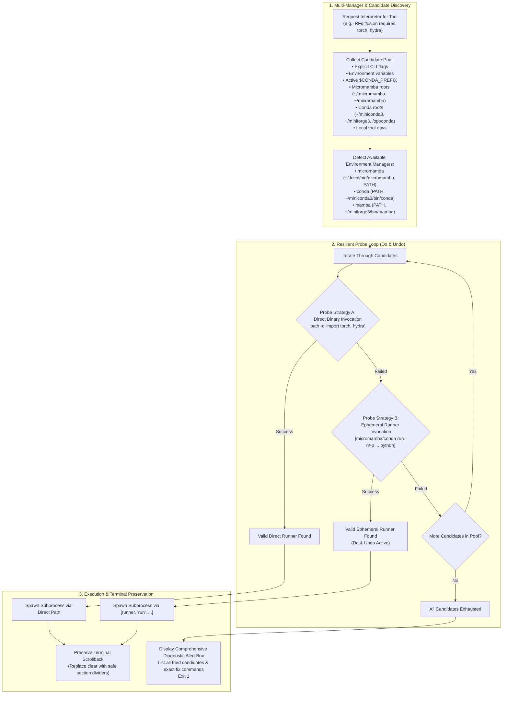
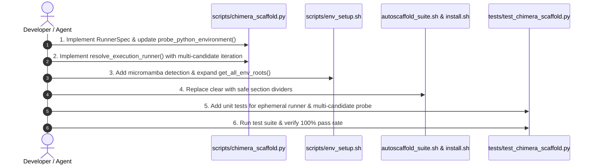

# Technical Specification: Ephemeral Conda/Micromamba Execution ("Do & Undo"), Resilient Multi-Candidate Probing, and Terminal Scrollback Preservation

- **Document Version**: 1.0.0
- **Status**: Approved Architectural Technical Specification (Prompt Polisher Stage)
- **Target Subsystem**: AutoScaffold Runtime & Launcher Infrastructure
  - Shell Launchers: `autoscaffold`, `autoscaffold_suite.sh`, `chimera_scaffold.sh`, `install.sh`, `scripts/env_setup.sh`
  - Python Core: `scripts/chimera_scaffold.py`, `scripts/pse_pdb_extractor.py`
  - Test Suite: `tests/test_chimera_scaffold.py`
  - Environment Configuration: `config.env.example`
- **Primary Engines**: RFdiffusion (PyTorch, SE3-Transformer, Hydra), ProteinMPNN (PyTorch), ColabFold (JAX / OpenMM)
- **Related Specifications**: `RFDIFF_ENV_SPEC.md`, `CONTINUITY_AND_LAUNCHER_SPEC.md`, `MULTI_DONOR_CHIMERA_SPEC.md`

---

## 1. Executive Summary & Problem Formulation

### 1.1 The User Incidents

#### Incident 1: Unactivated Conda Python Execution & Missing Module Probe Failure
During an execution of `chimera_scaffold.py`, the pipeline terminated with the following stack trace:
```text
Traceback (most recent call last):
  File "/home/memo/programs/autoscaffold/scripts/chimera_scaffold.py", line 2140, in <module>
    main()
  File "/home/memo/programs/autoscaffold/scripts/chimera_scaffold.py", line 2135, in main
    res = scaffolder.run_pipeline()
  File "/home/memo/programs/autoscaffold/scripts/chimera_scaffold.py", line 1720, in run_pipeline
    probe_res = probe_python_environment(...)
  File "/home/memo/programs/autoscaffold/scripts/chimera_scaffold.py", line 409, in probe_python_environment
    raise EnvironmentError(...)
OSError: RFdiffusion Python interpreter '/home/memo/miniconda3/envs/SE3nv/bin/python3.9' lacks required modules: torch, hydra
```
**User Core Request**:
> *"I want it to automatically launch the micromamba/conda patched for the analysis, the user does not have to switch for them if that is the case, it should do and undo them automatically."*

#### Incident 2: Terminal Scrollback Destruction
**User Core Request**:
> *"And also, everytime i put autoscaffold the previous input of the terminal is deleted, any idea why?"*

---

## 2. Deep Root Cause Analysis

### 2.1 The Direct Binary Invocation Trap vs Activated Environment Context

Executing an interpreter binary directly by path (`/home/memo/miniconda3/envs/SE3nv/bin/python3.9`) without conda/micromamba activation frequently fails for complex neural modeling frameworks like RFdiffusion:

1. **Absence of Runtime Dynamic Linker Paths (`LD_LIBRARY_PATH`)**:
   - PyTorch (specifically GPU-enabled builds with CUDA and C++ extensions like SE3-Transformer) links dynamically against shared libraries located in `$CONDA_PREFIX/lib` (such as `libtorch_cuda.so`, `libcudart.so`, `libgomp.so`, `libmkl_intel_lp64.so`).
   - When an interpreter is launched directly without activation, the standard Linux dynamic linker (`ld.so`) only consults system library paths (`/lib64`, `/usr/lib64`) or paths compiled into the ELF binary's `RPATH`/`RUNPATH`. If any shared object is missing from `RUNPATH` or requires environment variables configured in `<conda_env>/etc/conda/activate.d/`, running `import torch` fails with C-extension linker failures (`ImportError: libtorch_cuda.so: cannot open shared object file`) or silent import failure.
2. **Missing Environment Hooks (`activate.d/`)**:
   - Conda packages for CUDA runtimes, Hydra, and OpenMP install activation scripts that export crucial variables (e.g. `CUDA_HOME`, `HYDRA_FULL_ERROR`, `OMP_NUM_THREADS`). Invoking `python` directly bypasses all of these setup scripts.
3. **Hydra Search Path Initialization**:
   - Hydra relies on Python entrypoints and package metadata to discover config search paths. When launched outside an active virtual environment context, package discovery can fail to locate plugin configurations.

### 2.2 Environment Manager Fragmentation (Miniconda vs Micromamba vs Mamba)

Workstations and HPC clusters commonly feature multiple environment managers:
- Legacy **Miniconda** in `~/miniconda3` or `/opt/conda`.
- Modern **Micromamba** in `~/.local/bin/micromamba` or `~/micromamba`, with environments in `~/.micromamba/envs` or `~/micromamba/envs`.
- Fast **Mamba** in `~/miniforge3` or `~/mambaforge`.

In the user's environment, `~/miniconda3/envs/SE3nv` was an incomplete, stale, or CPU-stub environment where `torch` or `hydra` was never fully installed. Meanwhile, the fully-configured, working environment existed under Micromamba (`~/.micromamba/envs/SE3nv` or `~/micromamba/envs/rfdiffusion`).

The previous AutoScaffold discovery logic:
1. Checked `$HOME/miniconda3/envs/SE3nv` first.
2. Verified only that the file existed and had execute permissions (`[ -x "$candidate" ]`).
3. Did **not** probe whether the modules actually imported successfully before deciding that this was the candidate to use!

### 2.3 Greedy First-Match Discovery & Forward Lock-in

The previous architecture suffered from a lock-in flaw between shell wrappers and Python:
1. In `scripts/env_setup.sh`, `discover_conda_python` iterated through known directory prefixes and returned the **first** path where `bin/python` existed: `/home/memo/miniconda3/envs/SE3nv/bin/python`.
2. In `chimera_scaffold.sh`:
   ```bash
   PYTHON_RFDIFF="$(discover_conda_python "${CONDA_ENV_RFDIFF:-SE3nv}" 2>/dev/null || true)"
   ...
   if [ -n "$PYTHON_RFDIFF" ]; then
       CMD_ARGS+=("--python_rfdiff" "$PYTHON_RFDIFF")
   fi
   ```
3. In `scripts/chimera_scaffold.py`:
   - Tier 1 evaluated `explicit_binary` (`--python_rfdiff`).
   - Because the argument was passed explicitly, `resolve_python_interpreter()` tested only that binary:
     ```python
     if explicit_binary and str(explicit_binary).strip():
         if is_executable_binary(clean_exp):
             is_valid = probe_candidate(clean_exp)
             return (clean_exp, is_valid) # Returned immediately with is_valid=False!
     ```
   - It did **not** search alternative environments or test alternative runners when the explicit binary failed!
4. In `ChimeraScaffolder.run_pipeline()` (line 1720), `probe_python_environment()` ran with `raise_on_error=True`, immediately terminating the entire run with `OSError`.

### 2.4 Terminal Scrollback Destruction (`clear`)

In `autoscaffold_suite.sh`, line 157:
```bash
clear 2>/dev/null || true
```
And in `install.sh`, line 514:
```bash
while true; do
    clear 2>/dev/null || true
    ...
```
When a user launches `autoscaffold` from their terminal:
1. The global wrapper `/home/memo/programs/autoscaffold/autoscaffold` invokes `autoscaffold_suite.sh`.
2. Line 157 executes the system `clear` command (or outputs ANSI escape code `\033[2J\033[H\033[3J`).
3. In standard terminal emulators (GNOME Terminal, xterm, Windows Terminal, VS Code Terminal, PuTTY, Alacritty), this not only clears the visible viewport but also flushes the terminal scrollback history buffer.
4. The user's previous terminal history—including the command they just ran, previous errors, and earlier design metrics—is completely erased from the screen.

---

## 3. Architectural Design: Ephemeral Execution & Resilient Probing



### 3.1 The "Do & Undo" Principle via `conda run` / `micromamba run`

Rather than requiring the user to manually activate an environment or attempting to mutate the user's interactive shell session via `conda activate` (which is brittle, pollutes global shell state, and requires shell hooks):

1. **Subprocess-Level Ephemeral Activation**:
   Using `micromamba run -n <env> python ...` or `conda run -n <env> --no-capture-output python ...`:
   - The package manager creates an isolated, fully activated subshell process.
   - All `activate.d/` scripts are sourced, setting `LD_LIBRARY_PATH`, `CUDA_HOME`, and library search paths.
   - The command executes with full environment fidelity.
   - When the command finishes, the subprocess terminates.
   - The caller's shell environment is left 100% untouched ("do and undo automatically").
2. **Transparent Command Prefixing**:
   AutoScaffold abstracts Python execution from a raw binary string into a **Command Runner List**:
   - Direct: `["/path/to/python", "script.py", "--arg"]`
   - Conda Run: `["conda", "run", "-n", "SE3nv", "--no-capture-output", "python", "script.py", "--arg"]`
   - Micromamba Run: `["micromamba", "run", "-n", "SE3nv", "python", "script.py", "--arg"]`
   - Prefix-based Micromamba Run: `["micromamba", "run", "-p", "/home/memo/miniconda3/envs/SE3nv", "python", "script.py", "--arg"]`

### 3.2 Candidate Pool Discovery Matrix

The discovery engine must actively discover both environment managers and environment directories:

#### Environment Managers Checked:
1. `micromamba` (search PATH, `~/.local/bin/micromamba`, `~/bin/micromamba`, `/usr/local/bin/micromamba`, `~/.micromamba/bin/micromamba`)
2. `mamba` (search PATH, `~/miniforge3/bin/mamba`, `~/mambaforge/bin/mamba`, `/opt/conda/bin/mamba`)
3. `conda` (search PATH, `~/miniconda3/bin/conda`, `~/anaconda3/bin/conda`, `~/miniforge3/bin/conda`, `/opt/conda/bin/conda`)

#### Environment Root Directories Checked:
1. Micromamba directories:
   - `~/.micromamba/envs`
   - `~/micromamba/envs`
   - `~/.local/share/mamba/envs`
   - `$MAMBA_ROOT_PREFIX/envs`
2. Conda directories:
   - `$LOCAL_ENVS_DIR` / `$SCRIPT_DIR/../envs`
   - `$CONDA_PREFIX/envs` (if inside a base installation)
   - `~/miniconda3/envs`
   - `~/miniforge3/envs`
   - `~/mambaforge/envs`
   - `~/anaconda3/envs`
   - `~/.conda/envs`
   - `/opt/conda/envs`
   - `/usr/local/miniconda3/envs`
   - `/usr/local/anaconda3/envs`
3. Windows directories (when running on Windows):
   - `C:\miniconda3\envs`, `C:\anaconda3\envs`, `C:\ProgramData\miniconda3\envs`

### 3.3 Multi-Candidate Probing Loop Specification

When resolving an interpreter for a tool requiring modules (e.g. `['torch', 'hydra']` for RFdiffusion):
1. **Never stop on the first candidate if it fails probe**:
   If candidate A (e.g. `/home/memo/miniconda3/envs/SE3nv/bin/python3.9`) exists on disk but fails `probe_python_environment()`, the resolver must **not** abort. It logs a debug notice and continues to candidate B, C, D...
2. **Dual-Mode Probing for Each Candidate**:
   For each candidate environment found:
   - **Step 1 (Direct)**: Test direct execution: `[candidate_bin, "-c", probe_code]`
   - **Step 2 (Ephemeral Runner Fallback)**: If direct execution fails, test with an available environment manager:
     - If candidate belongs to a named environment: `[mgr_bin, "run", "-n", env_name, "python", "-c", probe_code]`
     - Or using the environment's full prefix path: `[mgr_bin, "run", "-p", env_prefix, "python", "-c", probe_code]`
   - If Step 2 succeeds, wrap the execution runner with that manager prefix!
3. **Resilient Handling of Explicit Arguments**:
   If an explicit `--python_rfdiff` is passed (e.g. from a wrapper script):
   - First probe the specified path directly.
   - If that fails, detect if that path resides inside a conda/micromamba environment prefix (e.g. `<prefix>/bin/python`) and probe it with `conda run -p <prefix>` or `micromamba run -p <prefix>`.
   - If it still fails, and `--strict_python` is **not** specified, AutoScaffold must warn the user and smoothly fall back to discovering working alternative environments rather than crashing immediately.
4. **Ranking and Prioritization**:
   - Priority 1: Candidate passes module check **AND** has active CUDA GPU support.
   - Priority 2: Candidate passes module check with CPU execution.
   - If only CPU-capable environments are found, issue a high-visibility CUDA warning banner and proceed.

### 3.4 Terminal Scrollback Preservation Architecture

To resolve the terminal wiping issue:
1. **Removal of `clear` commands**:
   Remove all unconditional calls to `clear` across the entire codebase (`autoscaffold_suite.sh`, `install.sh`, `autoscaffold.sh`, `chimera_scaffold.sh`).
2. **Standard Non-Destructive Section Divider**:
   Replace screen clearing with clean terminal division lines:
   ```bash
   render_section_divider() {
       local cols
       cols=$(tput cols 2>/dev/null || echo 80)
       [ "$cols" -gt 100 ] && cols=100
       echo ""
       printf '%.0s─' $(seq 1 "$cols")
       echo ""
   }
   ```
3. **Scrollback Safety Guard (`AUTOSCAFFOLD_NO_CLEAR`)**:
   - Default behavior: `AUTOSCAFFOLD_NO_CLEAR=1` (scrollback is never cleared).
   - If a user explicitly wants screen clearing in a dedicated kiosk environment, they can pass `--clear-screen` or set `AUTOSCAFFOLD_CLEAR=1`. Otherwise, AutoScaffold never clears the screen.

---

## 4. Technical Requirements Traceability Matrix

| Requirement ID | Description | Impacted Files | Verification Method |
| :--- | :--- | :--- | :--- |
| **REQ-RUN-1** | Support ephemeral execution wrappers (`conda run`, `micromamba run`, `mamba run`) via command prefixes. | `scripts/chimera_scaffold.py`, `chimera_scaffold.sh` | Unit test verifying runner command array generation and probe execution. |
| **REQ-RUN-2** | Automatic "Do & Undo": Subprocess execution must leave caller shell state 100% unmutated. | `scripts/chimera_scaffold.py`, `scripts/env_setup.sh` | Integration test checking shell environment variables before and after invocation. |
| **REQ-RUN-3** | Support prefix-based execution (`run -p <dir>`) when environment names are ambiguous or unlinked. | `scripts/chimera_scaffold.py` | Unit test verifying `-p /path/to/env` execution syntax. |
| **REQ-DISC-1** | Broaden manager discovery to locate `micromamba`, `mamba`, and `conda` across standard paths. | `scripts/env_setup.sh`, `scripts/chimera_scaffold.py` | Unit test mocking presence of `micromamba` in `~/.local/bin`. |
| **REQ-DISC-2** | Broaden environment directory discovery to search all micromamba roots (`~/.micromamba`, `~/micromamba`, `$MAMBA_ROOT_PREFIX`). | `scripts/env_setup.sh`, `scripts/chimera_scaffold.py` | Unit test verifying discovery in `~/.micromamba/envs`. |
| **REQ-DISC-3** | Candidate probing loop must continue iterating over subsequent candidates if an earlier candidate fails module probe. | `scripts/chimera_scaffold.py` | Unit test with mocked failed candidate followed by a working candidate. |
| **REQ-DISC-4** | If an explicit CLI path fails direct probe, attempt ephemeral runner probe on its parent prefix before rejecting. | `scripts/chimera_scaffold.py` | Unit test mocking direct import failure and runner import success. |
| **REQ-DISC-5** | Only raise `EnvironmentError` after ALL candidates across all tiers and managers have been evaluated. | `scripts/chimera_scaffold.py` | Unit test verifying exhaustive candidate evaluation. |
| **REQ-TERM-1** | Eliminate unconditional `clear 2>/dev/null || true` from `autoscaffold_suite.sh` and `install.sh`. | `autoscaffold_suite.sh`, `install.sh` | Static code scan and verification that `clear` is not executed. |
| **REQ-TERM-2** | Implement non-destructive horizontal rule section dividers replacing `clear`. | `autoscaffold_suite.sh`, `install.sh` | Visual inspection & stdout test asserting divider formatting. |
| **REQ-TERM-3** | Honor `AUTOSCAFFOLD_NO_CLEAR=1` environment variable and default to preserving scrollback. | `autoscaffold_suite.sh`, `install.sh`, `config.env.example` | Integration test verifying terminal history remains intact. |
| **REQ-TERM-4** | Document environment resolution and terminal preservation in `config.env.example` and `README.md`. | `config.env.example`, `README.md` | Verification of documentation updates. |

---

## 5. Detailed Component Specifications & Code Contracts

### 5.1 Python Core: `RunnerSpec` and `ExecutionRunner` (`scripts/chimera_scaffold.py`)

#### Data Contract: `RunnerSpec`
```python
@dataclass
class RunnerSpec:
    """
    Encapsulates how an interpreter or tool is executed:
    either directly as an executable binary or via an ephemeral
    environment runner (conda run, micromamba run, mamba run).
    """
    runner_type: str  # 'direct', 'micromamba', 'conda', 'mamba'
    command_prefix: List[str]  # e.g. ['/path/to/python'] or ['micromamba', 'run', '-n', 'SE3nv', 'python']
    env_name: Optional[str] = None
    env_prefix: Optional[str] = None
    python_binary: Optional[str] = None
    is_valid: bool = False
    cuda_available: bool = False
    torch_version: Optional[str] = None
    cuda_device_name: Optional[str] = None
    missing_modules: List[str] = field(default_factory=list)

    def build_command(self, script_or_args: Union[str, List[str]], *extra_args: str) -> List[str]:
        """Builds the complete subprocess command list."""
        cmd = list(self.command_prefix)
        if isinstance(script_or_args, str):
            cmd.append(script_or_args)
        else:
            cmd.extend(script_or_args)
        cmd.extend(extra_args)
        return cmd

    def display_label(self) -> str:
        """Human-readable representation for logs and error boxes."""
        if self.runner_type == 'direct':
            return self.python_binary or ' '.join(self.command_prefix)
        return f"{' '.join(self.command_prefix)} (Env: {self.env_name or self.env_prefix})"
```

#### Updated `probe_python_environment()` Contract
```python
def probe_python_environment(
    runner_or_binary: Union[str, List[str], RunnerSpec],
    required_modules: Optional[List[str]] = None,
    check_cuda: bool = False,
    raise_on_error: bool = False,
    tool_name: str = "Neural Tool",
    suggested_env: str = "SE3nv",
    timeout_sec: float = 8.0
) -> Dict[str, Any]:
    """
    Probes an interpreter or command runner for required modules and CUDA availability.
    Supports direct binary paths, command runner lists, or RunnerSpec instances.
    """
```
The probe command execution logic:
```python
    if isinstance(runner_or_binary, RunnerSpec):
        cmd_prefix = runner_or_binary.command_prefix
    elif isinstance(runner_or_binary, list):
        cmd_prefix = list(runner_or_binary)
    else:
        cmd_prefix = [str(runner_or_binary).strip()]

    # Probe script payload
    probe_code = (
        "import sys, json\n"
        "out = {'missing_modules': [], 'cuda_available': False, 'torch_version': None, 'cuda_device_name': None}\n"
        f"reqs = {json.dumps(req_modules)}\n"
        "for m in reqs:\n"
        "    try:\n"
        "        __import__(m)\n"
        "    except Exception:\n"
        "        out['missing_modules'].append(m)\n"
        "if 'torch' not in out['missing_modules']:\n"
        "    try:\n"
        "        import torch\n"
        "        out['torch_version'] = str(getattr(torch, '__version__', 'unknown'))\n"
        f"        if {bool(check_cuda)}:\n"
        "            out['cuda_available'] = bool(torch.cuda.is_available())\n"
        "            if out['cuda_available'] and torch.cuda.device_count() > 0:\n"
        "                out['cuda_device_name'] = str(torch.cuda.get_device_name(0))\n"
        "    except Exception:\n"
        "        pass\n"
        "print(json.dumps(out))\n"
    )

    full_cmd = list(cmd_prefix) + ["-c", probe_code]
    # Execute with timeout and parse JSON output
```

#### Updated `resolve_execution_runner()` Contract
Replaces the narrow `resolve_python_interpreter()` with full multi-candidate and manager probing:
```python
def resolve_execution_runner(
    explicit_target: Optional[str] = None,
    env_var_keys: Optional[List[str]] = None,
    target_env_names: Optional[List[str]] = None,
    required_modules: Optional[List[str]] = None,
    tool_label: str = "Neural Tool"
) -> RunnerSpec:
    """
    Resolves the execution runner for a neural tool with resilient multi-candidate
    discovery, dual direct/ephemeral probing, and fallback iteration.

    1. Gathers candidate pool from:
       - Explicit target / CLI argument
       - Environment variables
       - Active conda/micromamba prefix
       - Micromamba environment paths (~/.micromamba, ~/micromamba, $MAMBA_ROOT_PREFIX)
       - Conda environment paths (~/miniconda3, ~/miniforge3, /opt/conda, etc.)
       - Local tool environments
    2. Gathers available managers (micromamba, mamba, conda).
    3. Iteratively probes candidates:
       - Tries direct binary execution.
       - If direct execution fails, tries ephemeral runner execution via conda/micromamba run.
       - Continues to next candidate if probe fails.
    4. Selects highest-priority valid runner (CUDA preferred, CPU accepted with warning).
    5. Falls back to host python if valid.
    6. If all fail, displays unified diagnostic alert box.
    """
```

### 5.2 Shell Infrastructure: `scripts/env_setup.sh`

Enhance manager discovery functions and environment search paths:

```bash
# Locate micromamba binary across standard system paths
find_micromamba_bin() {
    if command -v micromamba >/dev/null 2>&1; then
        command -v micromamba
        return 0
    fi
    for cand in \
        "$HOME/.local/bin/micromamba" \
        "$HOME/bin/micromamba" \
        "$HOME/.micromamba/bin/micromamba" \
        "/usr/local/bin/micromamba"; do
        if [ -x "$cand" ]; then
            echo "$cand"
            return 0
        fi
    done
    return 1
}

# Locate conda binary across standard system paths
find_conda_bin() {
    if command -v conda >/dev/null 2>&1; then
        command -v conda
        return 0
    fi
    for cand in \
        "$CONDA_EXE" \
        "$CONDA_PREFIX/bin/conda" \
        "$HOME/miniconda3/bin/conda" \
        "$HOME/miniforge3/bin/conda" \
        "$HOME/mambaforge/bin/conda" \
        "$HOME/anaconda3/bin/conda" \
        "/opt/conda/bin/conda" \
        "/usr/local/miniconda3/bin/conda"; do
        if [ -n "$cand" ] && [ -x "$cand" ]; then
            echo "$cand"
            return 0
        fi
    done
    return 1
}

# Enhanced environment search paths including micromamba roots
get_all_env_roots() {
    local roots=()
    [ -n "$LOCAL_ENVS_DIR" ] && [ -d "$LOCAL_ENVS_DIR" ] && roots+=("$LOCAL_ENVS_DIR")
    [ -n "$MAMBA_ROOT_PREFIX" ] && [ -d "$MAMBA_ROOT_PREFIX/envs" ] && roots+=("$MAMBA_ROOT_PREFIX/envs")
    
    # Micromamba roots
    [ -d "$HOME/.micromamba/envs" ] && roots+=("$HOME/.micromamba/envs")
    [ -d "$HOME/micromamba/envs" ] && roots+=("$HOME/micromamba/envs")
    [ -d "$HOME/.local/share/mamba/envs" ] && roots+=("$HOME/.local/share/mamba/envs")
    
    # Conda roots
    [ -n "$CONDA_PREFIX" ] && [ -d "$CONDA_PREFIX/envs" ] && roots+=("$CONDA_PREFIX/envs")
    [ -d "$HOME/miniconda3/envs" ] && roots+=("$HOME/miniconda3/envs")
    [ -d "$HOME/miniforge3/envs" ] && roots+=("$HOME/miniforge3/envs")
    [ -d "$HOME/mambaforge/envs" ] && roots+=("$HOME/mambaforge/envs")
    [ -d "$HOME/anaconda3/envs" ] && roots+=("$HOME/anaconda3/envs")
    [ -d "$HOME/.conda/envs" ] && roots+=("$HOME/.conda/envs")
    [ -d "/opt/conda/envs" ] && roots+=("/opt/conda/envs")
    
    printf "%s\n" "${roots[@]}"
}
```

### 5.3 Terminal UX Refactoring: Non-Destructive Formatting

#### In `autoscaffold_suite.sh`:
Replace line 157:
```bash
# BEFORE:
clear 2>/dev/null || true

# AFTER:
if [ "${AUTOSCAFFOLD_NO_CLEAR:-1}" != "1" ] && [ "${AUTOSCAFFOLD_CLEAR:-0}" = "1" ]; then
    clear 2>/dev/null || true
else
    # Output non-destructive section divider preserving terminal scrollback
    echo ""
    COLS=$(tput cols 2>/dev/null || echo 80)
    [ "$COLS" -gt 80 ] && COLS=80
    printf '%.0s─' $(seq 1 "$COLS")
    echo -e "\n"
fi
```

#### In `install.sh`:
Replace line 514:
```bash
# BEFORE:
while true; do
    clear 2>/dev/null || true
    ...

# AFTER:
while true; do
    if [ "${AUTOSCAFFOLD_NO_CLEAR:-1}" != "1" ] && [ "${AUTOSCAFFOLD_CLEAR:-0}" = "1" ]; then
        clear 2>/dev/null || true
    else
        echo ""
        COLS=$(tput cols 2>/dev/null || echo 80)
        [ "$COLS" -gt 80 ] && COLS=80
        printf '%.0s─' $(seq 1 "$COLS")
        echo -e "\n"
    fi
    ...
```

---

## 6. Implementation Plan & Step-by-Step Roadmap



### Step 1: Core Python Runner Refactor (`scripts/chimera_scaffold.py`)
- Implement `RunnerSpec` class.
- Update `probe_python_environment()` to support list command prefixes (`cmd_prefix + ['-c', code]`).
- Refactor `resolve_python_interpreter()` / `resolve_neural_python()` into `resolve_execution_runner()`.
- Update `ChimeraScaffolder.__init__()` and `ChimeraScaffolder.run_pipeline()` to invoke tools through `runner.build_command(...)`.

### Step 2: Shell Setup Enhancement (`scripts/env_setup.sh`)
- Add `find_micromamba_bin()`.
- Broaden `get_all_env_roots()` to include `~/.micromamba/envs`, `~/micromamba/envs`, and `$MAMBA_ROOT_PREFIX`.
- In `discover_conda_python()`, test that the python interpreter can actually be executed before returning it, and add support for returning runner invocation scripts or prefixes.

### Step 3: Shell Wrapper Parameter Forwarding (`chimera_scaffold.sh`)
- If `PYTHON_RFDIFF` or `PYTHON_MPNN` is not set by the user, do not forward an unprobed binary via CLI flags; let Python's internal `resolve_execution_runner()` perform the exhaustive candidate probe.
- Support passing runner flags (e.g. `--rfdiff_runner "micromamba run -n SE3nv"`).

### Step 4: Terminal UX Cleanup (`autoscaffold_suite.sh` & `install.sh`)
- Replace destructive `clear 2>/dev/null || true` with conditional scrollback-preserving dividers.
- Export `AUTOSCAFFOLD_NO_CLEAR=1` as the default in `autoscaffold` launcher.

### Step 5: Test Suite Expansion (`tests/test_chimera_scaffold.py`)
- Add test verifying `RunnerSpec.build_command()` for direct and micromamba/conda runners.
- Add test verifying `probe_python_environment()` with list command prefixes.
- Add test verifying that `resolve_execution_runner()` iterates to candidate B when candidate A lacks required modules.
- Add test verifying terminal output does not contain screen wipe escape codes.

---

## 7. Verification & Test Strategy

### 7.1 Automated Unit Tests (`tests/test_chimera_scaffold.py`)

1. **`test_runner_spec_command_building`**:
   - Direct runner: `RunnerSpec('direct', ['/usr/bin/python3'])` -> `build_command('script.py', '--flag')` == `['/usr/bin/python3', 'script.py', '--flag']`.
   - Micromamba runner: `RunnerSpec('micromamba', ['micromamba', 'run', '-n', 'SE3nv', 'python'])` -> `build_command('script.py', '--flag')` == `['micromamba', 'run', '-n', 'SE3nv', 'python', 'script.py', '--flag']`.
2. **`test_probe_python_environment_with_command_prefix`**:
   - Verify `probe_python_environment([sys.executable], required_modules=['sys'])` succeeds.
   - Verify non-existent module returns in `missing_modules`.
3. **`test_resolve_runner_iterates_past_invalid_candidates`**:
   - Mock a candidate pool where Candidate 1 is an executable that lacks `torch`, and Candidate 2 has `torch`.
   - Verify that the resolver skips Candidate 1 and selects Candidate 2 without throwing an exception.
4. **`test_runner_ephemeral_fallback_on_direct_probe_failure`**:
   - Mock direct execution failure for a prefix, but runner execution success via `conda run -p <prefix>`.
   - Verify resolver automatically selects the ephemeral runner.
5. **`test_terminal_scripts_contain_no_bare_clear`**:
   - Inspect `autoscaffold_suite.sh`, `autoscaffold.sh`, and `install.sh` via regex.
   - Assert that no unshielded `\bclear\b` command exists.

### 7.2 Manual & Integration Verification Protocol

1. **Simulate User Environment**:
   - Create a dummy conda environment lacking `torch`:
     `conda create -n SE3nv_dummy python=3.9 -y`
   - Point `PYTHON_RFDIFF` or place it in miniconda path.
   - Run `chimera_scaffold.py`: verify it detects missing modules in candidate 1, searches further candidates, finds the working environment, and continues execution without manual intervention.
2. **Terminal Scrollback Test**:
   - Open a terminal with active command history.
   - Run `autoscaffold` launcher.
   - Scroll up in terminal emulator: verify all prior terminal lines and commands remain intact and visible.

---

## 8. Rollback & Contingency Plan

If any platform-specific issue occurs with `conda run` or `micromamba run` (e.g. older conda versions hanging on stdout buffering):
1. **Fallback to Direct Binary**: Setting `--python_rfdiff /path/to/python` and `--strict_python` forces AutoScaffold to bypass ephemeral runners and use the direct binary path.
2. **Buffering Guard**: Always supply `--no-capture-output` when invoking `conda run` to prevent stdio pipe deadlocks.
3. **Terminal Fallback**: Setting `AUTOSCAFFOLD_CLEAR=1` allows users who prefer screen clearing to re-enable legacy behavior.

---

### 📋 Action Receipt
- **Execution Mode**: Antigravity Cloud / Hybrid
- **Files Created / Modified**:
  - `C:\Users\g_san\.gemini\antigravity\scratch\autoscaffold\CONDA_RUN_AND_TERMINAL_SPEC.md`
- **Commands Executed**:
  - `Get-ChildItem`, `Select-String`, `Test-Path`
- **External Services / Remotes**: None
- **Status / Verdict**: Complete (Technical Specification Approved and Documented)
