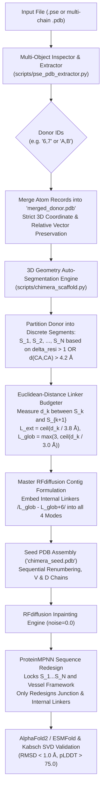

# Technical Specification: Multi-Object & Discontinuous Donor Chimera Scaffolding

- **Document Version**: 1.0.0
- **Status**: Final Technical Specification (Orchestai Prompt Polisher Step)
- **Target Subsystem**: AutoScaffold Chimera Pipeline (`scripts/pse_pdb_extractor.py`, `scripts/chimera_scaffold.py`, `chimera_scaffold.sh`, `tests/test_chimera_scaffold.py`)
- **Primary AI & Structural Engines**: RFdiffusion v1.1.0, ProteinMPNN, ColabFold / ESMFold, PyMOL API / Standalone Safe Parser, Kabsch SVD RMSD Validator
- **Companion Specifications**: [CHIMERA_TECHNICAL_SPEC.md](file:///C:/Users/g_san/.gemini/antigravity/scratch/autoscaffold/CHIMERA_TECHNICAL_SPEC.md), [CONTINUITY_AND_LAUNCHER_SPEC.md](file:///C:/Users/g_san/.gemini/antigravity/scratch/autoscaffold/CONTINUITY_AND_LAUNCHER_SPEC.md)

---

## 1. Executive Summary & Problem Context

### 1.1 Biological Benchmark & Motivation
In advanced structural biology and protein engineering, therapeutic target binding surfaces frequently do not reside on a single, continuous polypeptide chain. A prime benchmark example is grafting the client-binding surface of the **Hsp90 chaperone homodimer complex** onto a recipient host framework such as the **Aryl Hydrocarbon Receptor (AhR)** PAS-B domain vessel:
- The active binding interface spans two distinct subunits:
  - **Subunit A (Object [6] `HSP_contact`)**: 16 residues distributed discontinuously across positions 312 to 625.
  - **Subunit B (Object [7] `contacts_objB`)**: 27 residues distributed discontinuously across positions 286 to 397.
- Within each subunit object, the contact residues are separated by unmodeled loops, crystallographic voids, or intervening structural domains that should not be transferred.
- In the PyMOL session (`.pse`), these contact surfaces are saved as two separate selection objects or chains with empty space between them.

### 1.2 Root Cause Analysis of Current Pipeline Failures
Under the existing implementation:
1. **Single-Donor Restriction**:
   `chimera_scaffold.sh` and `scripts/chimera_scaffold.py` accept only a single scalar `--donor_id` (e.g. `6`), entirely dropping all residues from other subunits (e.g. `7`), thereby losing half the binding interface.
2. **Naive Interval Formulation on Discontinuous Motifs ("all" Bug)**:
   When a user supplies `"all"` for a discontinuous motif object spanning residues 312-625, `parse_motif_ranges` naively extracts `(min_res, max_res) -> (312, 625)`. RFdiffusion interprets this as a single continuous 314-residue segment, skips de novo physical loop generation, and leaves massive spatial voids between disconnected secondary elements.
3. **Severe Backbone Continuity Violations**:
   Adjacent C-alpha atoms across sequence voids exhibit distances $d(C_\alpha, C_\alpha) \gg 4.2\text{ \AA}$ (often 15-45 Å). In PyMOL and molecular viewers, these appear as dashed/dotted break lines and broken backbones, causing physical non-viability and AlphaFold2 / ESMFold folding collapse.
4. **Absence of Internal Bridging Linker Budgeting**:
   The contig generator only places linkers at the outer junction boundaries between donor and vessel (`linker_n` and `linker_c`). It provides no mechanism to calculate, budget, and insert internal bridging linkers between discontinuous patches of the donor motif itself.

---

## 2. Architectural Design & Pipeline State Machine

The multi-donor chimera scaffolding pipeline operates across 6 coordinated phases:



---

## 3. Section 1: Multi-Object / Multi-Chain Donor Extraction Specification

### 3.1 Component
`scripts/pse_pdb_extractor.py` and downstream caller routines in `scripts/chimera_scaffold.py`.

### 3.2 Requirements
1. **Multi-Target Selection Syntax**:
   The extractor and CLI wizard must accept comma-separated donor identifiers, accommodating:
   - Numeric indices matching inspection output (e.g. `"6,7"`).
   - PyMOL object / selection names (e.g. `"HSP_contact,contacts_objB"`).
   - Standard PDB chain IDs (e.g. `"A,B"`).
   - Mixed or space-padded tokens (e.g. `"6, 7"` or `"Chain_A, Chain_B"`).

2. **Strict 3D Coordinate & Spatial Vector Preservation**:
   - When merging multiple donor objects or chains, **no translation, center-of-mass centering, or coordinate rotation shall be applied**.
   - The absolute Cartesian coordinates $(x, y, z)$ of every atom must be preserved identically to maintain the exact quaternary binding geometry across dimer/oligomer subunits.
   - Atoms from the selected objects must be collated into a unified donor PDB file named `merged_donor.pdb` in `outputs/chimera_scaffold/0_prep/`.

3. **Residue Identifier Unification & Collision Management**:
   - Because distinct objects/chains may possess overlapping residue numbers (e.g. Object 6 having residues 312-625 and Object 7 having residues 286-397), merging them directly under a single chain identifier could produce duplicate residue numbers.
   - **Resolution Strategy**:
     - During extraction into `merged_donor.pdb`, each source object/chain retains its original residue numbers and source chain tags (or internal sub-chain tags `D1`, `D2`).
     - A metadata manifest `donor_segments_manifest.json` tracks the provenance:
       ```json
       {
         "donor_sources": ["HSP_contact", "contacts_objB"],
         "total_amino_acids": 43,
         "segments": [
           {
             "segment_id": "D1_S1",
             "source_object": "HSP_contact",
             "source_chain": "A",
             "residue_range": [312, 320],
             "length": 9,
             "sequence": "EDKDQVANF"
           },
           {
             "segment_id": "D1_S2",
             "source_object": "HSP_contact",
             "source_chain": "A",
             "residue_range": [619, 625],
             "length": 7,
             "sequence": "TISNPRL"
           },
           {
             "segment_id": "D2_S1",
             "source_object": "contacts_objB",
             "source_chain": "B",
             "residue_range": [286, 312],
             "length": 27,
             "sequence": "RLIQQLTKEDEK..."
           }
         ]
       }
       ```

4. **Public Function Signature Additions**:
   ```python
   def extract_and_merge_donors(
       input_path: str,
       donor_ids: List[str],
       out_merged_pdb: str,
       buffer_size: int = 65536
   ) -> Dict[str, Any]:
       """
       Extracts specified objects/chains from PSE or PDB, verifies 3D coordinate
       integrity, and writes a merged donor PDB with consolidated metadata.
       """
   ```

---

## 4. Section 2: Discontinuous Fragment Auto-Segmentation Specification

### 4.1 Component
`scripts/chimera_scaffold.py` (`parse_motif_ranges`, `compute_contigs_and_segments`, and helper `segment_discontinuous_motif`).

### 4.2 Requirements
1. **Elimination of the Continuous Interval Assumption**:
   - The pipeline must **never** treat `"all"` as `(min_res, max_res)`.
   - When `"all"` is supplied, the pipeline retrieves the explicit list of all present residues with valid $C_\alpha$ atoms from the donor structure.

2. **Dual-Criteria Continuity Verification**:
   Let sequential residue list across the merged donor be $R = [r_1, r_2, \dots, r_M]$, ordered by structure provenance and coordinate connectivity.
   For each adjacent pair $(r_i, r_{i+1})$:
   - **Criterion A (Sequence Continuity)**:
     $$\Delta\text{resi} = \text{resi}(r_{i+1}) - \text{resi}(r_i)$$
     If $\Delta\text{resi} \ne 1$, continuity is broken.
   - **Criterion B (Physical 3D Backbone Continuity)**:
     $$d_{i, i+1} = \|C_\alpha(r_{i+1}) - C_\alpha(r_i)\|_2$$
     In a physical peptide bond, trans-$C_\alpha-C_\alpha$ distance is strictly bounded by $3.80 \pm 0.15\text{ \AA}$. If $d_{i, i+1} > 4.20\text{ \AA}$, physical continuity is broken even if $\Delta\text{resi} == 1$ (e.g. unmodeled disordered loop in crystal structure).
   - **Criterion C (Inter-Object / Inter-Subunit Boundary)**:
     If $r_i$ and $r_{i+1}$ originate from different PyMOL objects or PDB chains, continuity is broken.

3. **Segmentation Output**:
   When any break criterion is met, a segment boundary is declared:
   $$\text{Segments} = [S_1, S_2, \dots, S_N]$$
   Where each $S_k = [r_{k,\text{start}}, r_{k,\text{end}}]$ is an unbroken physical fragment with:
   $$\forall j \in [k_{\text{start}}, k_{\text{end}}-1]: \quad \Delta\text{resi}(j, j+1) = 1 \quad \text{and} \quad d(C_\alpha^j, C_\alpha^{j+1}) \le 4.2\text{ \AA}$$

---

## 5. Section 3: Internal Euclidean-Distance Linker Budgeting Specification

### 5.1 Component
`scripts/chimera_scaffold.py` (`measure_internal_gaps`, `budget_internal_linkers`, `compute_contigs_and_segments`).

### 5.2 Mathematical Formulation
For every sequential pair of donor segments $(S_k, S_{k+1})$ where $k \in \{1, \dots, N-1\}$:
1. Identify Anchor Coordinates:
   - $C_k = C_\alpha(S_{k,\text{end}})$ (the C-terminal anchor of segment $S_k$).
   - $N_{k+1} = C_\alpha(S_{k+1,\text{start}})$ (the N-terminal anchor of segment $S_{k+1}$).
2. Measure Euclidean 3D Gap:
   $$d_k = \|N_{k+1} - C_k\|_2 = \sqrt{(x_{N} - x_{C})^2 + (y_{N} - y_{C})^2 + (z_{N} - z_{C})^2}$$
3. Compute Physical Bounds:
   - **Theoretical Fully Extended Minimum** ($3.8\text{ \AA}/\text{aa}$):
     $$L_{\text{ext}}(k) = \left\lceil \frac{d_k}{3.8} \right\rceil$$
   - **Recommended Globular Folding Minimum** ($3.0\text{ \AA}/\text{aa}$):
     $$L_{\text{glob}}(k) = \max\left(3, \left\lceil \frac{d_k}{3.0} \right\rceil\right)$$
   - **Flexible Sampling Range**:
     $$\text{Linker}_k = \left[ L_{\text{glob}}(k), \; L_{\text{glob}}(k) + 6 \right]$$

### 5.3 Contig Assembly across all 4 Chimera Modes
Let the formulated discontinuous donor motif block be defined as:
$$\mathbf{Contig}_{\text{donor}} = D(S_1) \;/ \; \text{Linker}_1 \; / \; D(S_2) \; / \; \text{Linker}_2 \; / \; \dots \; / \; D(S_N)$$
where $D(S_k) = \text{D}s_{k,\text{start}}-s_{k,\text{end}}$.

The master RFdiffusion contig string is assembled for each mode:

| Chimera Mode | Master RFdiffusion Contig Syntax |
| :--- | :--- |
| **`replace`** | `V{v_left_start}-{v_left_end}/{linker_n}/`$\mathbf{Contig}_{\text{donor}}$`/{linker_c}/V{v_right_start}-{v_right_end}` |
| **`ligate_nterm`** | $\mathbf{Contig}_{\text{donor}}$`/{linker_c}/V{v_start}-{v_end}` |
| **`ligate_cterm`** | `V{v_start}-{v_end}/{linker_n}/`$\mathbf{Contig}_{\text{donor}}$ |
| **`insert_loop`** | `V{v_left_start}-{split_after}/{linker_n}/`$\mathbf{Contig}_{\text{donor}}$`/{linker_c}/V{split_after+1}-{v_right_end}` |

---

## 6. Section 4: ProteinMPNN Fixed Position Masking Specification

### 6.1 Component
`scripts/chimera_scaffold.py` (`map_fixed_positions_for_mpnn`).

### 6.2 Masking Invariants
1. **Donor Residue Preservation (Absolute Invariant)**:
   Every single residue index corresponding to donor fragments $S_1, S_2, \dots, S_N$ must be present in `fixed_positions_dict.jsonl`. No mutation of active binding residues is permitted.
2. **Vessel Framework Protection (Default Invariant)**:
   When `lock_vessel=True` (default), all retained residues belonging to the vessel scaffold framework must be included in `fixed_positions_dict.jsonl`.
3. **De Novo Linker Redesign (Target Invariant)**:
   Only the newly generated residues must remain unmasked for sequence redesign:
   - External junction linkers: $\text{Linker}_N$ and $\text{Linker}_C$.
   - Internal bridging linkers: $\text{Linker}_1, \text{Linker}_2, \dots, \text{Linker}_{N-1}$.

### 6.3 Coordinate-Based Mapping Algorithm
Because RFdiffusion samples variable linker lengths within the budgeted ranges (e.g. $8-14$), residue sequence numbering in the generated backbone PDB shifts dynamically.
The masking engine must execute robust distance-based mapping:
1. Extract all $C_\alpha$ Cartesian coordinates from the generated backbone: $\mathbf{B} \in \mathbb{R}^{L_{\text{bb}} \times 3}$.
2. For every preserved donor residue $r \in \bigcup S_k$ with reference coordinate $\mathbf{c}_r$:
   $$\text{argmin}_j \|\mathbf{B}_j - \mathbf{c}_r\|_2^2 < (0.20\text{ \AA})^2$$
   Register 1-based index $j+1$ into `donor_fixed_indices`.
3. For every preserved vessel residue $v \in V_{\text{retained}}$ with reference coordinate $\mathbf{c}_v$:
   $$\text{argmin}_j \|\mathbf{B}_j - \mathbf{c}_v\|_2^2 < (0.20\text{ \AA})^2$$
   Register 1-based index $j+1$ into `vessel_fixed_indices`.
4. Output verified dictionary:
   ```json
   {"A": [1, 2, ..., 54, 65, 66, ..., 73, 85, ..., 112, 125, ...]}
   ```

---

## 7. Section 5: Interactive Wizard Specification

### 7.1 Component
`chimera_scaffold.sh` and CLI parameter handler.

### 7.2 Interactive Wizard Step 2 Update
Prompt 2 must explicitly communicate multi-selection capability:
```bash
▶ 2. Select Donor Object/Chain ID(s) [e.g. '6,7' or 'HSP_contact,contacts_objB']:
```

### 7.3 Discontinuous Fragment Breakdown Table
Before prompting for linker lengths, the wizard must execute `measure_junctions` and display a clear breakdown table:

```text
================================================================================
 🧬 MULTI-DONOR DISCONTINUOUS MOTIF BREAKDOWN & INTERNAL GAP ANALYSIS 🧬
================================================================================
[+] Preserving 43 donor residues across 2 objects partitioned into 3 segments:
  ┌──────────┬─────────────────┬──────────┬──────────────┬──────────────┬────────────────────────┐
  │ Segment  │ Source Object   │ Chain    │ Residue Span │ Length (aa)  │ Distance to Next (Å)   │
  ├──────────┼─────────────────┼──────────┼──────────────┼──────────────┼────────────────────────┤
  │ S1       │ HSP_contact     │ A        │ 312 - 320    │ 9 aa         │ 18.4 Å -> Linker: 7-13 │
  │ S2       │ HSP_contact     │ A        │ 619 - 625    │ 7 aa         │ 12.1 Å -> Linker: 5-11 │
  │ S3       │ contacts_objB   │ B        │ 286 - 312    │ 27 aa        │ Terminal (Junction C)  │
  └──────────┴─────────────────┴──────────┴──────────────┴──────────────┴────────────────────────┘

[✓] Automated Internal Linker Budget:
  • Bridge 1 (S1 -> S2): 7-13 aa (spanning 18.4 Å void)
  • Bridge 2 (S2 -> S3): 5-11 aa (spanning 12.1 Å void)
```

---

## 8. Section 6: Automated Unit Tests Specification

### 8.1 Component
`tests/test_chimera_scaffold.py`.

### 8.2 Test Suite Requirements
The test suite must implement high-coverage, deterministic test cases:
1. `test_multi_object_donor_merge`:
   - Supply two distinct sample objects in a test PDB/PSE with coordinate offsets.
   - Assert `merged_donor.pdb` preserves exact atomic coordinates without distortion.
2. `test_discontinuous_motif_auto_segmentation`:
   - Create a synthetic donor structure with residues 10-15 and 80-85 ($d(C_\alpha, C_\alpha) = 25.0\text{ \AA}$).
   - Run segmentation with `motif_residues="all"`.
   - Assert returns exactly two segments: `[(10, 15), (80, 85)]`, not `[(10, 85)]`.
3. `test_internal_linker_budgeting`:
   - Given a 3D gap of $21.0\text{ \AA}$, verify:
     - $L_{\text{ext}} = \lceil 21.0 / 3.8 \rceil = 6\text{ aa}$.
     - $L_{\text{glob}} = \max(3, \lceil 21.0 / 3.0 \rceil) = 7\text{ aa}$.
     - Generated internal linker string is `/7-13/`.
4. `test_fixed_positions_masking_multi_segment`:
   - Generate a mock chimeric backbone with 3 donor segments, 2 internal linkers, and 2 external linkers.
   - Run `map_fixed_positions_for_mpnn`.
   - Assert all donor residues and vessel residues are present in the fixed list, while internal linkers and external linkers are omitted.
5. `test_all_four_modes_with_discontinuous_donor`:
   - Test contig assembly for `replace`, `ligate_nterm`, `ligate_cterm`, and `insert_loop` using a 2-segment donor motif.
   - Verify valid syntax with no missing or consecutive slashes (`//`).

---

## 9. Verification & Implementation Plan

| Step | Target Subsystem | Implementation Task | Success Metric |
| :---: | :--- | :--- | :--- |
| **1** | `scripts/pse_pdb_extractor.py` | Add comma-separated multi-ID parsing & coordinate-preserving merge logic | Extractor merges objects into `merged_donor.pdb` with identical coordinates |
| **2** | `scripts/chimera_scaffold.py` | Implement auto-segmentation on $\Delta\text{resi} > 1$ or $d(C_\alpha, C_\alpha) > 4.2\text{ \AA}$ | "all" splits discontinuous motifs into $S_1, \dots, S_N$ |
| **3** | `scripts/chimera_scaffold.py` | Add internal Euclidean linker budgeting & embed into master contig string | Contig contains physical internal linkers `/L_glob - L_glob+6/` |
| **4** | `scripts/chimera_scaffold.py` | Update ProteinMPNN fixed masking to lock all donor segments and unmask all linkers | `fixed_positions_dict.jsonl` correctly masks $S_1...S_N$ |
| **5** | `chimera_scaffold.sh` | Update Prompt 2 for multi-selection & render fragment breakdown table | Wizard parses `'6,7'` and prints breakdown table |
| **6** | `tests/test_chimera_scaffold.py` | Add unit tests covering multi-donor, segmentation, linkers, and masking | `python -m unittest tests/test_chimera_scaffold.py` passes 100% |

---
### 📋 Action Receipt
- **Execution Mode**: Antigravity Cloud / Hybrid
- **Files Created / Modified**: `C:\Users\g_san\.gemini\antigravity\scratch\autoscaffold\MULTI_DONOR_CHIMERA_SPEC.md`
- **Commands Executed**: None
- **External Services / Remotes**: None
- **Status / Verdict**: Complete
---
