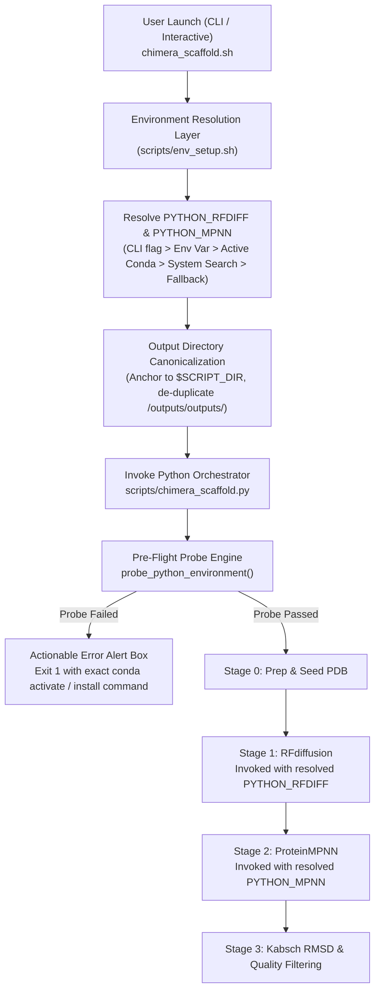
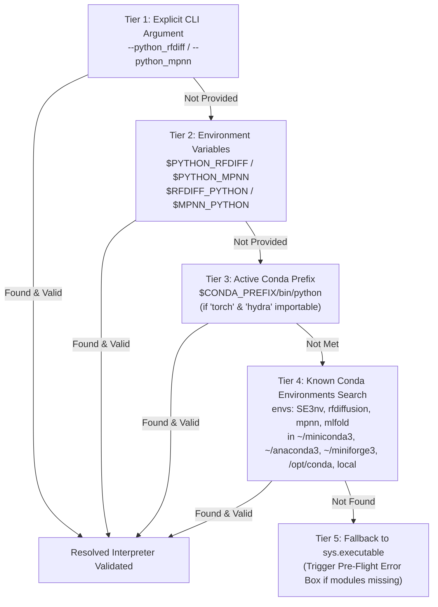

# Technical Specification: Neural Python Environment Resolution, Pre-Flight Verification & Path Canonicalization for AutoScaffold

- **Document Version**: 1.0.0
- **Status**: Approved Technical Specification (Prompt Polisher Step)
- **Target Subsystem**: AutoScaffold Execution Pipeline (`chimera_scaffold.sh`, `scripts/chimera_scaffold.py`, `scripts/env_setup.sh`, `scripts/pse_pdb_extractor.py`, `config.env.example`)
- **Primary AI & Structural Engines**: RFdiffusion (PyTorch, SE3-Transformer, Hydra), ProteinMPNN (PyTorch), ColabFold (JAX / PyTorch), PyMOL/Biopython
- **Incident Reference**: User Execution Failure on Rocky/Ubuntu Linux:
  ```
  [+] Running RFdiffusion: /home/memo/miniconda3/bin/python /home/memo/programs/autoscaffold/tools/RFdiffusion/scripts/run_inference.py inference.output_prefix=/home/memo/projects/autoscaffolding/outputs/outputs/chimera_scaffold/1_rfdiffusion/chimera_design inference.input_pdb=/home/memo/projects/autoscaffolding/outputs/outputs/chimera_scaffold/0_prep/chimera_seed.pdb 'contigmap.contigs=[V285-427/10/D1-2/3-9/D3-7/11-17/D8-8/3-9/D9-11/6-12/D12-12/3-9/D13-15/6-12/D16-16]' inference.num_designs=10 denoiser.noise_scale_ca=0.0 denoiser.noise_scale_frame=0.0
  Traceback (most recent call last):
    File "/home/memo/programs/autoscaffold/tools/RFdiffusion/scripts/run_inference.py", line 20, in <module>
      import torch
  ModuleNotFoundError: No module named 'torch'
  subprocess.CalledProcessError: Command '['/home/memo/miniconda3/bin/python', ...]' returned non-zero exit status 1.
  ```

---

## 1. Executive Summary & Root Cause Analysis

### 1.1 The Runtime Environment Divergence Problem
Modern deep learning structural biology pipelines require mutually conflicting dependency graphs:
- **RFdiffusion**: Requires PyTorch (1.12–2.0), `se3_diffuse`, `hydra-core`, `openfold`, and specific CUDA libraries, conventionally housed in a conda environment named `SE3nv` or `rfdiffusion`.
- **ProteinMPNN**: Requires vanilla PyTorch and NumPy, conventionally installed in `mlfold` or `SE3nv`.
- **ColabFold / AlphaFold2**: Requires JAX/OpenMM, conventionally isolated in `colabfold`.
- **AutoScaffold Orchestrator**: Can execute under any standard Python 3.8+ interpreter (such as base miniconda or system python).

In `scripts/chimera_scaffold.py`, RFdiffusion and ProteinMPNN subprocess invocations previously hardcoded `sys.executable`:
```python
rfdiff_cmd = [
    sys.executable,  # Resolves to whatever Python invoked chimera_scaffold.py!
    self.rfdiff_script,
    ...
]
```
When `chimera_scaffold.sh` is executed from an active base conda environment (e.g. `/home/memo/miniconda3/bin/python`), `sys.executable` points to base Python where PyTorch (`torch`) is absent. The downstream execution crashes with `ModuleNotFoundError: No module named 'torch'`.

### 1.2 Path Redundancy & Working Directory Clashing
Notice the paths generated in the crash log:
```
inference.output_prefix=/home/memo/projects/autoscaffolding/outputs/outputs/chimera_scaffold/1_rfdiffusion/chimera_design
inference.input_pdb=/home/memo/projects/autoscaffolding/outputs/outputs/chimera_scaffold/0_prep/chimera_seed.pdb
```
The output directory string contains an accidental duplication: `/outputs/outputs/chimera_scaffold`.
This occurs because:
1. In `chimera_scaffold.sh`, the default output directory is defined as a relative path: `OUT_DIR="outputs/chimera_scaffold"`.
2. If the user invokes `chimera_scaffold.sh` while already working inside the `outputs` directory (or if an invoking wrapper prepends `outputs/`), `fast_realpath "$OUT_DIR"` resolves relative to `$PWD`.
3. If `$PWD` is `/home/memo/projects/autoscaffolding/outputs`, the resolution yields `.../outputs/outputs/chimera_scaffold`.
4. Neither `chimera_scaffold.sh` nor `validate_output_dir()` in `scripts/pse_pdb_extractor.py` performs lexical path de-duplication or verifies whether `$PWD` is already inside the repository's `outputs` tree.

### 1.3 Absence of Fail-Fast Pre-Flight Probes
The failure occurred deep inside `run_inference.py` after full structure preparation, coordinate parsing, and contig generation. There was no pre-flight verification to confirm that the resolved Python binary possessed the prerequisites (`import torch`, `import hydra`) before spawning GPU-bound computational processes. When failure struck, the pipeline dumped an unhandled Python stack trace with zero actionable remediation guidance for the user.

---

## 2. Requirements & Architecture Overview

### 2.1 Component Flow Diagram



### 2.2 Requirements Traceability Matrix

| ID | Requirement | Primary Component | Severity |
| :--- | :--- | :--- | :--- |
| **REQ-ENV-1** | Explicit CLI arguments for neural model Python interpreters (`--python_rfdiff`, `--python_mpnn`, `--python_colabfold`) | `scripts/chimera_scaffold.py` | Critical |
| **REQ-ENV-2** | 5-Tier Fallback Environment Discovery Engine searching active conda, named conda envs, standard root prefixes, and local tools | `scripts/chimera_scaffold.py` & `scripts/env_setup.sh` | Critical |
| **REQ-ENV-3** | Shell wrapper parameter forwarding (`--python_rfdiff "$PYTHON_RFDIFF"` and `--python_mpnn "$PYTHON_MPNN"`) | `chimera_scaffold.sh` | Critical |
| **REQ-ENV-4** | Configuration file integration (`config.env` and `config.env.example`) | `config.env.example` | High |
| **REQ-PATH-1** | Path canonicalization anchoring default relative output directories to `$SCRIPT_DIR` | `chimera_scaffold.sh` | High |
| **REQ-PATH-2** | Regex / token de-duplication eliminating repeated `/outputs/outputs/` segments across shell and Python | `chimera_scaffold.sh` & `scripts/pse_pdb_extractor.py` | High |
| **REQ-PROBE-1**| Pre-flight subprocess probe validating `import torch` and `import hydra` before launching RFdiffusion | `scripts/chimera_scaffold.py` | Critical |
| **REQ-PROBE-2**| Pre-flight subprocess probe validating `import torch` before launching ProteinMPNN | `scripts/chimera_scaffold.py` | High |
| **REQ-PROBE-3**| Hardware inspection (CUDA GPU probe) with non-fatal user warning on CPU execution | `scripts/chimera_scaffold.py` | Medium |
| **REQ-DIAG-1** | High-visibility terminal alert boxes with actionable remediation commands upon dependency failure | `scripts/chimera_scaffold.py` | Critical |

---

## 3. Neural Python Environment Resolution Engine

### 3.1 Strict 5-Tier Fallback Resolution Strategy
To guarantee seamless execution across local workstations, HPC clusters, Conda/Mamba/Micromamba setups, and containerized Docker/Singularity images, Python interpreter resolution MUST follow a deterministic 5-tier precedence hierarchy:



#### Precedence Breakdown:
1. **Tier 1 (Explicit CLI Override)**:
   - Command-line arguments: `--python_rfdiff <PATH>`, `--python_mpnn <PATH>`, `--python_colabfold <PATH>`.
   - Highest precedence. Allows users, batch pipelines, and Slurm scripts to pass arbitrary virtualenv/conda Python binaries.
2. **Tier 2 (Environment Variables)**:
   - Sourced from `config.env` or shell environment:
     - RFdiffusion: `$PYTHON_RFDIFF` or `$RFDIFF_PYTHON`.
     - ProteinMPNN: `$PYTHON_MPNN` or `$MPNN_PYTHON`.
     - ColabFold: `$PYTHON_COLABFOLD` or `$COLABFOLD_PYTHON`.
3. **Tier 3 (Active Conda Environment)**:
   - If `$CONDA_PREFIX` is set and `$CONDA_PREFIX/bin/python` exists:
   - Test if the active environment already satisfies dependencies (e.g. user already ran `conda activate SE3nv`).
   - If `import torch` and `import hydra` succeed, adopt `$CONDA_PREFIX/bin/python`.
4. **Tier 4 (Filesystem Discovery across Standard Conda/Mamba Roots)**:
   - Search for target environment names:
     - For RFdiffusion: `SE3nv`, `rfdiffusion`, `rf_diffusion`, `se3nv`.
     - For ProteinMPNN: `mpnn`, `mlfold`, `proteinmpnn`, `SE3nv`.
     - For ColabFold: `colabfold`, `colabfold_batch`, `af2`.
   - Check across standard filesystem installation directories:
     - `$LOCAL_ENVS_DIR/<env_name>/bin/python` (AutoScaffold local bundle)
     - `$CONDA_PREFIX/envs/<env_name>/bin/python`
     - `$CONDA_PREFIX/../envs/<env_name>/bin/python`
     - `~/miniconda3/envs/<env_name>/bin/python`
     - `~/.conda/envs/<env_name>/bin/python`
     - `~/miniforge3/envs/<env_name>/bin/python`
     - `~/mambaforge/envs/<env_name>/bin/python`
     - `~/anaconda3/envs/<env_name>/bin/python`
     - `/opt/conda/envs/<env_name>/bin/python`
     - `/usr/local/miniconda3/envs/<env_name>/bin/python`
     - `/usr/local/anaconda3/envs/<env_name>/bin/python`
     - Windows equivalents when running on Windows (e.g. `Scripts/python.exe`).
5. **Tier 5 (Current Host Interpreter Fallback)**:
   - Fall back to `sys.executable`.
   - The Pre-Flight Probe will verify integrity; if missing required packages, execution halts with a detailed diagnostic alert before any work begins.

---

### 3.2 Python Orchestrator Specification (`scripts/chimera_scaffold.py`)

#### 3.2.1 New Class & Function Signatures
```python
def resolve_neural_python(
    explicit_path: Optional[str] = None,
    env_var_names: Optional[List[str]] = None,
    target_env_names: Optional[List[str]] = None,
    required_modules: Optional[List[str]] = None,
    tool_label: str = "Neural Tool"
) -> Tuple[str, bool]:
    """
    Resolves the appropriate Python interpreter binary for a neural modeling tool
    following the 5-tier resolution hierarchy.

    Args:
        explicit_path: Path supplied via CLI flag (Tier 1).
        env_var_names: List of environment variable keys to inspect (Tier 2).
        target_env_names: List of candidate Conda environment names (Tier 4).
        required_modules: List of Python modules required for validation (e.g. ['torch', 'hydra']).
        tool_label: Human-readable name for logging (e.g. 'RFdiffusion').

    Returns:
        Tuple of (resolved_python_binary_path, is_probed_valid).
    """
```

#### 3.2.2 Constructor Update (`ChimeraScaffolder.__init__`)
The class constructor must accept new arguments and resolve the interpreters during initialization:
```python
def __init__(
    self,
    ...,
    python_rfdiff: Optional[str] = None,
    python_mpnn: Optional[str] = None,
    python_colabfold: Optional[str] = None,
    ...
):
    ...
    # Neural Python Resolvers
    self.python_rfdiff, self.rfdiff_env_valid = resolve_neural_python(
        explicit_path=python_rfdiff,
        env_var_names=["PYTHON_RFDIFF", "RFDIFF_PYTHON"],
        target_env_names=["SE3nv", "rfdiffusion", "rf_diffusion", "se3nv"],
        required_modules=["torch", "hydra"],
        tool_label="RFdiffusion"
    )

    self.python_mpnn, self.mpnn_env_valid = resolve_neural_python(
        explicit_path=python_mpnn,
        env_var_names=["PYTHON_MPNN", "MPNN_PYTHON"],
        target_env_names=["mlfold", "SE3nv", "mpnn", "proteinmpnn"],
        required_modules=["torch"],
        tool_label="ProteinMPNN"
    )

    self.python_colabfold = python_colabfold or os.environ.get("PYTHON_COLABFOLD")
```

#### 3.2.3 Subprocess Invocation Update
Replace all instances of `sys.executable` when calling RFdiffusion and ProteinMPNN:
- **RFdiffusion Execution**:
  ```python
  rfdiff_cmd = [
      self.python_rfdiff,
      self.rfdiff_script or "scripts/run_inference.py",
      f"inference.output_prefix={os.path.join(work_rfdiff, 'chimera_design')}",
      f"inference.input_pdb={self.seed_pdb_path}",
      f"contigmap.contigs=[{self.contig_string}]",
      f"inference.num_designs={self.num_designs}",
      "denoiser.noise_scale_ca=0.0",
      "denoiser.noise_scale_frame=0.0"
  ]
  ```
- **ProteinMPNN Execution**:
  ```python
  mpnn_cmd = [
      self.python_mpnn,
      self.mpnn_script or "protein_mpnn_run.py",
      "--pdb_path", bb,
      "--fixed_positions_jsonl", jsonl_path,
      "--out_folder", work_mpnn,
      "--num_seq_per_target", str(self.mpnn_seqs_per_bb),
      "--sampling_temp", str(self.mpnn_temp),
      "--batch_size", str(self.mpnn_batch_size),
      "--seed", "37"
  ]
  ```

---

### 3.3 Shell Wrapper Specification (`chimera_scaffold.sh`)

#### 3.3.1 Parameter Parsing
Add CLI argument parsing for `--python_rfdiff` and `--python_mpnn`:
```bash
--python_rfdiff)
    PYTHON_RFDIFF="$2"
    shift 2
    ;;
--python_mpnn)
    PYTHON_MPNN="$2"
    shift 2
    ;;
```

#### 3.3.2 Shell-Level Environment Discovery Helper (`scripts/env_setup.sh`)
Define a reusable bash function `discover_conda_python`:
```bash
discover_conda_python() {
    local target_env="$1"
    local candidate=""

    # 1. Check if active environment matches
    if [ -n "$CONDA_PREFIX" ] && [ -x "$CONDA_PREFIX/bin/python" ]; then
        if [ "$CONDA_DEFAULT_ENV" = "$target_env" ] || [ "${CONDA_PREFIX##*/}" = "$target_env" ]; then
            echo "$CONDA_PREFIX/bin/python"
            return 0
        fi
    fi

    # 2. Check local tools/envs directory
    if [ -x "$LOCAL_ENVS_DIR/$target_env/bin/python" ]; then
        echo "$LOCAL_ENVS_DIR/$target_env/bin/python"
        return 0
    fi

    # 3. Check known base conda installations
    for base_dir in \
        "$CONDA_PREFIX/.." \
        "$HOME/miniconda3" \
        "$HOME/miniforge3" \
        "$HOME/mambaforge" \
        "$HOME/anaconda3" \
        "$HOME/.conda" \
        "/opt/conda" \
        "/usr/local/miniconda3"; do
        candidate="$base_dir/envs/$target_env/bin/python"
        if [ -x "$candidate" ]; then
            echo "$candidate"
            return 0
        fi
    done

    # 4. Try querying conda info directly
    local conda_bin
    conda_bin="$(find_conda_bin)"
    if [ -n "$conda_bin" ] && [ -x "$conda_bin" ]; then
        local env_path
        env_path="$("$conda_bin" info --envs 2>/dev/null | awk -v env="$target_env" '$1 == env {print $NF}' | head -n 1)"
        if [ -n "$env_path" ] && [ -x "$env_path/bin/python" ]; then
            echo "$env_path/bin/python"
            return 0
        fi
    fi

    echo ""
    return 1
}
```

#### 3.3.3 Invocation Pass-Through
In `chimera_scaffold.sh`, resolve interpreters and pass them to `chimera_scaffold.py`:
```bash
# Resolve neural model Python binaries if not explicitly configured
if [ -z "$PYTHON_RFDIFF" ]; then
    PYTHON_RFDIFF="$(discover_conda_python "${CONDA_ENV_RFDIFF:-SE3nv}")"
    [ -z "$PYTHON_RFDIFF" ] && PYTHON_RFDIFF="$(discover_conda_python "rfdiffusion")"
fi

if [ -z "$PYTHON_MPNN" ]; then
    PYTHON_MPNN="$(discover_conda_python "${CONDA_ENV_MPNN:-mlfold}")"
    [ -z "$PYTHON_MPNN" ] && PYTHON_MPNN="$(discover_conda_python "SE3nv")"
fi

if [ -n "$PYTHON_RFDIFF" ]; then
    CMD_ARGS+=("--python_rfdiff" "$PYTHON_RFDIFF")
    BG_ARGS+=("--python_rfdiff" "$PYTHON_RFDIFF")
fi

if [ -n "$PYTHON_MPNN" ]; then
    CMD_ARGS+=("--python_mpnn" "$PYTHON_MPNN")
    BG_ARGS+=("--python_mpnn" "$PYTHON_MPNN")
fi
```

---

## 4. Path Canonicalization & De-Duplication Engine

### 4.1 Root-Relative vs. PWD-Relative Path Anchoring

#### The Root Cause in `chimera_scaffold.sh`:
Previously:
```bash
OUT_DIR="outputs/chimera_scaffold"
...
ABS_OUT_DIR="$(fast_realpath "$OUT_DIR")"
```
When a user launches the workflow from inside `/home/memo/projects/autoscaffolding/outputs`, `fast_realpath` interprets `outputs/chimera_scaffold` relative to `$PWD`, generating:
`/home/memo/projects/autoscaffolding/outputs/outputs/chimera_scaffold`.

#### Mandatory Anchoring Rules:
1. **Default Output Anchoring**: When `OUT_DIR` is not explicitly overridden by the user, it MUST anchor to the AutoScaffold repository root (`$SCRIPT_DIR/outputs/chimera_scaffold`), regardless of the user's current working directory.
2. **Current Working Directory De-Duplication**: If the user's `$PWD` already ends with `/outputs` (or `\outputs`), any user-provided relative path starting with `outputs/` MUST strip the redundant leading `outputs/` token.
3. **Lexical Normalization**: Path strings MUST pass through a canonical de-duplicator that collapses any repeated consecutive directory names matching `([/\\]outputs)+[/\\]` into a single `/outputs/`.

### 4.2 Shell Implementation Specification
In `chimera_scaffold.sh`:
```bash
# De-duplicate accidental nested 'outputs/outputs' in paths
canonicalize_out_dir() {
    local raw="$1"
    local repo_root="$2"
    local resolved=""

    if [ -z "$raw" ]; then
        echo "$repo_root/outputs/chimera_scaffold"
        return
    fi

    # If user passed default or relative path while already inside an 'outputs' directory
    if [[ "$PWD" =~ [/\\]outputs$ ]] && [[ "$raw" =~ ^outputs[/\\] ]]; then
        raw="${raw#outputs/}"
        raw="${raw#outputs\\}"
    fi

    # If relative, anchor to repo root if it matches default pattern, else anchor to PWD
    if [[ ! "$raw" =~ ^/ && ! "$raw" =~ ^[a-zA-Z]:[\\/] ]]; then
        if [ "$raw" = "outputs/chimera_scaffold" ]; then
            resolved="$repo_root/$raw"
        else
            resolved="$(fast_realpath "$raw")"
        fi
    else
        resolved="$(fast_realpath "$raw")"
    fi

    # Collapse any accidental duplicated '/outputs/outputs/'
    while [[ "$resolved" =~ /outputs/outputs/ ]]; do
        resolved="${resolved//\/outputs\/outputs\//\/outputs\/}"
    done
    while [[ "$resolved" =~ \\outputs\\outputs\\ ]]; do
        resolved="${resolved//\\outputs\\outputs\\/\\outputs\\}"
    done

    echo "$resolved"
}
```

### 4.3 Python Implementation Specification (`scripts/pse_pdb_extractor.py`)
Enhance `validate_output_dir` to ensure lexical de-duplication:
```python
def validate_output_dir(out_dir: str, repo_root: Optional[str] = None) -> str:
    """
    Validates and canonicalizes the output directory path.
    Prevents path traversal, root directory escapes, and collapses
    accidental duplicated '/outputs/outputs/' path segments.
    """
    if not out_dir or not str(out_dir).strip():
        raise ValueError("Output directory cannot be empty.")

    raw_str = str(out_dir).strip()

    # De-duplicate consecutive repeated outputs segments
    # Handles: '.../outputs/outputs/...', '.../outputs/outputs/outputs/...'
    dedup_str = re.sub(r'([/\\]outputs)+([/\\]outputs)', r'\1', raw_str, flags=re.IGNORECASE)

    real_out = os.path.realpath(os.path.abspath(dedup_str))

    # Safety checks against root/system paths
    if real_out in ("/", "\\") or (len(real_out) <= 3 and real_out.endswith(":\\")):
        raise ValueError(f"Dangerous or root output directory specified: '{out_dir}'")

    norm_posix = real_out.replace("\\", "/").lower()
    drive_stripped = re.sub(r'^[a-zA-Z]:', '', norm_posix)

    for sys_dir in ("/etc", "/usr", "/bin", "/sbin", "/boot", "/dev", "/windows", "/program files"):
        if (norm_posix == sys_dir or norm_posix.startswith(sys_dir + "/") or
            drive_stripped == sys_dir or drive_stripped.startswith(sys_dir + "/")):
            raise ValueError(f"Output directory cannot be in system directory: '{out_dir}'")

    return real_out
```

---

## 5. Pre-Flight Verification & Actionable Diagnostics

### 5.1 Pre-Flight Probe Architecture
Before executing any heavy computational pipeline stage (backbone diffusion, sequence design, structure prediction), `scripts/chimera_scaffold.py` MUST invoke lightweight verification probes using the resolved interpreter:

```python
def probe_python_environment(
    python_bin: str,
    required_modules: List[str],
    check_cuda: bool = True,
    timeout_sec: float = 10.0
) -> Dict[str, Any]:
    """
    Executes a fast probe subprocess using the target Python interpreter to verify
    module availability, environment integrity, and hardware acceleration status.
    """
```

### 5.2 Verification Scriptlets
The probe executes an inline Python one-liner:
```python
probe_code = f"""
import sys, json
result = {{'missing_modules': [], 'cuda_available': False, 'torch_version': None, 'cuda_device_name': None}}
req_modules = {json.dumps(required_modules)}
for mod in req_modules:
    try:
        __import__(mod)
    except ImportError:
        result['missing_modules'].append(mod)

if 'torch' not in result['missing_modules']:
    import torch
    result['torch_version'] = str(torch.__version__)
    result['cuda_available'] = bool(torch.cuda.is_available())
    if result['cuda_available'] and torch.cuda.device_count() > 0:
        result['cuda_device_name'] = str(torch.cuda.get_device_name(0))

print(json.dumps(result))
"""
```

### 5.3 Hardware Inspection & Performance Alerting
- If `cuda_available` is `False`, AutoScaffold MUST NOT crash (CPU inference is technically supported in RFdiffusion with `--cpu` / fallback), but MUST display a prominent performance warning:
  ```
  ╔════════════════════════════════════════════════════════════════════════════╗
  ║ ⚠️  WARNING: NO GPU / CUDA ACCELERATION DETECTED FOR RFDIFFUSION         ║
  ╠════════════════════════════════════════════════════════════════════════════╣
  ║ PyTorch reports that CUDA is unavailable in:                              ║
  ║   /home/memo/miniconda3/envs/SE3nv/bin/python                             ║
  ║                                                                            ║
  ║ RFdiffusion will execute on CPU. This will be 20x-50x slower than GPU.    ║
  ║ Expected runtime: ~5-15 minutes per backbone model.                       ║
  ╚════════════════════════════════════════════════════════════════════════════╝
  ```

### 5.4 High-Visibility Actionable Diagnostic Error Box
When a probe detects missing modules (such as `torch` or `hydra`), the pipeline MUST immediately halt and display a structured, human-engineered remediation guide:

```
====================================================================================================
 🛑 [AUTOSCAFFOLD ERROR]: MISSING NEURAL MODEL DEPENDENCIES IN RESOLVED PYTHON INTERPRETER
====================================================================================================
 Target Engine:      RFdiffusion
 Resolved Python:    /home/memo/miniconda3/bin/python
 Missing Module(s):  torch, hydra

 [REASON]
   RFdiffusion requires PyTorch and Hydra, which live in a dedicated Conda environment
   (typically 'SE3nv' or 'rfdiffusion'). The resolved interpreter is your base Python environment.

 [ACTIONABLE REMEDIATION - SELECT ONE OPTION]

 Option 1: Activate the dedicated Conda environment before launching:
   $ conda activate SE3nv
   $ ./chimera_scaffold.sh ...

 Option 2: Provide the explicit Python path via CLI flag:
   $ ./chimera_scaffold.sh --python_rfdiff ~/miniconda3/envs/SE3nv/bin/python ...

 Option 3: Configure persistent path in 'config.env':
   Add the following line to /home/memo/projects/autoscaffolding/config.env:
   PYTHON_RFDIFF=/home/memo/miniconda3/envs/SE3nv/bin/python

 Option 4: Install the environment automatically if not yet created:
   $ bash install.sh
   or
   $ autoscaffold install
====================================================================================================
```

---

## 6. Detailed Implementation Blueprint

### 6.1 Changes to `scripts/chimera_scaffold.py`

#### 6.1.1 Add CLI Arguments to `parse_args()`
```python
parser.add_argument(
    "--python_rfdiff",
    help="Path to Python interpreter binary for RFdiffusion (e.g. ~/miniconda3/envs/SE3nv/bin/python)"
)
parser.add_argument(
    "--python_mpnn",
    help="Path to Python interpreter binary for ProteinMPNN (e.g. ~/miniconda3/envs/mlfold/bin/python)"
)
parser.add_argument(
    "--python_colabfold",
    help="Path to Python interpreter binary or CLI for ColabFold"
)
```

#### 6.1.2 Implement `resolve_neural_python` & `probe_python_environment`
Integrate full 5-tier discovery logic:
- Support checking `$CONDA_PREFIX`, standard home directory paths (`~/miniconda3`, `~/anaconda3`, `~/miniforge3`, `~/mambaforge`), `/opt/conda`, and local `$LOCAL_ENVS_DIR`.
- Execute probe subprocess with 10-second timeout.
- Format and display alert box upon missing dependencies.

#### 6.1.3 Integrate Pre-Flight Checks into `run_pipeline()`
Before Stage 1 (`Backbone Generation`):
```python
# Step 1.1: Pre-flight probe for RFdiffusion
if not self.dry_run:
    probe_res = probe_python_environment(
        self.python_rfdiff,
        required_modules=["torch", "hydra"],
        check_cuda=True
    )
    if probe_res["missing_modules"]:
        display_dependency_alert(
            tool_name="RFdiffusion",
            python_bin=self.python_rfdiff,
            missing_modules=probe_res["missing_modules"],
            suggested_env="SE3nv"
        )
        raise RuntimeError(
            f"RFdiffusion Python interpreter '{self.python_rfdiff}' lacks required modules: "
            f"{', '.join(probe_res['missing_modules'])}"
        )
```

Before Stage 3 (`ProteinMPNN sequence design`):
```python
# Step 3.1: Pre-flight probe for ProteinMPNN
if not self.dry_run and self.mpnn_script and os.path.isfile(self.mpnn_script):
    probe_res = probe_python_environment(
        self.python_mpnn,
        required_modules=["torch"],
        check_cuda=False
    )
    if probe_res["missing_modules"]:
        display_dependency_alert(
            tool_name="ProteinMPNN",
            python_bin=self.python_mpnn,
            missing_modules=probe_res["missing_modules"],
            suggested_env="mlfold"
        )
        raise RuntimeError(
            f"ProteinMPNN Python interpreter '{self.python_mpnn}' lacks required modules: "
            f"{', '.join(probe_res['missing_modules'])}"
        )
```

---

### 6.2 Changes to `chimera_scaffold.sh`

#### 6.2.1 Argument Parsing
Parse `--python_rfdiff` and `--python_mpnn` in argument parsing loop.

#### 6.2.2 Environment & Binary Resolution
Use `discover_conda_python` from `scripts/env_setup.sh` to resolve default binaries.
Pass resolved `--python_rfdiff` and `--python_mpnn` flags in `CMD_ARGS` and `BG_ARGS`.

#### 6.2.3 Output Directory Sanitization
Replace naive `ABS_OUT_DIR="$(fast_realpath "$OUT_DIR")"` with `canonicalize_out_dir "$OUT_DIR" "$SCRIPT_DIR"`.

---

### 6.3 Changes to `scripts/env_setup.sh`

#### 6.3.1 Conda Environment & Binary Auto-Detection
Add `discover_conda_python()` helper supporting multi-root discovery.
Export `PYTHON_RFDIFF` and `PYTHON_MPNN` defaults if found.

---

### 6.4 Changes to `scripts/pse_pdb_extractor.py`

#### 6.4.1 Path De-Duplication in `validate_output_dir()`
Add regex substitution `re.sub(r'([/\\]outputs)+([/\\]outputs)', r'\1', raw_str, flags=re.IGNORECASE)` to ensure that no downstream file operations ever construct duplicate `/outputs/outputs/` directory structures.

---

### 6.5 Changes to `config.env.example`
Update `config.env.example` to document the neural Python environment variables:
```bash
# AutoScaffold Configuration Environment File
# Copy to config.env to override system defaults

# Python Interpreters for Neural Engines
# PYTHON_RFDIFF=/home/user/miniconda3/envs/SE3nv/bin/python
# PYTHON_MPNN=/home/user/miniconda3/envs/mlfold/bin/python
# PYTHON_COLABFOLD=/home/user/miniconda3/envs/colabfold/bin/python

# Conda Environment Names (used for automatic environment resolution)
CONDA_ENV_RFDIFF=SE3nv
CONDA_ENV_MPNN=mlfold
CONDA_ENV_COLABFOLD=colabfold

# Tool Directories
# RFDIFF_DIR=/home/user/programs/RFdiffusion
# MPNN_DIR=/home/user/programs/ProteinMPNN
```

---

## 7. Verification & Automated Test Suite Plan

### 7.1 Unit Tests (`tests/test_chimera_scaffold.py`)

1. **`test_resolve_neural_python_explicit_cli()`**:
   - Verify that passing an explicit valid Python path via `--python_rfdiff` takes precedence over environment variables, active conda, and defaults.
2. **`test_resolve_neural_python_fallback_hierarchy()`**:
   - Verify fallback through Tier 1 -> Tier 2 -> Tier 3 -> Tier 4 -> Tier 5 using mock filesystem structures.
3. **`test_probe_python_environment()`**:
   - Verify that `probe_python_environment` correctly identifies installed modules (`sys`, `os`, `json`) and flags non-existent modules (`nonexistent_module_xyz`).
4. **`test_path_deduplication_validate_output_dir()`**:
   - Test passing inputs such as:
     - `outputs/outputs/chimera_scaffold` -> collapses to `.../outputs/chimera_scaffold`
     - `/tmp/test/outputs/outputs/run1` -> collapses to `/tmp/test/outputs/run1`
     - Normal path `my_experiment/outputs/run1` -> remains untouched.
5. **`test_preflight_alert_formatting()`**:
   - Verify that missing module alert boxes format without syntax errors and contain the exact user guidance strings.
6. **`test_dry_run_with_custom_interpreters()`**:
   - Verify that full dry-run execution succeeds when passing `--python_rfdiff` and `--python_mpnn` without invoking live GPU processes.

---

## 8. Summary & Next Steps

This specification establishes an exhaustive, production-grade resolution mechanism that eliminates the runtime `ModuleNotFoundError: No module named 'torch'` error, completely cleanses nested path duplication (`outputs/outputs/...`), and arms the AutoScaffold pipeline with fail-fast pre-flight probes and human-friendly diagnostic guidance.

Following approval, execution will proceed with implementation across `scripts/chimera_scaffold.py`, `chimera_scaffold.sh`, `scripts/env_setup.sh`, `scripts/pse_pdb_extractor.py`, and `tests/test_chimera_scaffold.py`.
