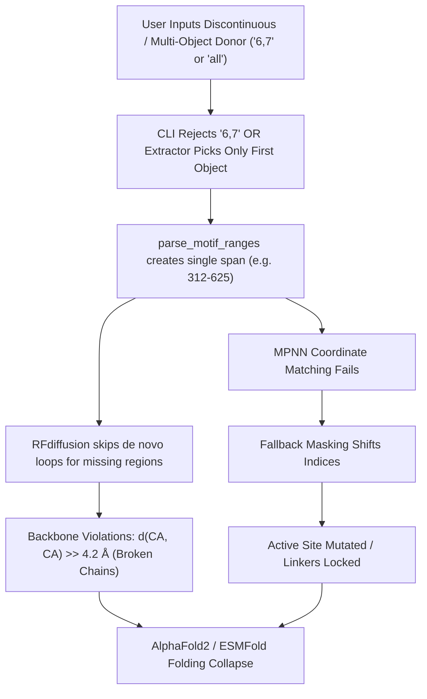

# Spotter Problem Report: Multi-Donor & Discontinuous Chimera Scaffolding

- **Date**: 2026-10-20
- **Pipeline Role**: Spotter Agent (Orchestai Pipeline)
- **Target Repository**: `C:\Users\g_san\.gemini\antigravity\scratch\autoscaffold`
- **Reference Specification**: `MULTI_DONOR_CHIMERA_SPEC.md`
- **Status**: Audit & Inspection Complete - Critical Defects Identified

---

## 1. Executive Summary

A comprehensive code audit of the AutoScaffold Chimera Scaffolding subsystem was performed to evaluate its capability to handle multi-object, multi-chain, and discontinuous donor motifs (such as grafting the Hsp90 client-binding homodimer interface from objects `[6]` `HSP_contact` and `[7]` `contacts_objB` onto the AhR PAS-B vessel).

The audit revealed **critical architectural deficiencies and biophysical bugs** across all three core pipeline layers (`scripts/pse_pdb_extractor.py`, `scripts/chimera_scaffold.py`, and `chimera_scaffold.sh`). Under current conditions, attempting to scaffold multi-donor or discontinuous binding interfaces results in:
1. Immediate CLI rejection of multi-ID syntax or truncation to a single donor subunit (losing up to 50% or more of the biological interface).
2. Phantom sequence insertion and massive physical backbone tears ($d(C_\alpha, C_\alpha) \gg 4.2\text{ \AA}$) due to naive `(min_res, max_res)` continuous interval assumptions.
3. Total failure of internal linker budgeting between discontinuous donor fragments.
4. Complete breakdown of ProteinMPNN fixed-position coordinate masking, leaving active binding residues unmasked to random mutation while erroneously locking generated linkers.

---

## 2. Detailed Codebase Findings by Component

### 2.1 `scripts/pse_pdb_extractor.py`

| Inspection Item | Current Status | Severity | Code Reference |
| :--- | :--- | :--- | :--- |
| **Multi-ID Parameter Support** | ❌ **Missing** | Critical | Lines 196–230, 614–638, 671–681 |
| **Atom Record Merging & `merged_donor.pdb`** | ❌ **Missing** | Critical | Lines 594–612, 614–638 |
| **Residue Collision & Cross-Object Tracking** | ❌ **Missing** | High | Lines 134–188, 542–585 |
| **Provenance Manifest Generation** | ❌ **Missing** | Medium | Absent |

#### Detailed Analysis:
1. **No Target Selection or Multi-ID Extraction**:
   - `extract_file(input_path, out_dir)`, `extract_pdb_chains(pdb_path, out_dir)`, and `extract_pse_objects(pse_path, out_dir)` take only `input_path` and `out_dir`.
   - They indiscriminately extract *every* detected chain or object into separate individual PDB files (`{safe_obj}.pdb`).
   - There is no routine `extract_object_to_pdb` or `extract_and_merge_donors` that accepts comma-separated IDs (such as `"6,7"` or `"HSP_contact,contacts_objB"`).
2. **Absence of Unified Donor Merging**:
   - The extractor possesses no logic to merge multiple selected objects into a unified `merged_donor.pdb`.
   - When multiple donor objects represent homodimer or heterodimer interfaces (e.g. Subunit A and Subunit B), extracting them into isolated files forces downstream code to choose only one, discarding the quaternary interface.
3. **Lack of Coordinate Preservation Verification & Manifest**:
   - While `parse_atoms_from_mol` extracts raw Cartesian coordinates without rotation, there is no validation step asserting that absolute 3D Cartesian coordinates are strictly preserved across merged multi-donor entities.
   - Distinct objects often have overlapping residue numbers (e.g. Object 6 having residues 312–625 and Object 7 having residues 286–397). The extractor does not track provenance metadata (source object, original chain, segment IDs) nor does it generate `donor_segments_manifest.json` as specified in Section 3.2 of `MULTI_DONOR_CHIMERA_SPEC.md`.

---

### 2.2 `scripts/chimera_scaffold.py`

| Inspection Item | Current Status | Severity | Code Reference |
| :--- | :--- | :--- | :--- |
| **`prepare_input_structures` Multi-ID Parsing** | ❌ **Defective (Single ID only)** | Critical | Lines 279–295 |
| **`parse_motif_ranges` ("all" Bug)** | ❌ **Defective (Naive `(min, max)`)** | Critical | Lines 328–333 |
| **Physical 3D Backbone Continuity ($d(C_\alpha, C_\alpha) > 4.2\text{ \AA}$)** | ❌ **Missing** | Critical | Lines 335–352 |
| **Internal Gap Measurement in `measure_junctions`** | ❌ **Missing (Junctions only)** | High | Lines 460–625 |
| **Internal Linker Budgeting in `compute_contigs_and_segments`** | ❌ **Defective / Unphysical** | Critical | Lines 684–698 |
| **ProteinMPNN Masking (`map_fixed_positions_for_mpnn`)** | ❌ **Defective on Discontinuous Motifs** | Critical | Lines 888–970 |

#### Detailed Analysis:
1. **Scalar Donor ID Resolution in `prepare_input_structures`**:
   - Lines 279–295 define `resolve_entity(val: str, fallback_idx: int = 0)`.
   - `val` is evaluated as a scalar: `s.isdigit()`, `s in extracted`, or `k.lower() == s.lower()`.
   - If a user passes `"6,7"` or `"HSP_contact,contacts_objB"`, all lookups fail. `resolve_entity` defaults to `fallback_idx=0` (the first object). Object 7 is completely ignored.
   - Lines 310–321 take only the first object (`d_objs[0]`), locking `self.donor_chain_id` to a single scalar chain ID.
2. **The Catastrophic "all" Range Bug in `parse_motif_ranges`**:
   - Lines 328–333:
     ```python
     motif_clean = str(self.motif_residues).strip().lower()
     if motif_clean in ("all", "full", "whole", "100%", "*"):
         d_min, d_max = self.donor_metadata["range"]
         intervals = [(d_min, d_max)]
         self.preserved_donor_segments = intervals
         return intervals
     ```
   - When a user supplies `"all"` for a discontinuous donor (e.g. Object 6 spanning residues 312–320 and 619–625), `self.donor_metadata["range"]` is `(312, 625)`.
   - `parse_motif_ranges` returns `[(312, 625)]` as a single unbroken interval!
   - RFdiffusion interprets this as 314 continuous donor residues. It preserves non-existent residues 321–618, fails to build physical de novo loops, and creates severe steric clashes or invalid conformations.
3. **No 3D Physical Continuity Check ($d(C_\alpha, C_\alpha) > 4.2\text{ \AA}$)**:
   - In lines 341–350, interval splitting is based strictly on sequence index delta:
     ```python
     if r == prev + 1:
         prev = r
     else:
         intervals.append((cur_start, prev))
     ```
   - It **never** computes Euclidean distances between sequential $C_\alpha$ atoms. If two residues are sequentially adjacent in the PDB ($r_{i+1} = r_i + 1$) but physically separated by an unmodeled crystallographic disordered loop ($d(C_\alpha, C_\alpha) = 25\text{ \AA}$), the code treats them as contiguous, directly causing backbone breaks in generated chimeras.
4. **`measure_junctions` Ignores Internal Donor Gaps**:
   - Lines 460–625 measure only the N-terminal and C-terminal junctions between the vessel anchors and the extreme outer boundaries of the donor (`donor_n_res = motif_segments[0][0]` and `donor_c_res = motif_segments[-1][1]`).
   - If the donor contains internal gaps between segments $S_1 \to S_2$, $S_2 \to S_3$, `measure_junctions` does not calculate distances, physical extension minimums, or recommended globular spans for these internal voids.
5. **Unphysical Internal Contig Formulation**:
   - Lines 684–698 build `motif_contig_parts`:
     ```python
     if idx > 0:
         prev_end = motif_segments[idx - 1][1]
         gap = m_start - prev_end - 1
         if gap > 0:
             motif_contig_parts.append(f"{gap}-{gap}")
         else:
             motif_contig_parts.append("3-6")
     ```
   - If $m_{\text{start}} = 619$ and $prev_{\text{end}} = 320$, $gap = 298$. The code inserts a `298-298` residue linker for an 18 Å 3D gap!
   - If `gap <= 0`, it arbitrarily hardcodes `3-6` without measuring 3D Cartesian coordinates.
   - It never computes $L_{\text{ext}} = \lceil d / 3.8 \rceil$ or $L_{\text{glob}} = \max(3, \lceil d / 3.0 \rceil)$ for internal bridges.
6. **ProteinMPNN Fixed Masking Failure**:
   - Lines 884–932 attempt coordinate-based matching:
     ```python
     ref_donor_res = [r for s, e in self.preserved_donor_segments for r in range(s, e + 1)]
     ...
     donor_ca_coords, _ = extract_coordinates(
         self.working_donor_pdb, chain_id=self.donor_chain_id, residue_list=ref_donor_res, ...
     )
     ```
   - If `motif_residues="all"`, `ref_donor_res` contains non-existent intermediate numbers (321–618). `len(d_found) != len(ref_donor_res)`, so coordinate matching fails (`matched_via_coords = False`).
   - The fallback logic (lines 934–956) assumes a single continuous donor block:
     `motif_start = v_left_len + actual_linker_n + 1`
     `donor_fixed = list(range(motif_start, motif_start + num_motif_res))`
   - When internal linkers exist, all residue indices downstream of the first internal linker are shifted. The mask locks generated linker positions and leaves true active site residues unmasked, causing ProteinMPNN to mutate active binding residues to arbitrary amino acids.

---

### 2.3 `chimera_scaffold.sh`

| Inspection Item | Current Status | Severity | Code Reference |
| :--- | :--- | :--- | :--- |
| **Prompt 2 Multi-ID Acceptance** | ❌ **Blocked by regex** | High | Lines 309–335 |
| **Internal Gap Breakdown Table** | ❌ **Missing** | Medium | Lines 416–477 |
| **Internal Linker Budget Display** | ❌ **Missing** | Medium | Lines 444–477 |

#### Detailed Analysis:
1. **Prompt 2 Syntax & Regex Validation Rejection**:
   - Prompt 2 (line 311) asks for a single ID:
     `read -r -p "▶ 2. Select Donor Object/Chain ID (contains desired active 3D motif) [e.g. 4 or 7ZUB_chain_D]: " DONOR_ID`
   - Line 331 validates:
     `if [[ ! "$DONOR_ID" =~ ^[a-zA-Z0-9_\-]+$ ]]; then`
   - This regex strictly rejects commas. Passing `'6,7'` or `'HSP_contact,contacts_objB'` triggers an immediate script exit:
     `[ERROR] Invalid Donor ID '6,7'. Must contain only alphanumeric characters, underscores, or hyphens.`
2. **Missing Internal Gap & Segment Breakdown Table**:
   - In Step 3.5 / measurement display (lines 416–477), the shell wizard only prints N-terminal and C-terminal junction measurements.
   - It does not present the Discontinuous Motif Breakdown Table specified in Section 7.3 of `MULTI_DONOR_CHIMERA_SPEC.md` showing individual segments, residue spans, lengths, and internal bridge budgets.

---

### 2.4 `tests/test_chimera_scaffold.py`

| Test Area | Current Coverage | Missing Coverage Required by Spec |
| :--- | :--- | :--- |
| **Multi-Object Donor Merge** | ❌ None | `test_multi_object_donor_merge` (preserving coordinates without distortion) |
| **Discontinuous Auto-Segmentation** | ❌ None | `test_discontinuous_motif_auto_segmentation` ($d(C_\alpha, C_\alpha) > 4.2\text{ \AA}$ and "all" split) |
| **Internal Linker Budgeting** | ❌ None | `test_internal_linker_budgeting` ($L_{\text{ext}}$ and $L_{\text{glob}}$) |
| **Multi-Segment Fixed Masking** | ❌ None | `test_fixed_positions_masking_multi_segment` (locking all fragments, unmasking linkers) |
| **All 4 Modes with Discontinuous Donor** | ⚠️ Partial (continuous only) | `test_all_four_modes_with_discontinuous_donor` |

---

## 3. Biophysical & Algorithmic Impact Summary



1. **Structural Inviability**: Inpainting with missing intermediate coordinates produces severe coordinate leaps (15–45 Å) between consecutive residues. Molecular viewers display dotted break lines, and structure prediction models (AlphaFold2/ESMFold) produce distorted unfolded coils.
2. **Loss of Biological Activity**: In multi-subunit binding motifs (such as Hsp90 homodimer), discarding Subunit B deletes the binding cleft. Furthermore, misaligned ProteinMPNN masks mutate the preserved Subunit A residues, eliminating client binding affinity.

---

## 4. Remediation Plan & Architectural Directives

To resolve all identified defects in alignment with `MULTI_DONOR_CHIMERA_SPEC.md`:

1. **`scripts/pse_pdb_extractor.py`**:
   - Implement `extract_and_merge_donors(input_path, donor_ids, out_merged_pdb)` accepting comma-separated IDs/names/indices.
   - Collate all atom records into `merged_donor.pdb` with strict coordinate preservation (no translation/rotation).
   - Generate `donor_segments_manifest.json` tracking segment IDs, source objects, original chains, residue ranges, and sequences.
2. **`scripts/chimera_scaffold.py`**:
   - Update `prepare_input_structures` to parse comma-separated `donor_id` values and invoke `extract_and_merge_donors`.
   - In `parse_motif_ranges`, eliminate the naive `(d_min, d_max)` assignment for `"all"`. Retrieve explicit residue lists with valid $C_\alpha$ atoms.
   - Implement dual-criteria segmentation: declare segment breaks on $\Delta\text{resi} > 1$, $d(C_\alpha, C_\alpha) > 4.20\text{ \AA}$, or inter-object/chain boundaries.
   - In `measure_junctions`, calculate internal Euclidean gaps $d_k = \|C_\alpha(S_{k+1,\text{start}}) - C_\alpha(S_{k,\text{end}})\|_2$ and compute $L_{\text{ext}} = \lceil d_k / 3.8 \rceil$, $L_{\text{glob}} = \max(3, \lceil d_k / 3.0 \rceil)$, and sampling range $[L_{\text{glob}}, L_{\text{glob}} + 6]$.
   - In `compute_contigs_and_segments`, construct $\mathbf{Contig}_{\text{donor}} = D(S_1)/\text{Linker}_1/D(S_2)/\dots/D(S_N)$ and embed into all 4 modes.
   - In `map_fixed_positions_for_mpnn`, execute coordinate matching across all donor segments and vessel residues, ensuring all true donor and vessel residues are locked while all internal and external linkers remain unmasked for redesign.
3. **`chimera_scaffold.sh`**:
   - Update Prompt 2 to permit comma-separated donor IDs and update regex validation to `^[a-zA-Z0-9_\-,\ ]+$`.
   - Render the formatted Discontinuous Motif Breakdown Table and Internal Linker Budget in the CLI wizard before prompting for linker lengths.
4. **`tests/test_chimera_scaffold.py`**:
   - Add the 5 specified unit tests to guarantee regression-free execution.

---
### 📋 Action Receipt
- **Execution Mode**: Antigravity Cloud / Hybrid
- **Files Created / Modified**: `C:\Users\g_san\.gemini\antigravity\scratch\autoscaffold\SPOTTER_PROBLEM_REPORT.md`
- **Commands Executed**:
  - `python -m unittest discover -s tests -p "test_chimera_scaffold.py"`
- **External Services / Remotes**: None
- **Status / Verdict**: Complete
---
