# Technical Specification: Universal Neural Environment Discovery, Deep Capability Scanning & Interactive Auto-Healing

- **Target Systems**: AutoScaffold Suite (`scripts/chimera_stages/stage4_runners.py`, `scripts/env_setup.sh`, `chimera_scaffold.sh`, `scripts/chimera_scaffold.py`, `tests/test_chimera_scaffold.py`)
- **Document ID**: `NEURAL_ENV_DISCOVERY_AND_AUTOHEAL_SPEC`
- **Architecture Pattern**: Dynamic Multi-Drive Package Manifest Resolution, Deep Capability Fallback Probing, Pre-Flight Self-Healing Interactive Wizard, and Clean CLI Fault Barrier
- **Author**: Prompt Polisher (Orchestai Pipeline - Step 1)
- **Status**: Approved for Implementation

---

## 1. Executive Summary & OrchestAI Diagnostic Dossier Analysis

### 1.1 Problem Context & Failure Dossier
During runtime execution of **Option [4] Chimera Scaffolding** on multi-partition Linux compute hosts (e.g. `/data1`, `/data2`, `/mnt/...`), AutoScaffold failed with an unhandled exception:

```text
[*] Attempting to activate environment: SE3nv...
[!] Notice: Conda activation for 'SE3nv' could not be completed. Falling back to direct interpreter resolution.

====================================================================================================
 🛑 [AUTOSCAFFOLD ERROR]: MISSING NEURAL MODEL DEPENDENCIES IN RESOLVED PYTHON INTERPRETER
====================================================================================================
 Target Engine:      RFdiffusion
 Resolved Python:    /data1/mgs/micromamba/envs/ambertools/bin/python3.10
 Missing Module(s):  torch, hydra
...
Traceback (most recent call last):
  File ".../scripts/chimera_scaffold.py", line 1088, in <module>
    main()
  File ".../scripts/chimera_scaffold.py", line 1083, in main
    res = scaffolder.run_pipeline()
  File ".../scripts/chimera_scaffold.py", line 653, in run_pipeline
    probe_res = probe_fn(
  File ".../scripts/chimera_stages/stage4_runners.py", line 360, in probe_python_environment
    raise EnvironmentError(
OSError: RFdiffusion Python interpreter '/data1/mgs/micromamba/envs/ambertools/bin/python3.10' lacks required modules: torch, hydra
```

### 1.2 Root Cause Decomposition
A comprehensive architectural audit identified four compounding defects across the launcher and runtime stages:

1. **Partition & Manifest Blindness in Root Discovery (`stage4_runners.py` & `env_setup.sh`)**:
   - `get_all_environment_roots()` and `env_setup.sh` only scan hardcoded paths under the user home directory (`~/.micromamba`, `~/miniconda3`, `~/anaconda3`), system defaults (`/opt/conda`), and a corrupted path concatenation `os.path.join(conda_prefix, "..", "envs")`.
   - When the user's active `CONDA_PREFIX` is located on an alternate partition (such as `/data1/mgs/micromamba/envs/ambertools`), `os.path.join(conda_prefix, "..", "envs")` produces `/data1/mgs/micromamba/envs/ambertools/../envs` = `/data1/mgs/micromamba/envs/envs`, which does not exist! The actual enclosing environment root directory `/data1/mgs/micromamba/envs` is completely missed.
   - Neither system queries the package manager registries (`micromamba env list --json` or `conda info --envs --json`). Consequently, any environment located on non-standard mount points (`/data1`, `/mnt`, secondary NVMe, network drives) is invisible unless explicitly pre-configured.

2. **Absence of Capability-Based Environment Scanning (`stage4_runners.py`)**:
   - `resolve_execution_runner()` strictly scans target environment directories matching exact pre-defined names (`SE3nv`, `rfdiffusion`).
   - If an environment has an alternate name (e.g., `rf_diffusion`, `se3nv_cu12`, `prot_foundry`, or a unified `mlfold` containing PyTorch and Hydra), or if `SE3nv` is absent, the resolver falls back to `CONDA_PREFIX` (which happened to be `ambertools`, a molecular dynamics toolchain without PyTorch or Hydra) or `sys.executable`. It never examines other installed environments for module capabilities.

3. **No Interactive Pre-Flight Healing in Shell Wizard (`chimera_scaffold.sh`)**:
   - When Conda/Micromamba subshell activation fails, `chimera_scaffold.sh` emits a brief notice and blindly launches Python.
   - In interactive mode, rather than crashing downstream during heavy execution, the wizard should detect missing prerequisites and offer instant interactive remediation options (install environment, scan system, specify custom interpreter, or enter dry-run mode).

4. **Raw Python Traceback Leakage in CLI Entrypoint (`scripts/chimera_scaffold.py`)**:
   - `display_dependency_alert()` in `stage4_runners.py` renders a polished error banner. However, because `probe_python_environment()` raises `EnvironmentError(OSError)` and `main()` in `chimera_scaffold.py` has no exception guard, the Python interpreter dumps an unhandled 15-line stack trace to `stderr`. This degrades user experience and obfuscates the diagnostic banner.

---

## 2. End-to-End System Architecture

```mermaid
flowchart TD
    subgraph "Launcher & Interactive Pre-Flight (chimera_scaffold.sh)"
        Start["Shell Invocation<br/>(chimera_scaffold.sh)"] --> SourceEnv["source scripts/env_setup.sh"]
        SourceEnv --> PreFlightCheck{"Pre-Flight Neural Check:<br/>Is RFdiffusion Python verified<br/>with torch & hydra?"}
        PreFlightCheck -->|Yes| LaunchPy["Assemble CMD_ARGS and Execute Python"]
        PreFlightCheck -->|No| IsTTY{"Interactive TTY session?<br/>[ -t 0 ] and not dry-run"}
        IsTTY -->|No: Headless/CI| LaunchPy
        IsTTY -->|Yes| ShowMenu["Present Interactive Healing Menu:<br/>[1] Install SE3nv now<br/>[2] Deep scan system<br/>[3] Enter custom path<br/>[4] Dry-run mode<br/>[0] Cancel cleanly"]
        ShowMenu --> MenuChoice{"User Choice"}
        MenuChoice -->|Option 1| RunInstall["Execute install.sh / install_dependencies.sh"] --> ReCheck["Re-verify interpreter"] --> PreFlightCheck
        MenuChoice -->|Option 2| DeepScanBash["Trigger deep package manifest scan"] --> ScanFound{"Found candidate?"}
        ScanFound -->|Yes| ExportPy["Export PYTHON_RFDIFF & offer config.env save"] --> LaunchPy
        ScanFound -->|No| ShowMenu
        MenuChoice -->|Option 3| PromptPath["Prompt user for python executable path"] --> ValidatePath{"Validates torch & hydra?"}
        ValidatePath -->|Yes| ExportPy
        ValidatePath -->|No| ShowMenu
        MenuChoice -->|Option 4| SetDryRun["Append --dry_run flag"] --> LaunchPy
        MenuChoice -->|Option 0| CleanExit["Exit 0 (Operation Cancelled)"]
    end

    subgraph "Universal Multi-Drive Discovery & Deep Probe (stage4_runners.py)"
        LaunchPy --> ScaffolderInit["ChimeraScaffolder.__init__()"]
        ScaffolderInit --> ResolveRunner["resolve_execution_runner(tool='RFdiffusion')"]
        ResolveRunner --> QueryManifests["Query Package Managers:<br/>micromamba env list --json<br/>conda info --envs --json"]
        QueryManifests --> InferRoots["Infer Parent Roots:<br/>e.g. /data1/mgs/micromamba/envs/ambertools<br/>-> Root: /data1/mgs/micromamba/envs"]
        InferRoots --> DedupeRoots["Deduplicate & Validate Roots<br/>(Exclude / and OS root escapes)"]
        DedupeRoots --> Tier1To4["Tiers 1-4: Explicit, EnvVar, Active Prefix, Named Envs"]
        Tier1To4 --> FoundNamed{"Valid Runner Found?"}
        FoundNamed -->|Yes| ReturnRunner["Return RunnerSpec(is_valid=True)"]
        FoundNamed -->|No| CheckStrict{"strict_python=True?"}
        CheckStrict -->|Yes| ReturnFirstInvalid["Return First Invalid Spec"]
        CheckStrict -->|No| Tier4b["Tier 4b: Deep Capability-Based Scan<br/>Probe all environments across all roots<br/>for required modules (torch, hydra)"]
        Tier4b --> FoundDeep{"Discovered Capability Match?"}
        FoundDeep -->|Yes| ReturnRunner
        FoundDeep -->|No| ReturnFirstInvalid
    end

    subgraph "Execution Guard & Traceback Elimination (chimera_scaffold.py)"
        ReturnRunner --> RunPipeline["scaffolder.run_pipeline()"]
        ReturnFirstInvalid --> RunPipeline
        RunPipeline --> ExecProbe["probe_python_environment(raise_on_error=True)"]
        ExecProbe --> ProbePass{"All modules present?"}
        ProbePass -->|Yes| ExecutePipelineSteps["Execute RFdiffusion / MPNN Pipeline"]
        ProbePass -->|No| DisplayAlert["display_dependency_alert() (Banner)"] --> RaiseEnvErr["raise EnvironmentError(...)"]
        RaiseEnvErr --> CatchMain["main() Exception Guard:<br/>except EnvironmentError as err"]
        CatchMain --> OutputRemedy["Print human-friendly remedy summary to stderr"]
        OutputRemedy --> ExitOne["sys.exit(1) (NO TRACEBACK)"]
    end
```



---

## 3. Specification 1: Universal Multi-Drive / Custom Partition Root Discovery

### 3.1 Python Discovery Engine (`scripts/chimera_stages/stage4_runners.py`)

#### 3.1.1 Problem Statement
`get_all_environment_roots()` assumes environments only exist within `$HOME` subdirectories or `/opt/conda`. Furthermore, line 547 (`roots.append(os.path.join(conda_prefix, "..", "envs"))`) evaluates to `.../envs/envs` whenever `CONDA_PREFIX` is inside an `envs/` subdirectory.

#### 3.1.2 Algorithmic Contract for `get_all_environment_roots(use_cache: bool = True) -> List[str]`
1. **Parent Root Detection from Active and Discovered Prefixes**:
   - Inspect `CONDA_PREFIX`, `MAMBA_ROOT_PREFIX`, and any environment directory passed via `LOCAL_ENVS_DIR`.
   - For any path `P`, calculate `parent = os.path.dirname(P)`.
   - If `os.path.basename(parent) == "envs"`, add `parent` directly as an environment root!
   - Calculate `grandparent = os.path.dirname(parent)`. If `os.path.isdir(os.path.join(grandparent, "envs"))`, add `os.path.join(grandparent, "envs")`.
   - If `os.path.basename(P) != "envs"` and `os.path.isdir(os.path.join(P, "envs"))`, add `os.path.join(P, "envs")`.

2. **Package Manager Environment Manifest Querying**:
   - Dynamically discover package manager binaries using `find_environment_managers()`.
   - For `micromamba`:
     - Execute `[micromamba_bin, "env", "list", "--json"]` with `timeout=2.0`.
     - Parse JSON key `envs: List[str]`.
     - For each registered environment path `env_path`:
       - If `os.path.basename(os.path.dirname(env_path)) == "envs"`, record `os.path.dirname(env_path)`.
       - Record `env_path` itself in an auxiliary manifest environment registry.
   - For `conda` / `mamba`:
     - Execute `[conda_bin, "info", "--envs", "--json"]` or `[conda_bin, "env", "list", "--json"]` with `timeout=2.0`.
     - Parse JSON key `envs: List[str]`.
     - Extract enclosing `envs` root directories and manifest environment paths.
   - Fallback: If `--json` invocation fails or produces invalid JSON, parse stdout lines formatted as `<env_name> <path>` or `<path>`.

3. **Exclusion & Security Invariants**:
   - Every candidate root MUST be canonicalized via `os.path.realpath(os.path.expanduser(os.path.expandvars(r)))`.
   - Reject any path matching filesystem root escapes: `/`, `\`, `//`, `\\`, drive roots (`C:\`, `D:\`), or empty strings.
   - Reject paths containing shell injection tokens (`_RE_SHELL_INJECTION`).
   - Only directories that exist (`os.path.isdir(r)`) and are readable shall be returned.
   - Preserve deduplicated insertion order (`seen = set()`).
   - Cache results in module-level `_CACHED_ROOTS` and synchronize via `_sync_caches_to_facade()`.

### 3.2 Shell Discovery Engine (`scripts/env_setup.sh`)

#### 3.2.1 Problem Statement
`discover_conda_python()` in `scripts/env_setup.sh` defaults parameter `enable_deep` to `0`, preventing manifest introspection. When called in `env_setup.sh` lines 529-530, it fails to find environments across custom partitions.

#### 3.2.2 Algorithmic Contract for `discover_conda_python()`
Function signature:
```bash
discover_conda_python() {
    local target_env="$1"
    local req_module="${2:-}"
    local enable_deep="${3:-1}"   # Default deep search to enabled (1)
    ...
}
```

1. **Parent Partition Root Inference**:
   - If `CONDA_PREFIX` is set:
     ```bash
     local prefix_parent
     prefix_parent="$(dirname "$CONDA_PREFIX")"
     if [ "$(basename "$prefix_parent")" = "envs" ]; then
         _SCAN_ROOTS+=("$prefix_parent")
     elif [ -d "$CONDA_PREFIX/envs" ]; then
         _SCAN_ROOTS+=("$CONDA_PREFIX/envs")
     fi
     ```
2. **Package Manager Manifest Interrogation**:
   - Inspect package managers in order: `micromamba`, `conda`, `mamba`.
   - Query environment list:
     ```bash
     if command -v micromamba >/dev/null 2>&1; then
         # Extract registered environment paths matching target_env
         micromamba env list --json 2>/dev/null | ...
     elif command -v conda >/dev/null 2>&1; then
         conda info --envs 2>/dev/null | awk ...
     fi
     ```
   - For any resolved environment directory matching `$target_env`, verify Python binary via `_verify_python "$cand"`.

---

## 4. Specification 2: Deep Capability-Based Environment Scanning

### 4.1 Resolution Tier Architecture in `stage4_runners.py`

`resolve_execution_runner()` must implement a 6-tier discovery strategy:

| Tier | Name | Target Scanned | Early Exit Condition |
| :--- | :--- | :--- | :--- |
| **Tier 1** | Explicit Target | User CLI / constructor flag (`--python_rfdiff`) | Immediate return if valid |
| **Tier 2** | Environment Variables | `$PYTHON_RFDIFF`, `$RFDIFF_PYTHON` | Immediate return if valid (CUDA match priority) |
| **Tier 3** | Active Conda Prefix | `$CONDA_PREFIX` (`bin/python`) | Early return if CUDA matches; record `first_invalid_spec` if missing dependencies |
| **Tier 4** | Named Environment Scan | Known names (`SE3nv`, `rfdiffusion`) across all roots | Early return if CUDA matches; queue CPU fallbacks |
| **Tier 4b** | **Deep Capability Scan** | **All directories in all roots + manifest environments** | **Probe for `req_mods` (`torch`, `hydra`). Return first valid candidate (GPU > CPU)** |
| **Tier 5** | Host Interpreter | `sys.executable` (`/usr/bin/python3`) | Return if valid; else return `first_invalid_spec` |

### 4.2 Detailed Contract for Tier 4b Deep Scanning

```python
# Tier 4b: Deep Capability-Based Environment Scan (when strict=False)
if not strict and not cpu_fallback_runners:
    candidate_env_dirs: List[Tuple[str, str]] = [] # [(env_name, env_dir), ...]
    
    # 1. Collect all child directories from discovered roots
    for root in all_roots:
        if not os.path.isdir(root):
            continue
        try:
            with os.scandir(root) as it:
                for entry in it:
                    if entry.is_dir() and not entry.name.startswith("."):
                        candidate_env_dirs.append((entry.name, entry.path))
        except (PermissionError, OSError):
            continue

    # 2. Collect environments from package manager manifest cache
    for manifest_env in get_manifest_environments():
        env_name = os.path.basename(manifest_env)
        if (env_name, manifest_env) not in candidate_env_dirs:
            candidate_env_dirs.append((env_name, manifest_env))

    # 3. Capability-probe candidate interpreters
    for env_name, env_dir in candidate_env_dirs:
        # Avoid re-probing target_env_names already tested in Tier 4
        if env_name in (target_env_names or []):
            continue
            
        for rel in ["bin/python", "python.exe", "Scripts/python.exe"]:
            cand = os.path.join(env_dir, rel)
            if not os.path.isfile(cand):
                continue
            spec = test_candidate(cand_bin=cand, env_name=env_name, env_prefix=env_dir)
            if spec:
                if spec.cuda_available:
                    return spec  # Found deep environment with GPU acceleration!
                cpu_fallback_runners.append(spec)
                break
```

### 4.3 Strict Mode Contract
- When `strict=True` is provided (e.g., via `--strict_python` CLI flag), Tier 4b MUST be skipped entirely.
- This guarantees that automated validation pipelines or users who mandate an exact environment name (such as production cluster containers) can enforce strict isolation.

---

## 5. Specification 3: Interactive Pre-Flight Environment Resolution & Healing

### 5.1 Pre-Flight Check in `chimera_scaffold.sh`

Before assembling command arguments and launching the Python runtime, `chimera_scaffold.sh` will execute `preflight_neural_environment_check`.

### 5.2 Verification Logic

```bash
preflight_neural_environment_check() {
    # If dry-run requested, bypass neural environment enforcement
    if [ "${DRY_RUN:-0}" -eq 1 ] || [[ " $* " =~ " --dry_run " ]]; then
        return 0
    fi

    # Check if PYTHON_RFDIFF is set and operational
    if [ -n "${PYTHON_RFDIFF:-}" ] && [ -x "$PYTHON_RFDIFF" ]; then
        if "$PYTHON_RFDIFF" -c "import torch, hydra" >/dev/null 2>&1; then
            return 0
        fi
    fi

    # Check if active environment possesses required modules
    if [ -n "${CONDA_PREFIX:-}" ] && [ -x "$CONDA_PREFIX/bin/python" ]; then
        if "$CONDA_PREFIX/bin/python" -c "import torch, hydra" >/dev/null 2>&1; then
            export PYTHON_RFDIFF="$CONDA_PREFIX/bin/python"
            return 0
        fi
    fi

    # Check if discover_conda_python can resolve a candidate
    local disc_py
    disc_py="$(discover_conda_python "${CONDA_ENV_RFDIFF:-SE3nv}" "torch" 1 2>/dev/null || true)"
    if [ -n "$disc_py" ] && [ -x "$disc_py" ]; then
        if "$disc_py" -c "import torch, hydra" >/dev/null 2>&1; then
            export PYTHON_RFDIFF="$disc_py"
            return 0
        fi
    fi

    # If verification failed:
    if [ -t 0 ] && [ "${NON_INTERACTIVE:-0}" -ne 1 ]; then
        interactive_environment_healing_menu
        return $?
    fi

    # Non-interactive / headless fallback: continue to python entrypoint for clean error barrier
    return 0
}
```

### 5.3 Interactive Healing Menu UI Specification

When `interactive_environment_healing_menu` is invoked, it renders the following interface:

```text
================================================================================
 ⚠️  [AUTOSCAFFOLD PRE-FLIGHT] NEURAL ENVIRONMENT RESOLUTION ALERT
================================================================================
 Target Tool:       RFdiffusion
 Required Modules:  torch, hydra
 Current Status:    No verified Python interpreter found for 'SE3nv'.
 Current Prefix:    /data1/mgs/micromamba/envs/ambertools (Lacks torch, hydra)
--------------------------------------------------------------------------------
 AutoScaffold cannot run neural backbone generation without PyTorch & Hydra.
 Please choose an action:

   [1] Build/Install 'SE3nv' environment now (runs install.sh)
   [2] Deep Scan system for any Python interpreter providing PyTorch & Hydra
   [3] Specify custom Python interpreter path
   [4] Run in Dry-Run mode (--dry_run)
   [0] Cancel cleanly and exit
--------------------------------------------------------------------------------
 Choice [1-4, 0]: 
```

#### Detailed Option Behaviors:
1. **Option [1] (Build / Install)**:
   - Invokes: `bash "$SCRIPT_DIR/install.sh" --env "${CONDA_ENV_RFDIFF:-SE3nv}"` or `bash "$SCRIPT_DIR/scripts/install_dependencies.sh"`.
   - Upon completion with status code 0, re-executes `discover_conda_python`.
   - If verified, sets `PYTHON_RFDIFF` and resumes pipeline execution.
2. **Option [2] (Deep Scan)**:
   - Executes Python capability probe helper:
     `"$PYTHON_BIN" "$SCRIPT_DIR/scripts/chimera_scaffold.py" scan_environments`
   - Displays all discovered Python environments containing `torch` and `hydra`.
   - Allows user to select from a numbered list of candidates.
   - Optionally appends `PYTHON_RFDIFF="/path/selected"` to `$SCRIPT_DIR/config.env` for permanent persistence.
3. **Option [3] (Custom Path)**:
   - Prompts: `Enter absolute path to Python binary: `.
   - Strips whitespace and quotes; canonicalizes path.
   - Tests binary with: `"$custom_py" -c "import torch, hydra"`.
   - If successful: exports `PYTHON_RFDIFF="$custom_py"` and offers to save to `config.env`.
   - If failed: prints clear reason (`Missing module(s)` or `Not an executable`) and re-prompts menu.
4. **Option [4] (Dry-Run Mode)**:
   - Appends `--dry_run` to `CMD_ARGS`.
   - Emits yellow warning: `[!] Proceeding in Dry-Run mode. Backbone generation will be simulated.`
   - Allows user to inspect geometry, contig formula, and merged seed PDB without neural dependencies.
5. **Option [0] (Cancel Cleanly)**:
   - Prints: `[!] Operation aborted by user.`
   - Returns exit code `0` (or `130` if SIGINT received).

---

## 6. Specification 4: Traceback Elimination & Clean CLI Failure

### 6.1 Problem Statement
When `probe_python_environment()` raises `EnvironmentError(OSError)`, `scripts/chimera_scaffold.py` allows the exception to escape `main()`. This causes Python to print:

```text
Traceback (most recent call last):
  File ".../scripts/chimera_scaffold.py", line 1088, in <module>
    main()
  File ".../scripts/chimera_scaffold.py", line 1083, in main
    res = scaffolder.run_pipeline()
  File ".../scripts/chimera_scaffold.py", line 653, in run_pipeline
    probe_res = probe_fn(...)
  File ".../scripts/chimera_stages/stage4_runners.py", line 360, in probe_python_environment
    raise EnvironmentError(...)
OSError: RFdiffusion Python interpreter '/data1/mgs/micromamba/envs/ambertools/bin/python3.10' lacks required modules: torch, hydra
```

### 6.2 Implementation Contract in `scripts/chimera_scaffold.py`

Modify `main()` in `scripts/chimera_scaffold.py` to establish an airtight fault barrier:

```python
def main():
    parser = argparse.ArgumentParser(
        description="AutoScaffold Chimera: Hybrid Motif Scaffolding Engine",
        formatter_class=argparse.ArgumentDefaultsHelpFormatter,
    )
    # ... argument configurations remain identical ...

    try:
        scaffolder = ChimeraScaffolder(
            # ... arguments ...
        )
        res = scaffolder.run_pipeline()
        print(json.dumps(res, indent=2))
        sys.exit(0)
    except EnvironmentError as env_err:
        # display_dependency_alert() has already rendered the formatted alert banner.
        # We output a concise, actionable remedy summary to stderr without any traceback.
        sys.stderr.write(f"\n\033[0;31m[ERROR] Environment validation failed:\033[0m {env_err}\n")
        sys.stderr.write("\033[1;33m[REMEDY]\033[0m To resolve this issue, you can:\n")
        sys.stderr.write("  1. Specify a valid interpreter with --python_rfdiff /path/to/SE3nv/bin/python\n")
        sys.stderr.write("  2. Export PYTHON_RFDIFF=/path/to/valid/python in your shell or config.env\n")
        sys.stderr.write("  3. Run 'bash install.sh' to automatically configure the SE3nv environment\n")
        sys.stderr.write("  4. Run with --dry_run to prepare seed structures without neural execution\n\n")
        sys.exit(1)
    except KeyboardInterrupt:
        sys.stderr.write("\n\033[1;33m[!] Pipeline execution cancelled by user.\033[0m\n")
        sys.exit(130)
    except Exception as exc:
        # Unexpected fatal logic errors retain diagnostic traceback for debugging
        sys.stderr.write(f"\n\033[0;31m[FATAL ERROR]\033[0m {exc}\n")
        raise
```

### 6.3 Exit Status Matrix
- `0`: Pipeline completed successfully or cancelled via explicit menu choice `[0]`.
- `1`: Environment / dependency validation error, missing input file, or invalid biological parameter.
- `130`: Terminated via `Ctrl+C` (`SIGINT`).

---

## 7. Specification 5: Backward Compatibility & Testing Strategy

### 7.1 Preservation of Existing Contracts
1. **CLI Flags & Signatures**:
   - Preserve `--python_rfdiff`, `--python_mpnn`, `--python_colabfold`, `--strict_python`, `--dry_run`, `--out_dir`.
   - Maintain function signatures:
     - `get_all_environment_roots(use_cache: bool = True) -> List[str]`
     - `resolve_execution_runner(...) -> RunnerSpec`
     - `probe_python_environment(...) -> Dict[str, Any]`
     - `discover_conda_python(target_env, req_module, enable_deep)`
2. **Environment Variable Hierarchy**:
   `--python_rfdiff` > `$PYTHON_RFDIFF` > `$RFDIFF_PYTHON` > `$CONDA_ENV_RFDIFF` > Deep Capability Discovery > Fallback.

### 7.2 Unit Test Matrix (`tests/test_chimera_scaffold.py`)

The test suite must be expanded with five dedicated test cases:

```python
class TestNeuralEnvDiscoveryAndAutoheal(unittest.TestCase):

    def test_get_all_environment_roots_discovers_custom_partition_and_manifest(self):
        """Verify get_all_environment_roots discovers roots from custom partitions and manifests."""
        from scripts.chimera_stages.stage4_runners import get_all_environment_roots, clear_environment_cache
        
        clear_environment_cache()
        with patch.dict(os.environ, {"CONDA_PREFIX": "/data1/mgs/micromamba/envs/ambertools"}):
            with patch("os.path.isdir") as mock_isdir:
                mock_isdir.side_effect = lambda p: p in [
                    "/data1/mgs/micromamba/envs",
                    "/data1/mgs/micromamba/envs/ambertools",
                ]
                roots = get_all_environment_roots(use_cache=False)
                # Verify that /data1/mgs/micromamba/envs is detected as a valid root
                self.assertIn("/data1/mgs/micromamba/envs", roots)
                # Ensure no invalid ".../envs/envs" paths are produced
                self.assertNotIn("/data1/mgs/micromamba/envs/envs", roots)

    def test_resolve_execution_runner_deep_capability_scan(self):
        """Verify resolve_execution_runner rescues missing SE3nv by discovering alternative torch+hydra env."""
        from scripts.chimera_stages.stage4_runners import resolve_execution_runner, RunnerSpec, clear_probe_cache
        
        clear_probe_cache()
        roots = ["/data1/mgs/micromamba/envs"]
        
        def mock_probe(runner_or_bin, required_modules=None, **kwargs):
            s = str(runner_or_bin)
            if "prot_foundry" in s:
                return {"missing_modules": [], "cuda_available": True, "torch_version": "2.2.0"}
            return {"missing_modules": required_modules or [], "cuda_available": False}

        with patch("scripts.chimera_scaffold.get_all_environment_roots", return_value=roots), \
             patch("os.scandir") as mock_scandir, \
             patch("os.path.isfile", return_value=True), \
             patch("os.path.isdir", return_value=True), \
             patch("scripts.chimera_scaffold.probe_python_environment", side_effect=mock_probe):
             
            # Create mock ScandirEntry for alternative env 'prot_foundry'
            entry = MagicMock()
            entry.is_dir.return_value = True
            entry.name = "prot_foundry"
            entry.path = "/data1/mgs/micromamba/envs/prot_foundry"
            mock_scandir.return_value.__enter__.return_value = [entry]

            runner = resolve_execution_runner(
                explicit_target=None,
                env_var_keys=[],
                target_env_names=["SE3nv"],
                required_modules=["torch", "hydra"],
                tool_label="RFdiffusion",
                strict=False,
            )
            self.assertTrue(runner.is_valid)
            self.assertTrue(runner.cuda_available)
            self.assertIn("prot_foundry", runner.display_label())

    def test_resolve_execution_runner_strict_mode_bypasses_deep_scan(self):
        """Verify resolve_execution_runner skips deep capability scan when strict=True."""
        from scripts.chimera_stages.stage4_runners import resolve_execution_runner
        
        roots = ["/data1/mgs/micromamba/envs"]
        with patch("scripts.chimera_scaffold.get_all_environment_roots", return_value=roots), \
             patch("os.scandir") as mock_scandir, \
             patch("scripts.chimera_scaffold.probe_python_environment", return_value={"missing_modules": ["torch"]}):
            
            runner = resolve_execution_runner(
                explicit_target=None,
                env_var_keys=[],
                target_env_names=["SE3nv"],
                required_modules=["torch", "hydra"],
                tool_label="RFdiffusion",
                strict=True,
            )
            self.assertFalse(runner.is_valid)
            # Scandir should not have been called for deep scanning
            mock_scandir.assert_not_called()

    def test_main_cli_environment_error_handling_no_traceback(self):
        """Verify scripts/chimera_scaffold.py main() catches EnvironmentError and exits with code 1."""
        from scripts.chimera_scaffold import main
        import sys
        
        test_args = ["chimera_scaffold.py", "--input_file", "dummy.pdb"]
        with patch.object(sys, "argv", test_args), \
             patch("scripts.chimera_scaffold.ChimeraScaffolder.run_pipeline", side_effect=EnvironmentError("Missing torch, hydra")), \
             patch("sys.stderr.write") as mock_stderr, \
             self.assertRaises(SystemExit) as exit_ctx:
            main()
            
        self.assertEqual(exit_ctx.exception.code, 1)
        # Verify remedy was written to stderr
        err_output = "".join([call[0][0] for call in mock_stderr.call_args_list])
        self.assertIn("[ERROR] Environment validation failed", err_output)
        self.assertIn("[REMEDY]", err_output)
```

---

## 8. Implementation Plan & File Touch Map

| File Path | Component | Changes Required |
| :--- | :--- | :--- |
| `scripts/chimera_stages/stage4_runners.py` | Universal Root Discovery & Deep Scan | 1. Fix `os.path.join(conda_prefix, "..", "envs")` path bug by correctly checking `os.path.basename(parent) == "envs"`.<br/>2. Add manifest queries (`micromamba env list --json`, `conda info --envs --json`).<br/>3. Implement Tier 4b Deep Capability Scanning in `resolve_execution_runner()`. |
| `scripts/env_setup.sh` | Shell Environment Resolution | 1. Infer parent roots from `CONDA_PREFIX`.<br/>2. Interrogate `micromamba`/`conda` manifests in `discover_conda_python()`.<br/>3. Default `enable_deep=1` in `discover_conda_python()`. |
| `chimera_scaffold.sh` | Pre-Flight Validation & Healing Menu | 1. Implement `preflight_neural_environment_check`.<br/>2. Add interactive 5-option healing menu (`[1]` Install, `[2]` Deep Scan, `[3]` Custom Path, `[4]` Dry Run, `[0]` Cancel).<br/>3. Wire option persistence to `config.env`. |
| `scripts/chimera_scaffold.py` | CLI Fault Barrier | 1. Wrap `scaffolder.run_pipeline()` in `main()` with `try/except EnvironmentError`.<br/>2. Suppress raw traceback and output concise remedy to `stderr`.<br/>3. Return exit code 1 on environment failure and 130 on SIGINT. |
| `tests/test_chimera_scaffold.py` | Unit & Regression Tests | Add test suite `TestNeuralEnvDiscoveryAndAutoheal` covering custom partition discovery, manifest queries, deep capability scanning, strict mode honoring, and CLI error handling. |

---

## 9. Conclusion & Pipeline Readiness
This specification establishes a robust, self-healing foundation that prevents path-traversal vulnerabilities, repairs partition blindness across distributed mount points, rescues orphaned neural workflows through capability-based scanning, and provides a polished, interactive recovery experience for end users.

Proceed to Orchestai Pipeline Step 2 (Architecture & Plan Verification).
