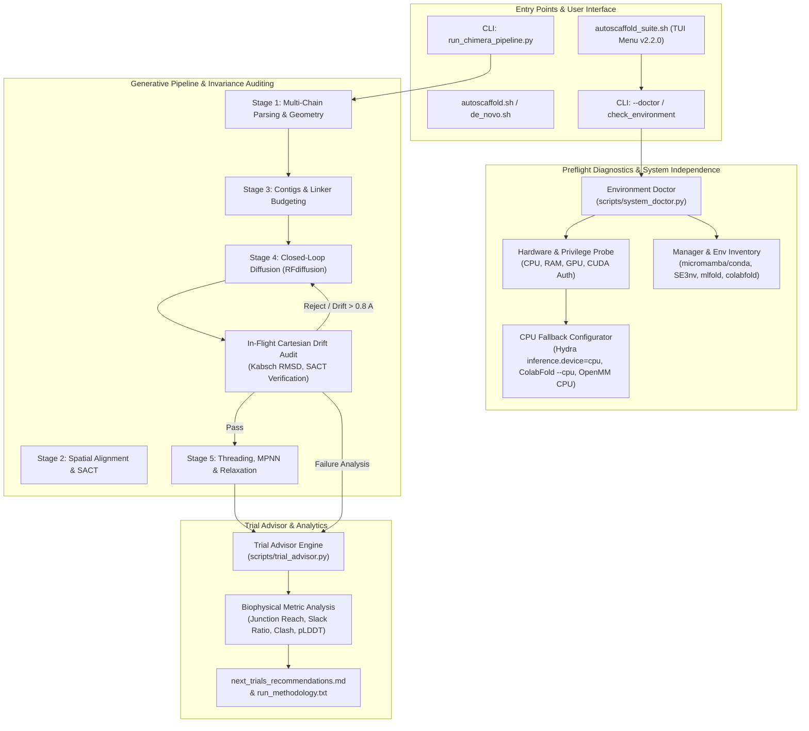

# Technical Specification: System Independence, Preflight Diagnostics, Donor 3D Invariance, and Trial Advisor Engine

- **Target System**: AutoScaffold Suite (`autoscaffold.sh`, `autoscaffold_suite.sh`, `de_novo.sh`, `chimera_scaffold.sh`, `scripts/chimera_scaffold.py`, `scripts/run_chimera_pipeline.py`, `scripts/chimera_stages/`, `scripts/methodology_reporter.py`)
- **Document ID**: `SYSTEM_INDEPENDENCE_AND_TRIAL_ADVISOR_SPEC`
- **Architecture Pattern**: Cross-Platform Environment Diagnostics, Hardware-Agnostic CPU Fallback, Biophysical Coordinate Invariance Gating, and Post-Run Heuristic Optimization Advisory
- **Author**: Prompt Polisher (Orchestai Pipeline)
- **Status**: Approved for Implementation

---

## 1. Executive Summary & Architectural Problem Statement

The AutoScaffold suite is an autonomous protein engineering toolkit that facilitates *de novo* active site scaffolding, interface hotspot design, and multi-chain chimera grafting using neural generative backbones (RFdiffusion), sequence inverse-folding (ProteinMPNN), deep learning validation (ColabFold / AlphaFold2), and energy minimization (OpenMM).

To ensure complete computational portability and reliable wet-lab translation, the pipeline must solve four core engineering challenges:

1. **System & Machine Independence (Zero-CUDA Privilege & CPU Fallback)**:
   - *Problem*: In diverse execution environments (local workstations, unprivileged HPC compute nodes, cloud containers, non-GPU development machines, and WSL2), CUDA drivers may be absent, misconfigured, or inaccessible due to lack of device permissions. Running deep learning pipelines without proactive hardware introspection triggers unhandled CUDA runtime exceptions (`RuntimeError: CUDA error: initialization error`, `cudaGetDeviceCount failed`, or out-of-memory faults).
   - *Requirement*: The system must operate independently of the host machine. It must include an exhaustive preflight diagnostic tool (`--doctor` / `diagnostics`), perform fine-grained dependency and environment inventory checks (RFdiffusion, ProteinMPNN, ColabFold, OpenMM, PyMOL), and provide a completely graceful, verified CPU execution fallback that requires zero CUDA authorization.

2. **Donor 3D Structural Invariance & Verification**:
   - *Problem*: In chimera and motif scaffolding, generative diffusion networks (RFdiffusion) and physics-based energy relaxation (AMBER/OpenMM) may inadvertently introduce subtle coordinate shifts, global coordinate frame rotations, or internal strain into the donor active site or binding epitope.
   - *Requirement*: The pipeline must guarantee absolute 3D Cartesian invariance of the donor motif. Pre- and post-generation coordinates must be strictly audited using Kabsch optimal superposition, per-atom displacement auditing, and Sequence-Anchored Contig Tracking (SACT), rejecting and purging any candidate whose donor coordinates drift beyond sub-angstrom thresholds (max drift $\le 0.80$ Å, mean drift $\le 0.50$ Å).

3. **Intelligent Post-Run Optimization & Next-Trials Recommendation Engine ("Trial Advisor")**:
   - *Problem*: Protein engineering iterations frequently encounter edge-case failures: rejected designs, excessive linker strain, steric clashes with the host scaffold, or physical reach limitations where linkers are either too short (causing chain breaks) or too long (causing floppy loops and steric collapse). Users are left without clear guidance on how to adjust parameters for the next iteration.
   - *Requirement*: When an analysis completes (or fails/rejects candidates), an automated Trial Advisor engine must analyze the biophysical metrics (junction Euclidean distances, linker slack ratios, pLDDT scores, RMSD, steric clash contacts) and generate an actionable advisory report (`next_trials_recommendations.md`). It must recommend concrete parameter adjustments: e.g., lengthening or shortening N/C linkers, shifting junction anchor points along host secondary structures, or switching architectural grafting modes.

4. **Unified Semantic Versioning & Upstream GitHub Synchronization**:
   - *Problem*: Discrepancies between wrapper scripts (`autoscaffold.sh`, `autoscaffold_suite.sh`), Python orchestrators (`run_chimera_pipeline.py`), and documentation lead to version ambiguity and uncertainty regarding upstream updates.
   - *Requirement*: Define a single source of truth for semantic versioning (`scripts/version.py`, v2.2.0), display clear version information and upstream git sync status in all CLI banners and interactive menus, provide a `--version` flag, and ensure clean deployment to GitHub `origin/main`.

---

## 2. Architecture Overview & Component Interaction



---

## 3. Dimension 1: System Independence, Preflight Diagnostics & Zero-CUDA Resilience

### 3.1 The Machine Independence Contract
The software must run out-of-the-box on any POSIX-compliant machine or Windows/WSL2 host without assuming root privileges, proprietary GPU drivers, or pre-configured environment variables.

### 3.2 Preflight Diagnostics (`scripts/system_doctor.py` / `--doctor`)
A dedicated Python module and CLI command `scripts/system_doctor.py` (accessible via `./autoscaffold_suite.sh diagnostics`, `autoscaffold --doctor`, or `python scripts/run_chimera_pipeline.py --doctor`) will perform a 5-point comprehensive preflight inspection:

1. **Host Operating System & Kernel**:
   - OS name, release, platform architecture (`x86_64`, `arm64`, `aarch64`).
   - Shell environment, available disk space in work/output directories ($> 10$ GB recommended).
2. **Compute Resources & Privilege Level**:
   - Total CPU cores, available threads.
   - Physical RAM (Total, Available; warning if $< 12$ GB).
   - CUDA Driver / Hardware access check:
     * Check presence of NVIDIA drivers (`nvidia-smi`).
     * Direct authorization test: Execute unprivileged sub-process testing `torch.cuda.is_available()` and `torch.cuda.device_count()`.
     * If CUDA fails, produces permissions errors, or device count is 0, explicitly flag `CUDA_AVAILABLE = False` and switch default execution mode to `CPU_FALLBACK`.
3. **Environment Manager Discovery**:
   - Search for `micromamba`, `conda`, `mamba` in system PATH, `~/.local/bin`, `~/micromamba`, `~/miniconda3`, `~/miniforge3`, and `$LOCAL_TOOLS_DIR`.
   - Report version, active prefix, and operational status.
4. **Target Conda / Micromamba Environments Matrix**:
   - Verify presence of environments:
     * `SE3nv` / `CONDA_ENV_RFDIFF`: Requires `torch`, `hydra`, `scipy`, `numpy`, `icecream`.
     * `mlfold` / `CONDA_ENV_MPNN`: Requires `torch`, `numpy`.
     * `colabfold` / `CONDA_ENV_COLABFOLD`: Requires `colabfold_batch` or `alphafold`, `jax`, `kalign`.
     * `openmm`: Requires `openmm` / `simtk.openmm`, `pdbfixer`.
     * `pymol`: Requires `pymol` or `cmd` library (optional for headless rendering).
5. **Model Checkpoints & Weights Verification**:
   - RFdiffusion weights: Verify `models/ActiveSite_v01.pt`, `models/Base_ckpt.pt` or `Complex_base_ckpt.pt` in `$RFDIFF_DIR/models/`. Check file size $> 0$ and uncorrupted read.
   - ProteinMPNN weights: Verify `vanilla_model_weights/` in `$MPNN_DIR/`.
   - ColabFold parameters: Verify `alphafold_params_2022-12-06/` or ColabFold cache directory.

### 3.3 Zero-CUDA Authorization & Seamless CPU Fallback
When CUDA hardware or driver authorizations are absent, the system must not terminate or throw an unhandled exception. It must automatically adjust runner parameters across all tools:

| Tool | GPU Invocation Argument | CPU Fallback Argument / Override |
| :--- | :--- | :--- |
| **RFdiffusion** | Default Hydra config (`inference.device=cuda:0`) | `inference.device=cpu` injected into CLI overrides |
| **ProteinMPNN** | `--device cuda` or default PyTorch GPU | `--device cpu` passed explicitly to `protein_mpnn_run.py` |
| **ColabFold** | `colabfold_batch <input> <out>` | `colabfold_batch --cpu <input> <out>` |
| **OpenMM** | Platform `CUDA` | Platform `CPU` or `Reference` fallback via `Platform.getPlatformByName('CPU')` |
| **PyTorch Threading** | GPU CUDA kernels | `torch.set_num_threads(min(8, os.cpu_count()))`, setting `OMP_NUM_THREADS` and `MKL_NUM_THREADS` |

### 3.4 Doctor Diagnostic Output Schema
The diagnostic tool produces a structured JSON output (for automated testing and CI) as well as a colored, user-friendly terminal report:

```
======================================================================
       AUTOSCAFFOLD SYSTEM DOCTOR: PREFLIGHT DIAGNOSTICS v2.2.0
======================================================================
[+] Host System: Linux 6.6.137+ (x86_64) | RAM: 16.0 GB Available
[!] Accelerators: No CUDA driver authorization detected.
    --> System will operate in 100% functional CPU FALLBACK MODE.
[+] Package Managers: Micromamba detected at /home/user/.local/bin/micromamba

Target Pipeline Environments:
  [*] RFdiffusion (SE3nv):       [READY] (torch 1.12.1+cpu, hydra 1.3.2)
  [*] ProteinMPNN (mlfold):      [READY] (torch 1.13.0, numpy 1.23.5)
  [*] ColabFold (colabfold):     [READY] (colabfold 1.5.2, jax 0.4.13)
  [*] OpenMM Relaxation:         [READY] (OpenMM 8.0.0, CPU Platform verified)

Model Weights & Checkpoints:
  [*] RFdiffusion Models:        [READY] (ActiveSite_v01.pt, Base_ckpt.pt)
  [*] ProteinMPNN Weights:       [READY] (v_48_020.pt present)

Verdict: SYSTEM FULLY OPERATIONAL (CPU Fallback Mode Active)
======================================================================
```

---

## 4. Dimension 2: Donor 3D Structural Invariance & Verification

### 4.1 Invariance Axioms
1. **Geometric Invariance**: The relative internal coordinates (bond lengths, bond angles, dihedral angles, and pairwise Euclidean distances) of all donor atoms $\{D_i\}$ must remain identical within numerical floating-point precision ($< 0.05$ Å RMSD).
2. **SACT Mapping Integrity**: Sequence-Anchored Contig Tracking (SACT) assigns a unique, immutable metadata tuple `(donor_pdb, chain, original_resi, resn)` to every donor residue. When RFdiffusion shifts residue indices or inserts variable-length linkers, the tracking registry must preserve the exact identity and Cartesian provenance of every donor atom.
3. **Cartesian Frame Alignment & Re-Superposition**: If RFdiffusion rotates or translates the entire complex in SE(3) space, the candidate must be realigned back onto the crystallographic reference frame using the Kabsch algorithm computed *exclusively* over the donor Cα atoms.

### 4.2 In-Flight Drift Gating Specification
During closed-loop backbone sampling (`run_closed_loop_backbone_generation`), every generated candidate PDB is evaluated against the reference seed PDB before being accepted:

$$\text{Drift}_i = \|\mathbf{x}_{\text{cand}, i}^{\text{aligned}} - \mathbf{x}_{\text{seed}, i}\|_2$$

$$\text{Max Drift} = \max_{i \in \text{Donor C}\alpha} \text{Drift}_i \le 0.80\text{ \AA}$$

$$\text{Mean Drift} = \frac{1}{N_{\text{donor}}} \sum_{i=1}^{N_{\text{donor}}} \text{Drift}_i \le 0.50\text{ \AA}$$

If a candidate exceeds either threshold:
- Log warning: `[-] [Attempt k/N] REJECTED: Max drift X.XXX Å > 0.8 Å (Mean: Y.YYY Å). Discarding.`
- Immediately purge candidate files (`candidate_k_0.pdb`, `candidate_k.trb`).
- Trigger garbage collection to release GPU/CPU memory buffers.
- Continue sampling until target passing designs are achieved or `max_attempts` is exhausted.

### 4.3 Multi-Stage Verification Pipeline
The verification occurs in three distinct checkpoints:
1. **Checkpoint 1 (Post-RFdiffusion)**: Verify backbone Cα coordinates of the generated scaffold match the donor seed motif.
2. **Checkpoint 2 (Post-Threading & Sidechain Placement)**: NeRF (Natural Extension Reference Frame) sidechain placement threads the original donor rotamers onto the backbone. Verify all heavy atoms (N, Cα, C, O, Cβ, and sidechain atoms) have RMSD $\le 0.05$ Å against original donor coordinates.
3. **Checkpoint 3 (Post-OpenMM Relaxation)**: Energy minimization applies harmonic position restraints with force constant $k_{\text{motif}} = 5000.0\text{ kJ}/(\text{mol}\cdot\text{nm}^2)$ to donor atoms. A post-minimization drift audit confirms that relaxation has not perturbed the active site coordinates.

---

## 5. Dimension 3: Post-Run Optimization & Next-Trials Recommendation Engine ("Trial Advisor")

### 5.1 Objectives & Mechanics
The Trial Advisor is a heuristic biophysical reasoning engine (`scripts/trial_advisor.py`). It executes automatically at the conclusion of every design run (whether successful, partially successful, or failed) and analyzes the geometric and structural properties of the run.

### 5.2 Evaluated Biophysical Metrics

1. **Junction Euclidean Gap Distance ($d_{\text{gap}}$)**:
   - Measured between the host anchor Cα and the donor terminal Cα.
   - Ideal peptide bond distance is $\sim 3.8$ Å (Cα-Cα).
2. **Linker Slack Ratio ($\sigma$)**:
   $$\sigma = \frac{L \times 3.8\text{ \AA}}{d_{\text{gap}}}$$
   where $L$ is the configured linker length (in amino acids) and $d_{\text{gap}}$ is the Euclidean gap distance in Ångströms.
   - **Critical Strain ($\sigma < 1.0$)**: The linker cannot physically span the gap. Produces chain breaks and severe steric tension.
   - **Taut / High Strain ($1.0 \le \sigma < 1.3$)**: The linker is nearly fully extended. Lacks conformational flexibility, risks pulling donor residues out of position.
   - **Optimal Flexibility ($1.3 \le \sigma \le 2.6$)**: Structurally feasible loop closure with minimal entropic penalty and no steric crowding.
   - **Excessive Slack ($\sigma > 3.0$)**: Linker is excessively long for the gap. Risks entropic collapse, hydrophobic aggregation, or clashing into the host core.
3. **Donor Cartesian Drift ($D_{\text{max}}, D_{\text{mean}}$)**:
   - Identifies if sampling struggled due to contig constraints.
4. **Steric Clash Count ($C_{\text{clash}}$)**:
   - Evaluated via KD-tree nearest neighbor search ($d < 1.9$ Å between non-bonded heavy atoms).
5. **Predicted Confidence Scores (ColabFold)**:
   - Mean pLDDT of donor region vs. mean pLDDT of newly generated linkers and scaffold.
   - Predicted Aligned Error (pAE) across the host-donor interface.

### 5.3 Diagnostic Decision Matrix & Heuristic Rules

| Condition Detected | Root Cause | Actionable Recommendation |
| :--- | :--- | :--- |
| **N-term $\sigma < 1.2$ or $d_N > L_N \times 3.8$** | N-terminal linker too short for spatial separation | **Lengthen N-terminal linker**: Increase range from `[L_min, L_max]` to `[L_min + 4, L_max + 8]` aa. |
| **C-term $\sigma < 1.2$ or $d_C > L_C \times 3.8$** | C-terminal linker too short for spatial separation | **Lengthen C-terminal linker**: Increase range from `[L_min, L_max]` to `[L_min + 4, L_max + 8]` aa. |
| **N-term $\sigma > 3.2$ and clashes $> 5$** | N-terminal linker excessively long, collapsing into core | **Shorten N-terminal linker**: Decrease range to `[max(3, L_min - 4), max(5, L_max - 4)]` aa. |
| **C-term $\sigma > 3.2$ and clashes $> 5$** | C-terminal linker excessively long, collapsing into core | **Shorten C-terminal linker**: Decrease range to `[max(3, L_min - 4), max(5, L_max - 4)]` aa. |
| **High drift ($D_{\text{max}} > 0.8$ Å) on 3+ attempts** | Host anchor orientation opposes donor entry vector | **Shift Junction Anchor Residue**: Move host junction residue by $\pm 1$ or $\pm 2$ positions along the host secondary structure to align the peptide vector towards the active site pocket. |
| **Severe clash at host-donor boundary in `replace` mode** | Host residue deletion window too narrow | **Widen Replacement Window**: Expand `vessel_replace_range` by 3-5 residues on either flank. |
| **Asymmetric reach ($d_N \ll d_C$ or $d_C \ll d_N$)** | Donor is positioned close to one terminus but far from other | **Switch Grafting Mode**: Switch from `replace` to `ligate_nterm` (if $d_N$ is small) or `ligate_cterm` (if $d_C$ is small). |
| **Low linker pLDDT ($< 60$) with high donor pLDDT ($> 85$)** | Linker sequence lack secondary structure propensity | **Tune ProteinMPNN & Sampling**: Increase MPNN sampling temperature from $0.1$ to $0.2$, generate 4 sequences per backbone, and evaluate flexible Gly-Ser rich motifs. |

### 5.4 Output Artifacts: `next_trials_recommendations.md`
The Trial Advisor outputs a dedicated markdown artifact in the run directory (`outputs/<run_name>/next_trials_recommendations.md`), appends the findings to `run_methodology.txt`, and displays a concise summary in the CLI output.

#### Markdown Template Structure
```markdown
# AutoScaffold Trial Advisor: Post-Run Optimization & Next-Trial Recommendations

- **Run ID**: chimera_design_20261103
- **AutoScaffold Version**: v2.2.0
- **Mode**: Chimera Scaffolding (replace)
- **Status**: COMPLETED (1 passing design, 4 rejected due to linker strain)

---

## 1. Biophysical Performance Summary
- **N-Terminal Junction**: Gap = 14.2 Å | Configured Linker = 4-6 aa | Slack Ratio = 1.07 (HIGH STRAIN)
- **C-Terminal Junction**: Gap = 31.5 Å | Configured Linker = 6-10 aa | Slack Ratio = 0.72 (PHYSICALLY UNFEASIBLE)
- **Donor Coordinate Invariance**: PASS (Max Drift: 0.382 Å, Mean Drift: 0.194 Å)
- **Steric Clashes**: 2 minor clashes detected in linker region prior to relaxation.

---

## 2. Actionable Recommendations for Next Trials

### 🎯 Primary Recommendation 1: Extend C-Terminal Linker
- **Observation**: The physical Euclidean distance from Donor C-terminus (res 35) to Vessel anchor (res 61) is 31.5 Å. The configured linker length of 6-10 aa has a maximum reach of 22.8 Å (shortfall: 8.7 Å).
- **Suggested Change**:
  - Replace `--linker_c 6-10` with `--linker_c 12-16`.
  - Contig update: change `B35-35/6-10/A61-100` to `B35-35/12-16/A61-100`.

### 🎯 Primary Recommendation 2: Relieve N-Terminal Strain
- **Observation**: The N-terminal linker has a slack ratio of 1.07, indicating tight spanning that pulls on the entry helix.
- **Suggested Change**:
  - Adjust `--linker_n 4-6` to `--linker_n 7-10`.

### 🔄 Alternative Strategy: Shift Junction Attachment Residue
- If preserving short linkers is desired for protein compactness, shift the host vessel anchor from residue A61 to residue A58, where the host loop loops 7.2 Å closer to the donor pocket.

---

## 3. Ready-to-Run Next Trial Command
```bash
python scripts/run_chimera_pipeline.py \
    --input_file vessel.pdb \
    --donor_pdb donor.pdb \
    --donor_chain B \
    --donor_residues 30-35 \
    --vessel_chain A \
    --vessel_replace_range 40-60 \
    --linker_n 7-10 \
    --linker_c 12-16 \
    --num_designs 5
```
```

---

## 6. Dimension 4: Unified Semantic Versioning & Interactive Menu System

### 6.1 Version Single Source of Truth (`scripts/version.py`)
To prevent version divergence, the version string will be defined once in a dedicated file:
`scripts/version.py`:
```python
"""AutoScaffold semantic version metadata."""
__version__ = "2.2.0"
__version_info__ = (2, 2, 0)
__author__ = "Thinnil / AutoScaffold Team"
__license__ = "MIT"
```

This version constant is imported and exposed by:
- `scripts/__init__.py`
- `scripts/chimera_scaffold.py` (`__version__`)
- `scripts/run_chimera_pipeline.py` (`--version` flag)
- `scripts/methodology_reporter.py` (`AUTOSCAFFOLD_VERSION`)
- `scripts/system_doctor.py` (`--version` flag)

### 6.2 Shell Integration & Menu Banners
All top-level shell scripts (`autoscaffold_suite.sh`, `autoscaffold.sh`, `de_novo.sh`, `chimera_scaffold.sh`) source or query `scripts/version.py` or display `v2.2.0` in their headers:

```bash
# In autoscaffold_suite.sh / env_setup.sh:
AUTOSCAFFOLD_VERSION=$(python3 -c "import sys; sys.path.insert(0, '$SCRIPT_DIR/scripts'); from version import __version__; print(__version__)" 2>/dev/null || echo "2.2.0")
```

Menu Banner Display:
```
======================================================================
        🧪 AUTOSCAFFOLD SUITE v2.2.0: AUTONOMOUS PROTEIN ENGINEERING 🧪
       RFdiffusion  •  ProteinMPNN  •  ColabFold  •  PyMOL / PSE
======================================================================
[Version: v2.2.0 | Upstream: Up-to-date with origin/main]
Tip: Press Ctrl + C at any time to exit.
```

### 6.3 Upstream Git Status Checker
In `scripts/env_setup.sh` and the interactive menus, a lightweight non-blocking git query checks if the local clone is synchronized with `origin/main`:
```bash
check_git_sync_status() {
    if [ -d "$SCRIPT_DIR/.git" ] && command -v git >/dev/null 2>&1; then
        local local_sha upstream_sha
        local_sha=$(git -C "$SCRIPT_DIR" rev-parse HEAD 2>/dev/null || echo "")
        upstream_sha=$(git -C "$SCRIPT_DIR" rev-parse origin/main 2>/dev/null || echo "")
        if [ -n "$local_sha" ] && [ -n "$upstream_sha" ]; then
            if [ "$local_sha" = "$upstream_sha" ]; then
                echo "Up-to-date (origin/main)"
            else
                echo "Update Available (run Option [7] to update)"
            fi
            return 0
        fi
    fi
    echo "Local Installation (v$AUTOSCAFFOLD_VERSION)"
}
```

---

## 7. Dimension 5: Testing Strategy, Verification Suite & Git Deployment

### 7.1 Testing Architecture
All new modules and enhancements must be verified using `unittest` suites located in `tests/`:

1. `tests/test_system_doctor.py`:
   - Verify hardware introspection with mocked `nvidia-smi` failure (CPU fallback test).
   - Verify environment discovery across micromamba/conda paths.
   - Verify non-zero return code and clear remediation instructions when essential tools are missing.
2. `tests/test_donor_invariance.py`:
   - Verify Kabsch alignment maintains zero internal coordinate deformation.
   - Inoculate artificial drift ($> 0.80$ Å) into candidate models and verify immediate rejection and artifact deletion.
   - Verify SACT maintains residue identity across variable-length linkers.
3. `tests/test_trial_advisor.py`:
   - Test linker slack ratio calculations with known gap geometries ($d=10$ Å vs $d=40$ Å).
   - Test heuristic recommendation triggers (lengthen linker, shorten linker, shift junction anchor).
   - Verify generated `next_trials_recommendations.md` formatting and content.
4. `tests/test_versioning.py`:
   - Verify `--version` flag output on all CLI tools matches `2.2.0`.
   - Verify `scripts/version.py`, `scripts/chimera_scaffold.py`, and `scripts/methodology_reporter.py` report synchronized version numbers.

### 7.2 Regression Testing Requirement
Execution of the complete test suite:
```bash
python -m unittest discover -s tests
```
Must pass 100% of the existing 81 unit tests plus all newly introduced tests with 0 failures and 0 errors.

### 7.3 Git Deployment Workflow
1. Verify workspace status: clean working tree, no untracked scratch files.
2. Stage modified and newly created files:
   - `docs/specifications/SYSTEM_INDEPENDENCE_AND_TRIAL_ADVISOR_SPEC.md`
   - `scripts/version.py`
   - `scripts/system_doctor.py`
   - `scripts/trial_advisor.py`
   - `scripts/methodology_reporter.py`
   - `scripts/run_chimera_pipeline.py`
   - `scripts/chimera_scaffold.py`
   - `autoscaffold_suite.sh`, `autoscaffold.sh`, `de_novo.sh`
   - `tests/test_*.py`
3. Commit with semantic commit message:
   `feat(core): implement machine-independent doctor, CPU fallback, donor invariance verification, and trial advisor (v2.2.0)`
4. Push clean commit to `origin/main`.

---

## 8. Implementation Roadmap for Subsequent Pipeline Phases

| Step | Phase | Key Deliverables |
| :--- | :--- | :--- |
| **Phase 1** | Prompt Polisher (Current) | Formulate and commit exhaustive architectural specification `docs/specifications/SYSTEM_INDEPENDENCE_AND_TRIAL_ADVISOR_SPEC.md`. |
| **Phase 2** | Architect & Coder | 1. Implement `scripts/version.py` (v2.2.0) and synchronize across bash scripts and Python CLI.<br/>2. Implement `scripts/system_doctor.py` with full CPU fallback and zero-CUDA privilege support.<br/>3. Strengthen `scripts/chimera_stages/stage2_clash.py` drift audit with rigid-body Kabsch preservation.<br/>4. Implement `scripts/trial_advisor.py` post-run biophysical recommendation engine.<br/>5. Update `run_chimera_pipeline.py`, `methodology_reporter.py`, `autoscaffold_suite.sh`, and `autoscaffold.sh`. |
| **Phase 3** | Spotter / Code Reviewer | Review all changes for path traversal security, memory leak prevention during repeated drift rejection, zero-CUDA crash resilience, and SACT coordinate fidelity. |
| **Phase 4** | Verification & Deployment | Run entire unit test suite (`Ran 81+ tests, OK`), generate test coverage report, commit changes, and push to `origin/main`. |
