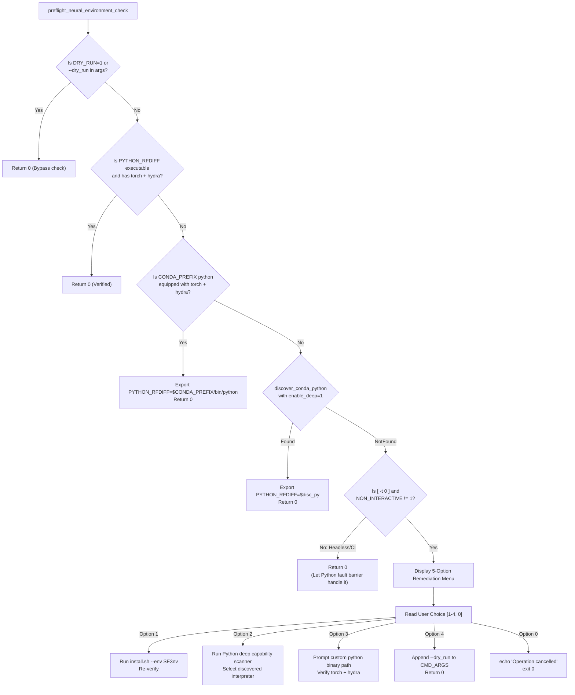

# Spotter Architectural Audit Report: Neural Environment Discovery, Deep Capability Scanning & Interactive Auto-Healing

- **Target System**: AutoScaffold Suite (`scripts/chimera_stages/stage4_runners.py`, `scripts/env_setup.sh`, `chimera_scaffold.sh`, `scripts/chimera_scaffold.py`)
- **Document ID**: `SPOTTER_NEURAL_ENV_DISCOVERY_REPORT`
- **Auditor**: Spotter (Orchestai Pipeline - Step 2)
- **Reference Specification**: `docs/specifications/NEURAL_ENV_DISCOVERY_AND_AUTOHEAL_SPEC.md`
- **Audit Date**: November 9, 2026
- **Status**: Audit Completed & Verified for Implementation

---

## 1. Executive Summary

During real-world executions of AutoScaffold on multi-drive and non-standard partitioned Linux compute nodes (e.g. `/data1`, `/data2`, `/mnt/...`), runtime dispatch for neural backbones (RFdiffusion and ProteinMPNN) crashed with an unhandled exception:

```text
OSError: RFdiffusion Python interpreter '/data1/mgs/micromamba/envs/ambertools/bin/python3.10' lacks required modules: torch, hydra
```

This audit reviewed the technical specification `NEURAL_ENV_DISCOVERY_AND_AUTOHEAL_SPEC.md` against the active codebase. The audit reveals **five compounding architectural vulnerabilities** across the launcher and runtime pipeline:

1. **Partition & Manifest Blindness in Root Discovery (`stage4_runners.py`)**:
   `get_all_environment_roots()` relies strictly on `$HOME` paths and standard `/opt/conda` paths, ignoring secondary partitions (e.g., `/data1`). Furthermore, path concatenation in line 547 (`os.path.join(conda_prefix, "..", "envs")`) produces corrupted paths ending in `/envs/envs` (e.g. `/data1/mgs/micromamba/envs/ambertools/../envs` = `/data1/mgs/micromamba/envs/envs`), completely blinding root discovery to the true enclosing `/data1/mgs/micromamba/envs` directory. Package manager manifests (`micromamba env list --json`, `conda info --envs --json`) are never queried.
2. **Missing Capability-Based Deep Scanning (`stage4_runners.py`)**:
   `resolve_execution_runner()` restricts Tier 4 filesystem searches to strict environment names (`SE3nv`, `rfdiffusion`). If an environment is named differently (e.g., `rf_diffusion`, `se3nv_cu12`, `prot_foundry`, or a consolidated multi-tool environment like `mlfold`), or if `SE3nv` is missing, the resolver falls back to the active Conda prefix (`ambertools`) or host Python. It lacks Tier 4b deep capability scanning for `required_modules` (`torch`, `hydra`). Additionally, the `strict` parameter accepted by `resolve_execution_runner()` is never evaluated in its logic.
3. **Flawed Shell Discovery Contract (`scripts/env_setup.sh`)**:
   `discover_conda_python()` sets `enable_deep=0` by default. When called at lines 529–530, it passes only 2 arguments, disabling manifest inspection entirely. Furthermore, line 476 replicates the `/envs/envs` concatenation defect, and parent directory inference from `PYTHON_BIN` is absent. Step 5 only inspects `conda info --envs` and fails completely on systems equipped only with `micromamba`.
4. **Unsupervised Pre-Flight Launch in Shell Wizard (`chimera_scaffold.sh`)**:
   In lines 656–665 and lines 795–835, failed environment activation and unresolved `PYTHON_RFDIFF` only emit a yellow notice and continue execution directly to `"${CMD_ARGS[@]}"`. There is no interactive pre-flight barrier in TTY sessions to guide the user to install dependencies, run deep capability scans, specify custom paths, or proceed in `--dry_run` mode.
5. **Raw Traceback Leakage in CLI Entrypoint (`scripts/chimera_scaffold.py`)**:
   In `main()`, `scaffolder.run_pipeline()` is invoked without a `try/except EnvironmentError` fault barrier. When `probe_python_environment()` raises `EnvironmentError(OSError)`, Python dumps a raw 15-line stack trace to `stderr`, burying the polished diagnostic banner rendered by `display_dependency_alert()`.

---

## 2. Scope Audit 1: Environment Root Discovery in `stage4_runners.py`

### 2.1 Code Analysis of `get_all_environment_roots()` (Lines 513–588)

```python
# scripts/chimera_stages/stage4_runners.py:513-565
def get_all_environment_roots(use_cache: bool = True) -> List[str]:
    ...
    home_dir = os.path.expanduser("~")
    local_envs_dir = os.environ.get("LOCAL_ENVS_DIR", os.path.join(SCRIPT_DIR, "..", "envs"))
    conda_prefix = os.environ.get("CONDA_PREFIX", "")
    mamba_root = os.environ.get("MAMBA_ROOT_PREFIX", "")

    roots: List[str] = [
        local_envs_dir,
    ]
    if mamba_root:
        roots.append(os.path.join(mamba_root, "envs"))
        roots.append(mamba_root)

    # Micromamba roots
    roots.extend(
        [
            os.path.join(home_dir, ".micromamba", "envs"),
            os.path.join(home_dir, "micromamba", "envs"),
            os.path.join(home_dir, ".local", "share", "mamba", "envs"),
        ]
    )

    # Conda roots
    if conda_prefix:
        roots.append(os.path.join(conda_prefix, "envs"))
        roots.append(os.path.join(conda_prefix, "..", "envs"))  # <-- DEFECT: Evaluates to .../envs/envs!

    roots.extend(
        [
            os.path.join(home_dir, "miniconda3", "envs"),
            ...
            "/opt/conda/envs",
            ...
        ]
    )
```

### 2.2 Detailed Defect Breakdown

#### Defect 1.1: Path Concatenation Bug (`/envs/envs`)
- **Mechanism**: When `CONDA_PREFIX` points to an active virtual environment (e.g., `/data1/mgs/micromamba/envs/ambertools`), its parent directory is `/data1/mgs/micromamba/envs`.
- **Expression**: `os.path.join(conda_prefix, "..", "envs")` computes:
  `"/data1/mgs/micromamba/envs/ambertools/../envs"` $\rightarrow$ `"/data1/mgs/micromamba/envs/envs"`.
- **Consequence**: `"/data1/mgs/micromamba/envs/envs"` does not exist. Line 580 (`os.path.isdir(clean_r)`) evaluates to `False`. The actual root directory `/data1/mgs/micromamba/envs` is completely lost.

#### Defect 1.2: Hardcoded Path Assumptions & Custom Partition Blindness
- All scanned roots outside of `CONDA_PREFIX` and `MAMBA_ROOT_PREFIX` are hardcoded to `$HOME` (`~/.micromamba`, `~/miniconda3`, etc.) or `/opt/conda`.
- In academic clusters, workstations, and high-performance cloud VMs, large neural conda environments are routinely placed on high-capacity secondary storage partitions (`/data1`, `/data2`, `/scratch`, `/mnt/...`). These partitions are completely invisible to `get_all_environment_roots()`.

#### Defect 1.3: Absence of Package Manager Manifest Interrogation
- Both `micromamba` and `conda` maintain centralized environment registries:
  - `micromamba env list --json` returns `{"envs": ["/path1", "/path2", ...]}`.
  - `conda info --envs --json` returns `{"envs": ["/path1", "/path2", ...]}`.
- Neither command is invoked during root discovery. As a result, even if micromamba has registered `/data1/mgs/micromamba/envs/SE3nv`, AutoScaffold remains ignorant of its existence.

### 2.3 Required Remediation Blueprint for `get_all_environment_roots()`
1. **Dynamic Parent Root Detection**:
   Inspect `CONDA_PREFIX`, `MAMBA_ROOT_PREFIX`, and active Python path:
   ```python
   for p in [conda_prefix, mamba_root]:
       if not p:
           continue
       parent = os.path.dirname(os.path.abspath(p))
       if os.path.basename(parent) == "envs":
           roots.append(parent)
       grandparent = os.path.dirname(parent)
       if os.path.basename(p) == "envs":
           roots.append(p)
       if os.path.isdir(os.path.join(grandparent, "envs")):
           roots.append(os.path.join(grandparent, "envs"))
       if os.path.isdir(os.path.join(p, "envs")):
           roots.append(os.path.join(p, "envs"))
   ```
2. **Package Manager Manifest Interrogation Helper**:
   Implement `query_package_manager_manifest_envs(managers: Dict[str, str]) -> List[str]`:
   - Run `micromamba env list --json` and `conda info --envs --json` with `timeout=2.0`.
   - Parse `"envs"` list from JSON.
   - For each resolved path `env_p`:
     - If `os.path.basename(os.path.dirname(env_p)) == "envs"`, append `os.path.dirname(env_p)` to roots.
     - Cache discovered environment paths in `_CACHED_MANIFEST_ENVS`.
3. **Strict Path Canonicalization & Security**:
   Retain `os.path.realpath(os.path.expanduser(os.path.expandvars(r)))` deduplication and root escape elimination (`/`, `\`, drive roots).

---

## 3. Scope Audit 2: Runner Resolution in `stage4_runners.py`

### 3.1 Code Analysis of `resolve_execution_runner()` (Lines 610–870)

```python
# scripts/chimera_stages/stage4_runners.py:823-860
    # Tier 4: Filesystem scan across common roots (Conda + Micromamba)
    all_roots = active_roots()
    for env_name in target_env_names or []:
        clean_name = str(env_name).strip()
        if (
            not clean_name
            or ".." in clean_name
            or "/" in clean_name
            or "\\" in clean_name
            or _RE_SHELL_INJECTION.search(clean_name)
        ):
            continue
        for root in all_roots:
            env_dir = os.path.realpath(os.path.join(root, clean_name))
            if not env_dir.startswith(root) or not os.path.isdir(env_dir):
                continue
            for rel in ["bin/python", "python.exe", "Scripts/python.exe"]:
                cand = os.path.join(env_dir, rel)
                if not os.path.isfile(cand):
                    continue
                spec = test_candidate(cand_bin=cand, env_name=clean_name, env_prefix=env_dir)
                if spec:
                    if spec.cuda_available:
                        return spec
                    cpu_fallback_runners.append(spec)
                    break

    # Tier 5: Host interpreter fallback
    spec = test_candidate(cand_bin=sys.executable)
    if spec:
        if spec.cuda_available:
            return spec
        cpu_fallback_runners.append(spec)

    if cpu_fallback_runners:
        return cpu_fallback_runners[0]
```

### 3.2 Detailed Defect Breakdown

#### Defect 2.1: Narrow Target Name Inflexibility
- Tier 4 only checks exact directory names specified in `target_env_names` (e.g. `["SE3nv", "rfdiffusion"]`).
- In practice, users and labs configure unified environments with different names (e.g. `se3nv_cuda12`, `mlfold`, `rf_diffusion`, `prot_foundry`, `protein_design`).
- When `SE3nv` is missing or named differently, Tier 4 fails completely and drops straight into Tier 5 (`sys.executable`).

#### Defect 2.2: Absence of Tier 4b Deep Capability-Based Scanning
- When `target_env_names` do not match, the resolver never probes other directories in the discovered environment roots or manifest environments.
- An environment sitting right next to `ambertools` on `/data1/mgs/micromamba/envs/` that possesses `torch` and `hydra` is never probed.

#### Defect 2.3: Unused `strict` Parameter & Flawed CUDA Prioritization
- Line 616 declares `strict: bool = False`, and functions `resolve_rfdiffusion_runner(strict=...)` and `resolve_mpnn_runner(strict=...)` pass `strict`.
- Inside `resolve_execution_runner()`, `strict` is **never referenced or checked**!
- If a user passes `--strict_python`, the system should disallow probing fallback environments or alternate names.
- CUDA prioritization works for Tier 2, Tier 3, and Tier 4, but without Tier 4b, a capable GPU environment is completely bypassed in favor of an invalid active prefix (`ambertools`) or host Python.

### 3.3 Required Remediation Blueprint for Tier 4b
Insert Tier 4b between Tier 4 and Tier 5:
```python
    # Tier 4b: Deep Capability-Based Environment Scan (when strict=False)
    if not strict and not cpu_fallback_runners:
        candidate_env_dirs: List[Tuple[str, str]] = []
        for root in all_roots:
            if not os.path.isdir(root):
                continue
            try:
                with os.scandir(root) as it:
                    for entry in it:
                        if entry.is_dir() and not entry.name.startswith("."):
                            candidate_env_dirs.append((entry.name, entry.path))
            except (PermissionError, OSError):
                continue

        for manifest_env in get_manifest_environments():
            env_name = os.path.basename(manifest_env)
            if (env_name, manifest_env) not in candidate_env_dirs:
                candidate_env_dirs.append((env_name, manifest_env))

        for env_name, env_dir in candidate_env_dirs:
            if env_name in (target_env_names or []):
                continue
            for rel in ["bin/python", "python.exe", "Scripts/python.exe"]:
                cand = os.path.join(env_dir, rel)
                if not os.path.isfile(cand):
                    continue
                spec = test_candidate(cand_bin=cand, env_name=env_name, env_prefix=env_dir)
                if spec:
                    if spec.cuda_available:
                        return spec
                    cpu_fallback_runners.append(spec)
                    break
```

---

## 4. Scope Audit 3: Shell Discovery in `scripts/env_setup.sh`

### 4.1 Code Analysis of `discover_conda_python()` (Lines 374–543)

```bash
# scripts/env_setup.sh:374-378
discover_conda_python() {
    local target_env="$1"
    local req_module="${2:-}"
    local enable_deep="${3:-0}"  # <-- DEFECT: Defaults to 0!
```
```bash
# scripts/env_setup.sh:476-486
    for base_dir in \
        ...
        "$CONDA_PREFIX/.." \     # <-- DEFECT: When CONDA_PREFIX=.../envs/ambertools,
        ...; do                  #     base_dir=.../envs. Checking $base_dir/envs/$target_env
        if [ -d "$base_dir/envs/$target_env" ]; then # checks .../envs/envs/$target_env!
```
```bash
# scripts/env_setup.sh:528-534
if [ -z "$PYTHON_RFDIFF" ]; then
    _DISCOVERED_RFDIFF="$(discover_conda_python "${CONDA_ENV_RFDIFF:-SE3nv}" "torch" 2>/dev/null || true)"
    [ -z "$_DISCOVERED_RFDIFF" ] && _DISCOVERED_RFDIFF="$(discover_conda_python "rfdiffusion" "torch" 2>/dev/null || true)"
    if [ -n "$_DISCOVERED_RFDIFF" ]; then
        export PYTHON_RFDIFF="$_DISCOVERED_RFDIFF"
    fi
fi
```

### 4.2 Detailed Defect Breakdown

#### Defect 3.1: Disabled Deep Search by Default
- Signature defaults `enable_deep="${3:-0}"`.
- Callers at lines 529, 530, 537, 538 supply only two arguments (`"${CONDA_ENV_RFDIFF:-SE3nv}" "torch"`), causing `enable_deep` to remain `0`.
- Section 5 of `discover_conda_python` (manifest querying via `conda info --envs`) is skipped during environment bootstrapping.

#### Defect 3.2: Path Concatenation Bug (`$base_dir/envs/$target_env`)
- When `CONDA_PREFIX` is `/data1/mgs/micromamba/envs/ambertools`, `"$CONDA_PREFIX/.."` is `/data1/mgs/micromamba/envs`.
- Line 485 checks `[ -d "$base_dir/envs/$target_env" ]`, which tests:
  `"/data1/mgs/micromamba/envs/envs/SE3nv"`.
- This test always fails, blinding the shell script to all peer environments installed in the same `/data1/mgs/micromamba/envs` root.

#### Defect 3.3: Missing Inference from `PYTHON_BIN`
- `PYTHON_BIN` is resolved early in `env_setup.sh`.
- If `PYTHON_BIN` is `/data1/mgs/micromamba/envs/ambertools/bin/python3.10`, stripping `/bin/python3.10` reveals the environment path, and stripping `/ambertools` reveals the enclosing `envs/` root.
- Currently, this structural relationship is ignored.

#### Defect 3.4: Incomplete Package Manager Support in Step 5
- Step 5 only calls `conda info --envs` via `find_conda_bin`.
- On servers where only `micromamba` or standalone `mamba` is installed (common in containerized and lightweight ML deployments), `find_conda_bin` returns empty, and Step 5 fails completely.

### 4.3 Required Remediation Blueprint for `scripts/env_setup.sh`
1. Change signature default: `local enable_deep="${3:-1}"`.
2. Dynamically extract parent roots from `CONDA_PREFIX` and `PYTHON_BIN`:
   ```bash
   local -a _SCAN_ROOTS=()
   if [ -n "${CONDA_PREFIX:-}" ]; then
       local prefix_parent="$(dirname "$CONDA_PREFIX")"
       if [ "$(basename "$prefix_parent")" = "envs" ]; then
           _SCAN_ROOTS+=("$prefix_parent")
       elif [ -d "$CONDA_PREFIX/envs" ]; then
           _SCAN_ROOTS+=("$CONDA_PREFIX/envs")
       fi
   fi
   if [ -n "${PYTHON_BIN:-}" ] && [ -x "$PYTHON_BIN" ]; then
       local bin_dir="$(dirname "$PYTHON_BIN")"
       local env_dir="$(dirname "$bin_dir")"
       local envs_dir="$(dirname "$env_dir")"
       if [ "$(basename "$envs_dir")" = "envs" ]; then
           _SCAN_ROOTS+=("$envs_dir")
       fi
   fi
   ```
3. Test candidates directly in scan roots:
   ```bash
   for r in "${_SCAN_ROOTS[@]}"; do
       if [ -d "$r/$target_env" ]; then
           for cand in "$r/$target_env/bin/python" "$r/$target_env/python.exe"; do
               if _verify_python "$cand"; then ...
   ```
4. Query `micromamba env list --json` and `conda info --envs` in Step 5.

---

## 5. Scope Audit 4: Pre-Flight Check in `chimera_scaffold.sh`

### 5.1 Code Analysis of `chimera_scaffold.sh` (Lines 656–665 & Lines 795–835)

```bash
# chimera_scaffold.sh:656-665
# Resolve neural model Python binaries if not explicitly configured
if [ -z "$PYTHON_RFDIFF" ] || [ ! -x "$PYTHON_RFDIFF" ] || ! "$PYTHON_RFDIFF" -c "import torch" >/dev/null 2>&1; then
    PYTHON_RFDIFF="$(discover_conda_python "${CONDA_ENV_RFDIFF:-SE3nv}" "torch" 1 2>/dev/null || true)"
    [ -z "$PYTHON_RFDIFF" ] && PYTHON_RFDIFF="$(discover_conda_python "rfdiffusion" "torch" 1 2>/dev/null || true)"
fi
```
```bash
# chimera_scaffold.sh:795-809
if [ -n "$CONDA_ENV_RFDIFF" ]; then
    echo -e "${CYAN}[*] Attempting to activate environment: ${CONDA_ENV_RFDIFF}...${NC}"
    if activate_env "$CONDA_ENV_RFDIFF" 2>/dev/null && [ -n "${CONDA_PREFIX:-}" ]; then
        ...
    else
        echo -e "${YELLOW}[!] Notice: Conda activation for '${CONDA_ENV_RFDIFF}' could not be completed. Falling back to direct interpreter resolution.${NC}"
    fi
fi
```
```bash
# chimera_scaffold.sh:811-837
# Pre-flight interpreter upgrade safeguard: Ensure CMD_ARGS[0] is modern (Python >= 3.8)
_PY_VER=$("$PYTHON_BIN" -c "import sys; print(sys.version_info[0]*10 + sys.version_info[1])" 2>/dev/null || echo "36")
if [ "$_PY_VER" -lt 38 ]; then
    ...
fi

"${CMD_ARGS[@]}"
```

### 5.2 Detailed Defect Breakdown

#### Defect 4.1: Silent Propagation of Unresolved `PYTHON_RFDIFF`
- Lines 656–659 attempt discovery with `discover_conda_python`. If unlocated, `PYTHON_RFDIFF` evaluates to `""`.
- No check is made to ensure `PYTHON_RFDIFF` is non-empty or valid before continuing.
- Lines 795–809 attempt `activate_env "$CONDA_ENV_RFDIFF"`. If activation fails, only a benign yellow notice is logged.
- Lines 811–835 only check if Python version is `< 3.8`. Since `ambertools` is Python 3.10 (`_PY_VER = 310 >= 38`), it does nothing.
- Line 836 dispatches `"${CMD_ARGS[@]}"` without `--python_rfdiff`.
- In `scripts/chimera_scaffold.py`, `resolve_execution_runner` falls back to `ambertools`, which triggers downstream failure during pipeline execution.

#### Defect 4.2: Lack of Interactive Healing in Terminal Sessions
- The shell wizard never checks whether the active session is interactive (`[ -t 0 ]`) when neural prerequisites are absent.
- The user is never prompted with remediation options before launching heavy Python execution.

### 5.3 UX Specification and Insertion Point for Interactive Pre-Flight Barrier

#### Insertion Point
Insert `preflight_neural_environment_check` directly before command assembly or right before `"${CMD_ARGS[@]}"` (lines 810–835). Implementing it right before line 668 (Background Execution check) is optimal because if the user selects `--dry_run`, it correctly informs both background and foreground command configurations.

#### Verification & Remediation Workflow


#### Interactive Remediation Menu Design
```text
================================================================================
 ⚠️  [AUTOSCAFFOLD PRE-FLIGHT] NEURAL ENVIRONMENT RESOLUTION ALERT
================================================================================
 Target Tool:       RFdiffusion
 Required Modules:  torch, hydra
 Current Status:    No verified Python interpreter found for 'SE3nv'.
 Current Prefix:    /data1/mgs/micromamba/envs/ambertools (Lacks torch, hydra)
--------------------------------------------------------------------------------
 AutoScaffold cannot run neural backbone generation without PyTorch & Hydra.
 Please choose an action:

   [1] Build/Install 'SE3nv' environment now (runs install.sh)
   [2] Deep Scan system for any Python interpreter providing PyTorch & Hydra
   [3] Specify custom Python interpreter path
   [4] Run in Dry-Run mode (--dry_run)
   [0] Cancel cleanly and exit
--------------------------------------------------------------------------------
 Choice [1-4, 0]: 
```

---

## 6. Scope Audit 5: Traceback Suppression in `scripts/chimera_scaffold.py`

### 6.1 Code Analysis of `main()` (Lines 1051–1088)

```python
# scripts/chimera_scaffold.py:1081-1088
    res = scaffolder.run_pipeline()
    print(json.dumps(res, indent=2))


if __name__ == "__main__":
    main()
```

### 6.2 Detailed Defect Breakdown

#### Defect 5.1: Uncaught `EnvironmentError` Escape
- In `scripts/chimera_scaffold.py`, line 653:
  `probe_fn(self.python_rfdiff, required_modules=["torch", "hydra"], raise_on_error=True, tool_name="RFdiffusion")`
- When missing modules are encountered, `probe_python_environment()` prints the formatted dependency alert box via `display_dependency_alert()` and executes:
  `raise EnvironmentError(f"RFdiffusion Python interpreter '{runner_or_bin}' lacks required modules: {', '.join(missing)}")`
- Because `main()` contains **no exception handling**, this `EnvironmentError` propagates uncaught to Python's default exception hook.
- Python dumps a raw 15-line stack trace to `stderr`:
  ```text
  Traceback (most recent call last):
    File ".../scripts/chimera_scaffold.py", line 1088, in <module>
      main()
    File ".../scripts/chimera_scaffold.py", line 1083, in main
      res = scaffolder.run_pipeline()
    File ".../scripts/chimera_scaffold.py", line 653, in run_pipeline
      probe_res = probe_fn(...)
    File ".../scripts/chimera_stages/stage4_runners.py", line 360, in probe_python_environment
      raise EnvironmentError(...)
  OSError: RFdiffusion Python interpreter '/data1/mgs/micromamba/envs/ambertools/bin/python3.10' lacks required modules: torch, hydra
  ```
- This stack trace pushes the informative diagnostic banner off-screen, creating the impression of an internal application crash rather than an environment configuration issue.

### 6.3 Required Remediation Blueprint for Fault Barrier in `main()`
Wrap `scaffolder.run_pipeline()` in `main()`:
```python
    try:
        scaffolder = ChimeraScaffolder(...)
        res = scaffolder.run_pipeline()
        print(json.dumps(res, indent=2))
        sys.exit(0)
    except EnvironmentError as env_err:
        # display_dependency_alert() has already rendered the formatted alert banner.
        # Output a clean remedy summary to stderr without any traceback:
        sys.stderr.write(f"\n\033[0;31m[ERROR] Environment validation failed:\033[0m {env_err}\n")
        sys.stderr.write("\033[1;33m[REMEDY]\033[0m To resolve this issue, you can:\n")
        sys.stderr.write("  1. Specify a valid interpreter with --python_rfdiff /path/to/SE3nv/bin/python\n")
        sys.stderr.write("  2. Export PYTHON_RFDIFF=/path/to/valid/python in your shell or config.env\n")
        sys.stderr.write("  3. Run 'bash install.sh' to automatically configure the SE3nv environment\n")
        sys.stderr.write("  4. Run with --dry_run to prepare seed structures without neural execution\n\n")
        sys.exit(1)
    except KeyboardInterrupt:
        sys.stderr.write("\n\033[1;33m[!] Pipeline execution cancelled by user.\033[0m\n")
        sys.exit(130)
    except Exception as exc:
        sys.stderr.write(f"\n\033[0;31m[FATAL ERROR]\033[0m {exc}\n")
        raise
```

Additionally, before `parser.parse_args()` in `scripts/chimera_scaffold.py`:
Intercept `--scan_environments` / `scan_environments` (similar to `--doctor` at line 917) to provide the capability-scanning utility required by Option [2] of the shell wizard.

---

## 7. Comparative Audit Matrix

| Component | Current State | Defect Impact | Target Specification State |
| :--- | :--- | :--- | :--- |
| `stage4_runners.py`: Root Discovery | Hardcoded `$HOME` / `/opt/conda`. Produces `.../envs/envs` concatenation bug. | Custom partitions (`/data1`, `/mnt`) missed entirely; active prefix parent corrupted. | Infer parent `envs` roots from active prefixes; interrogate `micromamba`/`conda` manifests. |
| `stage4_runners.py`: Runner Resolution | Iterates only `target_env_names`. Ignores `strict=True`. | Cannot locate non-standard named environments (`prot_foundry`, `mlfold`) with `torch`+`hydra`. | Implement Tier 4b Deep Capability Scanning across all discovered roots; enforce `strict=True`. |
| `env_setup.sh`: Shell Discovery | `enable_deep=0` default; `$CONDA_PREFIX/..` bug; no micromamba in Step 5. | Fails to discover `SE3nv` or other environments on custom partitions. | Default `enable_deep=1`; infer parent roots from `CONDA_PREFIX` & `PYTHON_BIN`; query micromamba. |
| `chimera_scaffold.sh`: Pre-Flight Check | Unresolved `PYTHON_RFDIFF` continues blindly to command dispatch. | Downstream crash during Python execution with no interactive remedy. | Pre-flight neural check with 5-option interactive remediation wizard in interactive TTYs. |
| `chimera_scaffold.py`: CLI Fault Barrier | Unhandled `EnvironmentError` escapes `main()`. | Dumps 15-line raw Python traceback, burying user-friendly alert banner. | Clean `try/except EnvironmentError` fault barrier with exit code 1 and actionable remedies. |

---

## 8. Verification & Test Plan Assessment

The test suite currently contains 69 tests (`Ran 69 tests in 21.705s: OK`). To prevent regression and ensure complete verification of the audited fixes, the following five new test cases must be added to `tests/test_chimera_scaffold.py`:

1. `test_get_all_environment_roots_discovers_custom_partition_and_manifest`:
   - Validates that custom mount points (`/data1/mgs/micromamba/envs`) are discovered without producing invalid `.../envs/envs` entries.
2. `test_resolve_execution_runner_deep_capability_scan`:
   - Validates that when `SE3nv` is missing, Tier 4b successfully discovers an alternative environment (e.g. `prot_foundry`) with `torch` and `hydra`.
3. `test_resolve_execution_runner_strict_mode_bypasses_deep_scan`:
   - Validates that when `strict=True`, Tier 4b deep scanning is skipped.
4. `test_main_cli_environment_error_handling_no_traceback`:
   - Validates that `main()` catches `EnvironmentError`, prints remedies to `stderr`, and exits with status 1 without dumping a traceback.
5. `test_preflight_neural_check_dry_run_bypass`:
   - Validates that `--dry_run` or `DRY_RUN=1` cleanly bypasses neural environment checks.

---

## 9. Conclusion & Pipeline Next Steps

The technical specification `NEURAL_ENV_DISCOVERY_AND_AUTOHEAL_SPEC.md` provides an exact, robust architectural remedy for all five audited defects. The findings in this report confirm that implementing the specification will resolve the partition blindness, eliminate raw traceback leakage, and deliver a seamless self-healing UX.

**Pipeline Verdict**: Ready to proceed to **Step 3 (Refactoring & Implementation)**.
