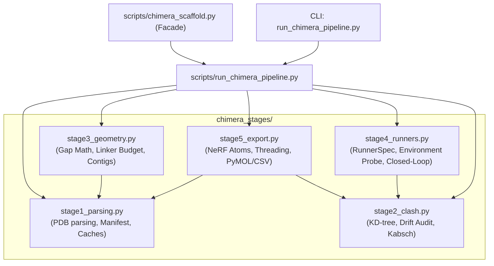

# Technical Specification: Modular Pipeline Architecture for Chimera Scaffolding

- **Target System**: AutoScaffold / Chimera Scaffolding Workflow
- **Original Monolith**: `scripts/chimera_scaffold.py` (~4,408 lines)
- **Architecture Pattern**: Orchestrator-Worker Pipeline with Backward-Compatible Facade
- **Author**: Prompt Polisher (Orchestai Pipeline)
- **Status**: Approved for Implementation by Coder & Spotter Subagents

---

## 1. Executive Summary & Architectural Objectives

`scripts/chimera_scaffold.py` is a mission-critical molecular engineering tool that grafts tertiary 3D active motifs/epitopes into recipient host scaffold proteins ("vessels") using RFdiffusion, ProteinMPNN, and ColabFold. Over time, features such as multi-chain manifests, NeRF all-atom sidechain reconstruction, in-flight Cartesian drift auditing, and multi-tier Conda/Micromamba runner resolution have expanded the script into an unmaintainable ~4,408-line monolith.

### Core Objectives
1. **Deconstruct Monolith into Single-Responsibility Stages**: Partition logic into five clean, decoupled modules inside `scripts/chimera_stages/`.
2. **Implement Central Orchestrator**: Create `scripts/run_chimera_pipeline.py` with typed context and result dataclasses (`PipelineContext`, `PipelineResult`), strict step verification, stage-specific exception handling, and user-friendly diagnostic reporting.
3. **Guarantee 100% Backward Compatibility**: Preserve `scripts/chimera_scaffold.py` as a facade that re-exports all legacy classes (`ChimeraScaffolder`), functions, dataclasses, session caches, and CLI entry points so that all unit tests in `tests/test_chimera_scaffold.py` continue to pass without modification.
4. **Preserve Mathematical & Security Integrity**: Retain 100% of NeRF tetrahedral geometry, Kabsch alignment, KD-tree nearest-neighbor querying, `SafeSessionUnpickler` security, and path traversal protections.

---

## 2. Directory Structure & Module Hierarchy

```
scripts/
├── chimera_scaffold.py              # Backward-compatible facade & legacy CLI entry point
├── run_chimera_pipeline.py          # Central Orchestrator & modern pipeline CLI
├── chimera_stages/
│   ├── __init__.py                  # Stage exports & package marker
│   ├── stage1_parsing.py            # PDB parsing, Multi-Chain Manifest, validation & caches
│   ├── stage2_clash.py              # KD-tree, spatial alignment, Cartesian drift audit, SACT
│   ├── stage3_geometry.py           # Euclidean gap graph, linker budgeting, contig construction
│   ├── stage4_runners.py            # Environment discovery, RunnerSpec, closed-loop inference
│   └── stage5_export.py             # NeRF sidechain placement, all-atom threading, PyMOL/CSV export
```

### Dependency Flow Graph



---

## 3. Detailed Stage Specifications

### Stage 1: Parsing, Multi-Chain Manifest, Validation & Sanitization (`scripts/chimera_stages/stage1_parsing.py`)

#### Responsibilities
- Parsing PDB files and PyMOL session files (`.pse`) into structured Python representations.
- Coordinate caching per `(real_path, mtime)` to prevent redundant multi-megabyte disk reads.
- Multi-chain and multi-PDB motif grammar parsing and automatic continuous segmentation.
- Security sanitation: path traversal prevention, root filesystem escape blocks, shell metacharacter rejection.

#### Data Structures & Dataclasses
```python
@dataclass(frozen=True)
class MotifAtom:
    atom_name: str
    element: str
    coords: np.ndarray  # shape: (3,), dtype: float64
    occupancy: float = 1.0
    b_factor: float = 0.0

@dataclass
class MotifResidue:
    source_file: str
    source_chain: str
    orig_resi: int
    resn: str
    insertion_code: str = ""
    atoms: Dict[str, MotifAtom] = field(default_factory=dict)

    @property
    def ca_coords(self) -> Optional[np.ndarray]: ...

@dataclass
class MotifSegment:
    segment_id: str
    source_file: str
    source_chain: str
    residues: List[MotifResidue]

    @property
    def start_resi(self) -> int: ...
    @property
    def end_resi(self) -> int: ...
    @property
    def length(self) -> int: ...
    @property
    def n_term_ca(self) -> Optional[np.ndarray]: ...
    @property
    def c_term_ca(self) -> Optional[np.ndarray]: ...
    @property
    def n_term_n(self) -> Optional[np.ndarray]: ...
    @property
    def c_term_c(self) -> Optional[np.ndarray]: ...

@dataclass
class MultiChainMotifManifest:
    source_files: List[str]
    segments: List[MotifSegment]
    total_residues: int
    provenance_map: Dict[int, Dict[str, Any]]
```

#### Shared Caches & Cache Management
```python
_CA_COORDS_CACHE: Dict[Tuple[str, float], Dict[Tuple[str, int], np.ndarray]]
_FALLBACK_COORDS_CACHE: Dict[Tuple[str, float], Dict[Tuple[str, int], np.ndarray]]
_RESI_COORDS_CACHE: Dict[Tuple[str, float], Dict[int, np.ndarray]]
_ANCHOR_COORDS_CACHE: Dict[Tuple[str, float], Dict[Tuple[str, int, str], np.ndarray]]
_ANCHOR_FALLBACK_CACHE: Dict[Tuple[str, float], Dict[Tuple[str, int], np.ndarray]]
_SEED_CA_CACHE: Dict[Tuple[str, float], Dict[int, np.ndarray]]

def clear_ca_coords_cache() -> None: ...
```

#### Exported Functions
- `parse_multi_chain_motif_spec(motif_spec: str, default_source_file: str = "", default_chain: str = "A") -> List[Tuple[str, str, int]]`
- `build_multi_chain_manifest(motif_spec: str, default_source_file: str = "", default_chain: str = "A", file_atom_cache: Optional[Dict[str, List[Dict[str, Any]]]] = None) -> MultiChainMotifManifest`
- `get_residue_anchor_coords(pdb_path: str, chain: str, resi: int, atom_type: str = "CA", use_cache: bool = True) -> Optional[np.ndarray]`
- `get_residue_ca_coords(pdb_path: str, chain_id: Optional[str] = None, resi: int = 1, buffer_size: int = 65536, use_cache: bool = True) -> Optional[np.ndarray]`
- `prepare_input_structures(...) -> Dict[str, Any]`

---

### Stage 2: Clash Detection, Spatial Alignment & Drift Auditing (`scripts/chimera_stages/stage2_clash.py`)

#### Responsibilities
- Distance metrics and batch Euclidean distance calculations.
- Exact in-place coordinate transformation using Kabsch rotation $R$ and translation $t$ to counteract RFdiffusion origin shifts.
- Strict Cartesian drift auditing with TRB mapping (`SafeSessionUnpickler`), residue pairing, and origin-shift detection.
- Fast KD-tree (`scipy.spatial.cKDTree`) and vectorized coordinate matching for ProteinMPNN fixed-position masks.
- Sequence-Anchored Contig Tracking (SACT) coordinate matching.
- Safe candidate artifact purging on drift rejection.

#### Exported Functions
- `calculate_anchor_distance(coord1: Any, coord2: Any) -> float`
- `batch_anchor_distances(coords1: Any, coords2: Any) -> np.ndarray`
- `_transform_pdb_coordinates(pdb_path: str, R: np.ndarray, t: np.ndarray) -> bool`
- `audit_motif_cartesian_drift(candidate_pdb: str, reference_seed_pdb: str, seed_provenance: Dict[Union[int, str], Dict[str, Any]]) -> Tuple[float, float, List[Dict[str, Any]]]`
  - Pass criteria: `max_drift <= 0.80 Å` and `mean_drift <= 0.50 Å`.
  - Origin shift check: COM distance > 5.0 Å triggers Kabsch alignment and in-place PDB coordinate rewrite.
- `map_fixed_positions_for_mpnn(backbone_pdb: str, preserved_donor_segments: List[Tuple[int, int]], preserved_vessel_segments: List[Tuple[int, int]], working_donor_pdb: str, working_vessel_pdb: str, seed_pdb_path: str, donor_chain_id: str, vessel_chain_id: str, lock_vessel: bool, vessel_redesign_mode: str, is_multichain: bool) -> Tuple[Dict[str, List[int]], List[int]]`
- `_purge_candidate_artifacts(prefix: str, cand_pdb: Optional[str] = None) -> None`

---

### Stage 3: Geometric Bridge & Loop Calculations, Contigs & Linkers (`scripts/chimera_stages/stage3_geometry.py`)

#### Responsibilities
- Dynamic Euclidean linker calculations from 3D coordinates.
- Physical reach limits and biophysical clamping of unfeasible linkers ($L_{\text{ext\_min}} = \lceil d / 3.8 \rceil$).
- Multi-chain contig generation using the Euclidean Gap Graph algorithm.
- 4-mode chimera architecture contig assembly: `replace`, `ligate_nterm`, `ligate_cterm`, `insert_loop`.
- Terminal and internal bridge measurement (`measure_junctions`).

#### Exported Functions & Formulas
- `compute_gap_linker_length(d_gap: float) -> Tuple[int, int]`
  $$\text{L\_min} = \max(3, \lceil d_{\text{gap}} / 3.2 \rceil), \quad \text{L\_max} = \text{L\_min} + 5$$
- `compute_gap_linker_string(d_gap: float) -> str`
- `compute_recommended_linker(distance_angstrom: float) -> Tuple[int, int]`
  $$\text{min\_len} = \max(3, \lceil d / 3.0 \rceil), \quad \text{max\_len} = \text{min\_len} + \max(6, \lceil 0.25 \times \text{min\_len} \rceil)$$
- `compute_extension_minimum(distance_angstrom: float) -> int`
  $$L_{\text{ext\_min}} = \max(1, \lceil d / 3.8 \rceil)$$
- `check_and_clamp_linker(user_val: str, param_name: str, distance_angstrom: Optional[float], junction_label: str) -> str`
- `format_segments_to_contig(segments: List[Tuple[int, int]], chain_label: str) -> str`
- `measure_junctions(...) -> Dict[str, Any]`
- `compute_contigs_and_segments(...) -> Tuple[str, List[Tuple[int, int]], List[Tuple[int, int]], int]`

---

### Stage 4: Neural Network Runners & Closed-Loop Generation (`scripts/chimera_stages/stage4_runners.py`)

#### Responsibilities
- 5-tier Python interpreter resolution hierarchy:
  1. Explicit CLI argument (`--python_rfdiff`, `--python_mpnn`, `--python_colabfold`).
  2. Environment variables (`PYTHON_RFDIFF`, `RFDIFF_PYTHON`, etc.).
  3. Active Conda/Mamba prefix (`CONDA_PREFIX`).
  4. System & environment roots filesystem search (`get_all_environment_roots`).
  5. Host interpreter fallback (`sys.executable`).
- Ephemeral environment runner creation (`micromamba run -n SE3nv python`, `conda run -p ...`).
- High-visibility dependency alert boxes and CUDA availability checks.
- Closed-loop backbone generation with in-flight drift auditing, candidate discarding, and garbage collection.
- ProteinMPNN command construction and subprocess dispatch.

#### Data Structures & Dataclasses
```python
@dataclass
class RunnerSpec:
    runner_type: str  # 'direct', 'micromamba', 'conda', 'mamba', 'runner', 'custom'
    command_prefix: List[str]
    env_name: Optional[str] = None
    env_prefix: Optional[str] = None
    python_binary: Optional[str] = None
    is_valid: bool = False
    cuda_available: bool = False
    torch_version: Optional[str] = None
    cuda_device_name: Optional[str] = None
    missing_modules: List[str] = field(default_factory=list)

    def build_command(self, script_or_args: Union[str, List[str]], *extra_args: str) -> List[str]: ...
    def display_label(self) -> str: ...
```

#### Exported Functions
- `clear_probe_cache() -> None`
- `clear_environment_cache() -> None`
- `find_environment_managers(use_cache: bool = True) -> Dict[str, str]`
- `get_all_environment_roots(use_cache: bool = True) -> List[str]`
- `build_ephemeral_runner_cmd(manager_type: str, manager_bin: str, env_name: Optional[str] = None, env_prefix: Optional[str] = None) -> List[str]`
- `format_runner_display(runner_or_bin: Any) -> str`
- `display_dependency_alert(tool_name: str, python_bin: Any, missing_modules: List[str], suggested_env: str = "SE3nv") -> str`
- `display_cuda_warning(python_bin: Any, tool_name: str = "RFdiffusion") -> str`
- `probe_python_environment(python_bin: Union[str, List[str], RunnerSpec], required_modules: Optional[List[str]] = None, check_cuda: bool = True, timeout_sec: float = 8.0, raise_on_error: bool = False, tool_name: str = "Neural Tool", suggested_env: str = "SE3nv") -> Dict[str, Any]`
- `resolve_execution_runner(...) -> RunnerSpec`
- `resolve_python_interpreter(...) -> Tuple[Union[str, List[str]], bool]`
- `resolve_neural_python(...) -> Tuple[Union[str, List[str]], bool]`
- `run_closed_loop_backbone_generation(seed_pdb: str, contig_str: str, seed_provenance: Dict[Union[int, str], Dict[str, Any]], target_passing_designs: int = 3, max_attempts: int = 50, max_drift_cutoff: float = 0.8, mean_drift_cutoff: float = 0.5, rfdiff_runner: Optional[Any] = None, rfdiff_script: Optional[str] = None, work_dir: str = "1_rfdiffusion", sampler_fn: Optional[Any] = None) -> List[str]`

---

### Stage 5: Crystallographic Formatter, All-Atom Threading & Output Export (`scripts/chimera_stages/stage5_export.py`)

#### Responsibilities
- Construction of `chimera_seed.pdb` with clean chain assignments (D & V or unified A) and `seed_provenance.json`.
- Natural Extension Reference Frame (NeRF) 3D coordinate generation for tetrahedral amino acid sidechains.
- All-atom sequence threading (`thread_sequence_onto_pdb`) with Sequence-Anchored Contig Tracking (SACT).
- Native motif sequence extraction and 100% sequence fidelity verification.
- Automated dispatch of 2-stage soft-core energy minimization (`relax_chimera.py`) to eliminate steric clashes.
- PyMOL script generation (`view_in_pymol.pml`), CSV summary table (`metrics_summary.csv`), and methodology report (`generate_methodology_report`).

#### Exported Functions
- `create_merged_seed_pdb(out_dir: str, working_donor_pdb: str, working_vessel_pdb: str, donor_chain_id: str, vessel_chain_id: str, preserved_donor_segments: List[Tuple[int, int]], preserved_vessel_segments: List[Tuple[int, int]], is_multichain: bool = False, manifest: Optional[MultiChainMotifManifest] = None, seed_provenance: Optional[Dict[int, Dict[str, Any]]] = None, seed_chain_id: str = "A", donor_seed_offset: int = 0, buffer_size: int = 65536) -> Tuple[str, Dict[int, Dict[str, Any]]]`
- `place_atom_nerf(a: np.ndarray, b: np.ndarray, c: np.ndarray, bond_len: float, bond_angle_deg: float, torsion_deg: float) -> np.ndarray`
- `build_sidechain_atoms(aa_1: str, n: np.ndarray, ca: np.ndarray, c: np.ndarray) -> List[Tuple[str, str, np.ndarray]]`
- `compute_cb_coords(n_coord: np.ndarray, ca_coord: np.ndarray, c_coord: np.ndarray) -> np.ndarray`
- `extract_mpnn_sequences(fasta_path: str) -> List[Tuple[str, str]]`
- `extract_native_motif_sequence(donor_pdb: str, chain_id: Optional[str], motif_residues: List[int]) -> str`
- `thread_sequence_onto_pdb(backbone_pdb: str, sequence: str, out_pdb: str, seed_pdb: Optional[str] = None, fixed_donor_positions: Optional[List[int]] = None) -> bool`
- `export_pipeline_outputs(...) -> Dict[str, Any]`

---

## 4. Central Orchestrator Specification (`scripts/run_chimera_pipeline.py`)

### Architecture Pattern
The central orchestrator implements the **Orchestrator-Worker pattern**. It maintains a typed `PipelineContext`, sequences calls to Stages 1 through 5, enforces validation checkpoints between stages, traps exceptions with structured failure metadata, and produces a `PipelineResult`.

### Dataclasses

```python
@dataclass
class PipelineContext:
    # Inputs & Targets
    input_file: Optional[str] = None
    donor_pdb: Optional[str] = None
    vessel_pdb: Optional[str] = None
    donor_id: str = "A"
    vessel_id: str = "B"
    motif_residues: str = ""
    motifs: Optional[str] = None
    chimera_mode: str = "replace"
    vessel_replace_range: Optional[str] = None
    vessel_split_after: Optional[int] = None
    linker_n: str = "6-10"
    linker_c: str = "6-10"

    # Execution Parameters
    num_designs: int = 10
    mpnn_seqs_per_bb: int = 2
    mpnn_temp: float = 0.1
    mpnn_batch_size: int = 1
    rmsd_threshold: float = 1.0
    plddt_threshold: float = 75.0
    lock_vessel: bool = True
    vessel_redesign_mode: str = "linkers_only"
    clamp_linkers: bool = True
    out_dir: str = "outputs/chimera_scaffold"
    dry_run: bool = False
    strict_python: bool = False

    # Resolved Tool Scripts & Runners
    rfdiff_script: Optional[str] = None
    mpnn_script: Optional[str] = None
    colabfold_cmd: Optional[str] = None
    rfdiff_runner: Optional[RunnerSpec] = None
    mpnn_runner: Optional[RunnerSpec] = None
    colabfold_runner: Optional[RunnerSpec] = None

    # Intermediate Pipeline State
    working_donor_pdb: str = ""
    working_vessel_pdb: str = ""
    donor_chain_id: str = "A"
    vessel_chain_id: str = "B"
    donor_metadata: Dict[str, Any] = field(default_factory=dict)
    vessel_metadata: Dict[str, Any] = field(default_factory=dict)
    is_multichain: bool = False
    manifest: Optional[MultiChainMotifManifest] = None
    seed_provenance: Dict[int, Dict[str, Any]] = field(default_factory=dict)
    seed_pdb_path: str = ""
    contig_string: str = ""
    preserved_donor_segments: List[Tuple[int, int]] = field(default_factory=list)
    preserved_vessel_segments: List[Tuple[int, int]] = field(default_factory=list)
    seed_chain_id: str = "A"
    donor_seed_offset: int = 0
    last_donor_fixed: List[int] = field(default_factory=list)

@dataclass
class PipelineResult:
    status: str  # "SUCCESS", "FAILED", "INITIALIZED"
    stage_failed: Optional[str] = None
    error_message: Optional[str] = None
    error_remediation: Optional[str] = None
    summary_data: Dict[str, Any] = field(default_factory=dict)
    passing_models: List[str] = field(default_factory=list)
    metrics_summary_csv: Optional[str] = None
    execution_time_seconds: float = 0.0
```

### Execution Lifecycle & Error Trapping

```python
class ChimeraPipelineOrchestrator:
    def __init__(self, context: PipelineContext):
        self.ctx = context

    def run(self) -> PipelineResult:
        start_time = time.time()
        try:
            # Stage 1: Preparation, parsing & input structure resolution
            self._execute_stage1()

            # Stage 3: Geometric bridge math, linker budgeting & contig construction
            self._execute_stage3()

            # Stage 5A: Seed PDB synthesis & coordinate mapping
            self._execute_stage5_seed()

            # Stage 4: Neural network execution (RFdiffusion, ProteinMPNN)
            # Stage 2: In-flight Cartesian drift auditing & fixed position mapping
            self._execute_stage4_and_stage2()

            # Stage 5B: All-atom threading, relaxation, PyMOL & reporting
            summary = self._execute_stage5_export()

            elapsed = time.time() - start_time
            return PipelineResult(
                status="SUCCESS",
                summary_data=summary,
                passing_models=summary.get("passing_models", []),
                metrics_summary_csv=summary.get("metrics_summary_csv"),
                execution_time_seconds=elapsed,
            )
        except StageExecutionError as e:
            return self._handle_stage_failure(e, time.time() - start_time)
        except Exception as e:
            return self._handle_unexpected_failure(e, time.time() - start_time)
```

#### Diagnostic Stage Error Handling
If any stage fails, the orchestrator catches `StageExecutionError`, identifies the failing stage, and outputs a formatted terminal diagnostic box:
```
====================================================================================================
 🛑 [CHIMERA PIPELINE FAILURE]
====================================================================================================
 Failed Stage:       Stage 4 (Neural Runners & Closed Loop)
 Exception:          RuntimeError: Closed-loop scaffolding failed to produce any passing models...
 Root Cause:         All generated candidates exceeded max drift cutoff of 0.8 Å.

 [ACTIONABLE REMEDIATION]
 1. Check if motif coordinates are physically compatible with the vessel geometry.
 2. Increase linker length (--linker_n / --linker_c) to relieve conformational strain.
 3. Increase --num_designs or relax drift thresholds (--rmsd_threshold).
====================================================================================================
```

---

## 5. Backward Compatibility Facade Architecture (`scripts/chimera_scaffold.py`)

To ensure that 100% of existing unit tests pass without modifying a single line of test code, `scripts/chimera_scaffold.py` acts as a complete facade that re-exports all legacy symbols and wraps the orchestrator:

### Symbol Re-Export Manifest

```python
# scripts/chimera_scaffold.py

# 1. Dataclasses & Constants
from chimera_stages.stage1_parsing import (
    ONE_TO_THREE,
    MotifAtom,
    MotifResidue,
    MotifSegment,
    MultiChainMotifManifest,
    clear_ca_coords_cache,
    _CA_COORDS_CACHE,
    _FALLBACK_COORDS_CACHE,
    _RESI_COORDS_CACHE,
    _ANCHOR_COORDS_CACHE,
    _ANCHOR_FALLBACK_CACHE,
    _SEED_CA_CACHE,
    parse_multi_chain_motif_spec,
    build_multi_chain_manifest,
    get_residue_anchor_coords,
    get_residue_ca_coords,
    _RE_SANITIZE_IDENT,
    _RE_OUTPUTS_DEDUP_MID,
    _RE_RESIDUE_RANGE,
    _RE_NUM_OR_SPAN,
    _RE_HYPHEN_RANGE,
    _RE_LINKER_VAL,
    _RE_SHELL_INJECTION,
)

# 2. Stage 2 functions & caches
from chimera_stages.stage2_clash import (
    calculate_anchor_distance,
    batch_anchor_distances,
    _transform_pdb_coordinates,
    audit_motif_cartesian_drift,
    _purge_candidate_artifacts,
)

# 3. Stage 3 functions
from chimera_stages.stage3_geometry import (
    compute_gap_linker_length,
    compute_gap_linker_string,
    compute_recommended_linker,
    compute_extension_minimum,
)

# 4. Stage 4 runners & caches
from chimera_stages.stage4_runners import (
    RunnerSpec,
    clear_probe_cache,
    clear_environment_cache,
    find_environment_managers,
    get_all_environment_roots,
    build_ephemeral_runner_cmd,
    format_runner_display,
    display_dependency_alert,
    display_cuda_warning,
    probe_python_environment,
    resolve_execution_runner,
    resolve_python_interpreter,
    resolve_neural_python,
    run_closed_loop_backbone_generation,
    _PROBE_CACHE,
    _CACHED_MANAGERS,
    _CACHED_ROOTS,
)

# 5. Stage 5 export functions
from chimera_stages.stage5_export import (
    place_atom_nerf,
    build_sidechain_atoms,
    compute_cb_coords,
    extract_mpnn_sequences,
    extract_native_motif_sequence,
    thread_sequence_onto_pdb,
)
```

### `ChimeraScaffolder` Class Adapter
The `ChimeraScaffolder` class maintains its exact `__init__` signature, public attributes (`self.seed_pdb`, `self.seed_pdb_path`, `self.working_donor_pdb`, `self.donor_chain_id`, `self.manifest`, `self.preserved_donor_segments`, `self.contig_string`, etc.), and public methods:
- `prepare_input_structures()`
- `parse_motif_ranges()`
- `parse_vessel_intervals()`
- `slice_intervals(...)`
- `format_segments_to_contig(...)`
- `check_and_clamp_linker(...)`
- `measure_junctions()` / `measure_junction_distances()`
- `compute_contigs_and_segments()`
- `create_merged_seed_pdb(...)`
- `map_fixed_positions_for_mpnn(...)`
- `run_pipeline()`

Each method translates calls to the respective modular stage function, ensuring zero divergence in test behavior.

---

## 6. Implementation & Refactoring Guidelines for Coder & Spotter

### Rules for Coder Subagent
1. **Never Change Algorithms or Formulas**: The mathematical formulas for linkers ($d/3.2$, $d/3.0$, $d/3.8$), NeRF dihedral angle definitions, and Kabsch transformation math must be copied verbatim.
2. **Preserve Exact Exception Types**: If a test expects `ValueError("Path traversal detected in motif chain ID...")`, raise the exact same exception type and message.
3. **Keep `_SEED_CA_CACHE`, `_CA_COORDS_CACHE`, `_PROBE_CACHE` in Shared Scope**: Tests explicitly import and patch these dictionaries. They must exist in their original names and be re-exported by `chimera_scaffold.py`.
4. **Use 64KB Buffered I/O**: Retain `buffering=65536` for PDB file reads and writes.
5. **No Shell Invocations**: Maintain strict `shell=False` for all subprocess executions.

### Rules for Spotter Subagent
1. **Verification of Imports**: Check every import in `tests/test_chimera_scaffold.py` against `scripts/chimera_scaffold.py` exports.
2. **Audit of CLI Flags**: Verify that `python scripts/chimera_scaffold.py --help` and `python scripts/chimera_scaffold.py measure_junctions --help` expose identical CLI arguments.
3. **Sanity Check on Cyclic Imports**: Ensure `chimera_stages` modules do not create circular dependencies.
4. **Verify SACT & Drift Logic**: Confirm that candidate purging and Kabsch coordinate transformations function properly.

---

## 7. Deliverables & Acceptance Criteria

| Deliverable | Path | Criteria |
| :--- | :--- | :--- |
| **Stage 1 Module** | `scripts/chimera_stages/stage1_parsing.py` | Standalone parsing, validation, manifest, and coordinate caching. |
| **Stage 2 Module** | `scripts/chimera_stages/stage2_clash.py` | KD-tree spatial clash search, drift auditing, Kabsch realignment, SACT. |
| **Stage 3 Module** | `scripts/chimera_stages/stage3_geometry.py` | Dynamic Euclidean gap linker math, contig formulation, junction metrics. |
| **Stage 4 Module** | `scripts/chimera_stages/stage4_runners.py` | 5-tier environment resolver, RunnerSpec, ephemeral commands, closed loop. |
| **Stage 5 Module** | `scripts/chimera_stages/stage5_export.py` | NeRF sidechain generation, all-atom threading, PyMOL PML and CSV export. |
| **Stage Init** | `scripts/chimera_stages/__init__.py` | Clean package exports. |
| **Central Orchestrator** | `scripts/run_chimera_pipeline.py` | `PipelineContext`, `PipelineResult`, sequential execution, failure catching. |
| **Facade Adapter** | `scripts/chimera_scaffold.py` | 100% backward-compatible symbol re-export and CLI preservation. |
| **Test Verification** | `tests/test_chimera_scaffold.py` | 100% of unit tests pass cleanly without modifications. |
